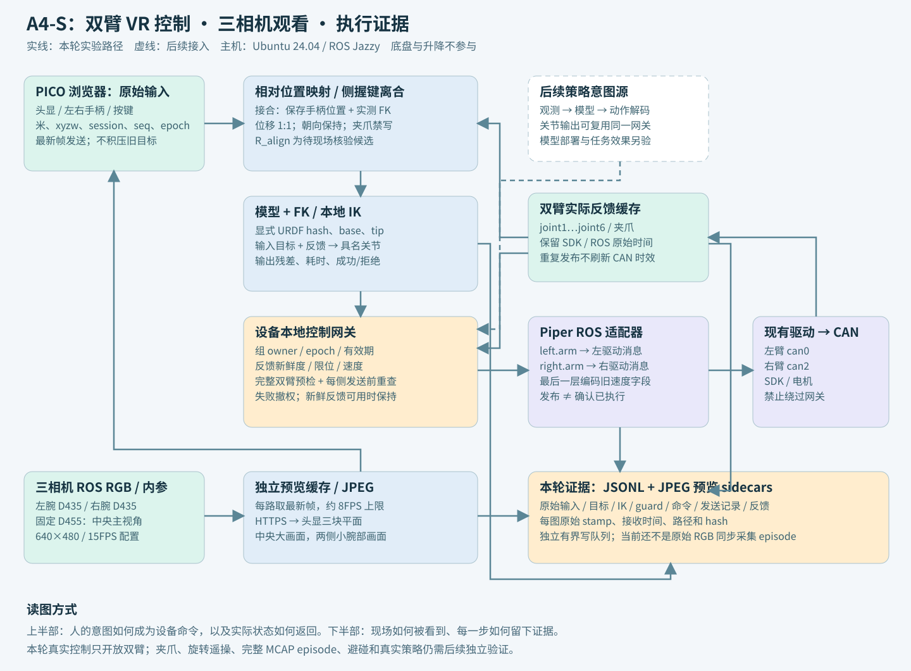

# 双 Piper + PICO + 三相机：数据到底怎样流动

更新：2026-10-16；对应[计划007](../plans/007-live-vr-teleop-and-video.md)。这是当前现场设置的说明。完整目标图见[原始 graph](a4s-graph.md)，下图突出本轮运行路径，虚线表示尚未接入的能力。

## 先把这套系统理解成四条线路

**控制线**把人的手部运动变成机械臂关节目标。**反馈线**把机械臂实际状态送回来，给映射、IK 和检查使用。**视频线**让操作者看到现场。**记录线**保存前三条线路产生的证据，帮助解释某次动作为什么发生或没有发生。这四条线相互关联，但不应互相堵塞。

这里两台 Piper 都是执行臂。PICO 左手柄对应左臂，右手柄对应右臂。底盘、升降、头显驱动机械臂、主从臂均不在本轮命令图里。所谓“头部画面”在这套子集中实际来自固定 D455，并不随头部转动。三相机的画面是平面 RGB，不是双目立体视频。

## 1. 一次“按住左侧握键、手柄向上移动”发生什么

1. **浏览器读原始输入。** WebXR 提供头显和两只手柄的位姿、按键、跟踪与参考空间。位置单位是米，姿态保留 xyzw 四元数。浏览器约每40毫秒提交最新一帧；一个请求未完成时，只保留更新的最新帧，不积攒一串过时目标。
2. **服务识别来源。** 每次网页载入有独立 session_id，每帧有递增 seq。设备侧记录浏览器原始时间和主机接收时间。两台电脑的时钟尚未标定，所以不能直接把两者相减当作网络延迟。服务返回的时间票据只用于拒绝通信停顿后重新到达的旧请求。
3. **检查控制权。** 用户在网页勾选允许控制并进入 VR 后，服务等待可见且跟踪稳定的帧，再申请双臂组控制权。控制权带 epoch；停止、超时或参考空间重置后，旧代次结果失效。另一网页不能直接接管当前 owner。
4. **侧握键接合时建立零点。** 左手柄侧握键从松开变成按住时，映射器同时记住手柄位置 `p_hand0` 和机械臂当前实测关节。后者通过 FK 得到当前末端位置 `p_robot0`。这一步使重新握键从当前位置开始，不会追赶上一次的旧目标。
5. **手部位移变成末端目标。** 当前候选公式为 `p_target = p_robot0 + scale × R_align × (p_hand - p_hand0)`。用户指定 scale=1。候选方向为 WebXR `(x,y,z)` → 机器人基座 `(-z,-x,y)`，即向前对应 +X、向左对应 +Y、向上对应 +Z。这个方向关系仍需现场逐轴核验，不能把配置存在当成安装标定完成。
6. **IK 求关节目标。** 本轮仅跟随位置，末端朝向保持接合瞬间的值。IK 从当前实测关节出发，输出六个具名关节角，以及位置/姿态残差、求解耗时和拒绝原因。求解失败不会发送失败的解。它不调用 ROS，也不知道 CAN 是哪个接口。
7. **调度限制每步运动。** 即使手柄突然移动，关节目标也按显式的速度上限逐步逼近。初始测试另有限定的关节偏移范围和当前每次接合10厘米的末端目标范围（首轮4厘米）。它们是本轮调试边界，不能冒充避碰规划。
8. **最终网关再次检查。** 网关检查 owner/epoch、有效期、完整双臂端点、关节名称/单位/frame、实测反馈新鲜度、关节限位、速度和目标与反馈之间的偏差。预检通过后，发送每一侧前还要重查，防止上一侧处理期间状态已经过期。
9. **适配器打包，旧驱动执行。** 框架内部为具名关节目标；最后一层适配器才转成旧驱动约定的 ROS JointState。旧驱动负责 ROS→Piper SDK→CAN→电机。网页没有 SDK，也不能直接把手柄坐标写入驱动。
10. **实际状态返回并记录。** 驱动发布关节反馈。框架将它和原始手柄输入、目标、IK 结果、guard 决定、发送记录关联起来。发布成功只记为 `published_not_acknowledged`；必须另外看到反馈变化、结合现场观察，才能说机械臂确实动了。

举例：某次接合后，手柄只沿 WebXR +Y 移动0.01米。候选映射得到基座 +Z 的0.01米位置目标。IK 可能求解成功、失败，或者目标被后面的测试范围检查拒绝。因此“手柄移动一厘米”不是“电机立即转动某个固定角度”；具体关节角取决于机械臂当前姿态、模型和约束。

## 2. 每个节点负责什么

| 节点 | 输入 → 输出 | 放在这里的原因 | 本轮代码 |
|---|---|---|---|
| WebXR 输入/显示 | 浏览器跟踪 → 原始包；JPEG → 三块显示面 | 读取输入和显示，不承担设备执行 | `web/xr-teleop.html` |
| 相对位置映射 | 原始包 + 当前关节/FK + profile → 末端目标 | 更换手柄或操作方式时可以单独替换 | `live_control.RelativePositionMapper` |
| 串联机械臂模型/IK | URDF + 具名关节 + 目标 → FK/IK结果 | 模型和求解器独立于驱动、输入设备 | `kinematics.SerialModel` |
| 本地控制网关 | CommandSet + 控制权 + 实测状态 → 拒绝或驱动批次 | 后续策略关节输出也应走这个物理入口 | `live_control.LiveGateway` |
| Piper ROS 适配器 | 具名六关节目标 → 旧驱动消息 | 隔离旧消息中混合单位与速度字段约定 | `adapters/piper_ros.py` |
| 已有 Piper 驱动 | ROS 目标 → SDK/CAN；CAN → ROS反馈 | 复用机器人端已安装的设备通信 | 机器人现有 `piper_single_ctrl` |
| 相机驱动与预览缓存 | 三路 RGB/内参 → 最新 JPEG/内参事件 | 慢视频消费者不会积压控制目标 | `live_teleop.py` 中独立视频工作线程 |
| 证据日志 | 输入/反馈/中间结果/发送/图像索引 → 文件 | 排查无动作、抖动、旧输入、模型与方向问题 | `live_teleop.EventJournal` |

核心运动学、映射与网关不导入 ROS 或 Piper SDK。ROS 导入发生在设备边界。当前 live 入口是实验切片，尚不是能够部署任意 graph 的通用图编译器。

## 3. 反馈线为什么不可省略

系统不能只记“我想让机械臂去哪里”。同一目标下，电机可能未使能、通信中断、被限位拒绝或尚未到达。反馈至少承担三个用途：离合器接合时重建参考位置；给 IK 当前种子；判断命令是否仍适合发送以及实际是否发生变化。

当前读取 `/left_arm/joint_states_feedback` 和 `/right_arm/joint_states_feedback`，按 joint1…joint6 的名字取值，不靠数组顺序猜左右。夹爪反馈单独保留。驱动关节消息的 header 来自 SDK 时间；同一时间戳被重复发布不会刷新“CAN 仍然更新”的判断。浏览器、ROS header 和主机 monotonic 分别保留。

本轮末端 frame 是 URDF 的 `gripper_base`。它是夹爪安装基座，不等于经过实测标定的指尖 TCP。FK 与 SDK 一致能核对模型/顺序/单位，但不能替代外部尺具标定或双臂安装变换。当前每臂在自身基座里做相对移动，没有跨臂的统一世界坐标避碰。

## 4. 实际驱动消息与本轮夹爪边界

完整目标 graph 有 left.arm、left.gripper、right.arm、right.gripper 四个逻辑端点，两侧分别打包进一份物理驱动消息。本轮真实运动先只开放两个 arm 端点；夹爪保持禁写，不把它伪装成已经完成的四端点采集。

旧驱动有特殊约定：JointState 的前六个 position 是关节角 rad，第七个 position 是夹爪开口 m；第七个 velocity 却是整臂速度百分比。框架适配器显式填写这个字段，初轮5%、扩大后的有界配置20%。内部命令不采用这种混合向量。

旧驱动的夹爪使能路径可能发送关闭夹爪命令，因此本轮启动必须为 `auto_enable=false, gripper_exist=false`。只使用已检查的 enable_flag 话题，不调用旧 enable_srv。夹爪控制需单独实现无跳变的使能与单位/范围验证后再加入。

“松开侧握键”“点击网页停止”“输入超时”“实体急停”不是一回事。松键清除该侧相对参考并尝试当前位置保持；停止/超时撤销组控制权。当前软件保持依赖新鲜反馈和仍可用的驱动；反馈失效时会明确记为无法生成保持目标。这里没有声称软件保持能替代实体急停，也没有实现驱动进程崩溃后的独立硬件 watchdog。

## 5. 三相机画面怎样到达头显

| 现场角色 | 当前实测型号 | ROS RGB话题 | 头显位置 |
|---|---|---|---|
| left_wrist | D435 | `/left_wrist/color/image_raw` | 左侧小画面 |
| scene_fixed | D455 | `/scene_fixed/color/image_raw` | 中央大画面 |
| right_wrist | D435 | `/right_wrist/color/image_raw` | 右侧小画面 |

相机按 RealSense SDK serial 绑定，USB descriptor serial 作为另一个命名空间保存；两个 serial 不可混用。现场身份留在忽略提交的本地 profile，代码没有内置设备序列号。

当前三路采集配置各为 RGB640×480/15FPS；预览线程每路最多约8FPS取最新帧、用 Pillow 编码 JPEG，头显独立请求三路图像并上传 WebGL 纹理。桌面页面是大中小三栏，沉浸模式为随头部观看的三块平面。画面过期时变为失效色，不继续把旧图当作实时画面。

这次没有增加 WebRTC/双目/深度/IMU。使用 Pillow 是实际部署中发现系统 OpenCV 与用户 NumPy ABI 不兼容后的隔离选择；没有降级或修改机器人现有环境。预览帧率和图像质量不是原始采集承诺。

## 6. 记录文件能证明什么

| 文件/事件 | 保存内容 | 使用边界 |
|---|---|---|
| `events.jsonl` | live-teleop-event/1；主机单调/Unix时间、raw_input、feedback、intent、motion_result、mapping、guard、command、receipt、ownership、stop等 | 当前真机诊断日志，不是 M1 或 collection-event/1 MCAP |
| `preview/<role>/<seq>.jpg` | 本轮抽取的有损 JPEG 预览 | 可用于排查画面与现场变化，不宣称无损原始 RGB |
| `camera_preview` 事件 | 预览文件路径、hash、原始 ROS stamp、接收时间、frame_id | 可以追到具体图像，尚无跨设备同步精度保证 |
| `camera_info` 事件 | 相机内参、畸变、尺寸与frame | 首次读取保存，尚非手眼/双臂外参标定 |
| `journal-summary.json` | 事件计数、字节量、写线程错误和结束状态 | 正常结束后生成；崩溃或缺少结束记录不能视为完整 episode |

日志通过有界队列在独立线程写入。队列或磁盘失败会终止控制授权，不允许静默丢失控制证据。相机保存与控制工作分开，但当前仍共享一台设备机、CPU和磁盘，不能据此声称硬实时隔离。

此前 `collect-demo/collect-read` 的流式 MCAP 和完整性校验仍是 fake 采集实现。把真实视频、输入、反馈接入统一 MCAP/原始图像记录、完整 episode finalize/QC，是随后采集切片的工作；这次不会用“网页里有画面、机械臂会动”替代数据集验收。

## 7. 换模型、换手柄、换机械臂时改哪里

换 PICO 为 Quest，先重新验证输入 profiles、按键和跟踪行为，再修改输入映射配置；不能只改网页标题。换机器人，替换设备适配器和匹配版本模型，重新核验关节/frame/限位/停止行为；相对输入、所有权与日志逻辑可复用。换相机，改身份绑定和实际支持的流，重新检查图像角色、内参/外参、吞吐与策略输入。

策略若原生输出关节目标，可以在完成动作解码与时间调度后直接构造 CommandSet，经共同物理网关执行；若输出末端目标，可以复用 IK。策略的观测对齐、归一化、action chunk、延迟、模型兼容与任务评测仍需独立实现。把意图来源换掉能够复用执行链，但不会自动完成推理部署。

本轮具体验证结果与尚未完成事项以[现场报告](validation/2026-10-16-a4s-live-control.md)为准。
