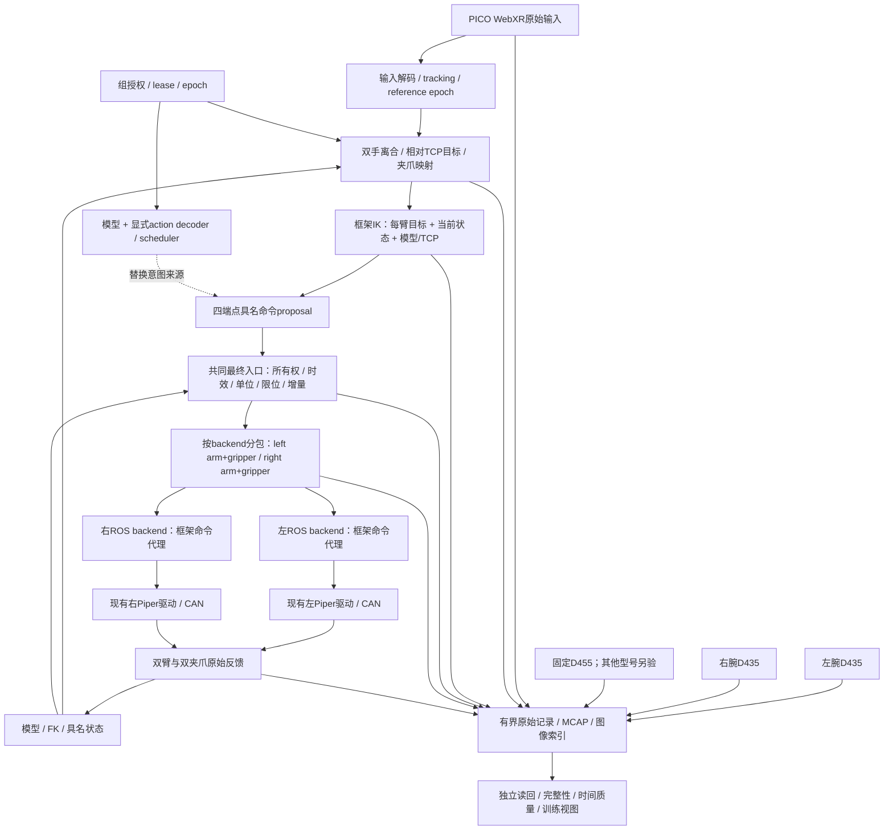

# A4-S：双臂VR采集graph与共享执行面

更新：2026-10-16。对应[计划006](../plans/006-a4s-graph-and-shared-execution.md)、[ADR-0009](adr/0009-a4s-graph-and-shared-execution.md)。用户明确选择双臂VR，不改为一主一从；两台Piper均为任务执行臂。原负责人所述“旧双臂VR效果不好、IK不佳、建议主从”为用户转述的经验，作为改进依据，不等于已定位旧IK的故障原因。

计划007后续实现了其中的**双臂位置遥操子集**，含框架FK/IK、本地网关与三相机显示，已有真实运动证据。详细图解见[通俗数据流](a4s-dataflow.md)、[现场报告](validation/2026-10-16-a4s-live-control.md)。夹爪/旋转/完整原始episode仍待验；下文“当前fake实现”指计划006冻结时状态，不代表新增live路径仍未实现。

本文先固定真实目标graph，再说明当前可运行的fake子集。本文不是可直接启动真机的配置；M1的validate/run仍只接受原固定fake图。

## 1. 这套设置的节点与连接



反馈经过显式采样/状态缓存，图中的环不表示递归调用。头显head pose先记录和用于显示，不驱动手臂；底盘、升降不创建命令节点。旧whole_body_reach的移动底盘/升降补偿不是本场景前置。视频回传头显是可选显示消费者，不阻塞执行或原始采集。

三个面分别处理不同问题：

| 面 | 节点和职责 | 当前目标 |
|---|---|---|
| 配置/控制面 | 设备绑定、模型/标定、preflight、session、来源授权、start/stop | 明确“谁、用什么配置、何时可以提交” |
| 意图/执行面 | VR归一化/离合、模型decoder、IK/轨迹、最终检查、驱动批次 | 研究者替换前半段，保留执行规则 |
| 观测/证据面 | 原始输入、反馈、图像、时间、命令/receipt、完整性与QC | 记录所有分支；不把慢录像塞进控制线程 |

这不是任意节点运行平台的首版范围；先把本场景需要的接口实现，再决定哪些节点值得通用注册/GUI配置。

## 2. 四个逻辑端点，两份驱动消息

| 逻辑端点 | 数据语义 | 驱动批次 | 现场绑定 |
|---|---|---|---|
| left.arm | 6个具名关节，position/rad | left.piper | 已确认can0；ROS namespace left_arm |
| left.gripper | 单一开口宽度，position/m | left.piper | 同左Piper的夹爪，单位/范围需实机复核 |
| right.arm | 6个具名关节，position/rad | right.piper | 已确认can2；ROS namespace right_arm |
| right.gripper | 单一开口宽度，position/m | right.piper | 同右Piper的夹爪，单位/范围需实机复核 |

**端点是语义/所有权单位，backend批次是实际I/O单位。** 现有ROS驱动用同一JointState装六关节和夹爪，并把velocity[6]当整臂速度百分比。框架内部不采用这个混合向量约定；adapter在最后一层显式编码，反馈再显式拆开。

一个周期形成具名CommandSet，先校验所含全部端点，再按backend打包。不能通过两份彼此不知情的“臂命令”和“夹爪命令”覆盖同一消息，也不能对缺失关节默填零。首切片要求完整执行组目标；真实离合单侧空闲时，应由明确hold策略使用新鲜反馈形成另一侧目标，记录active mask和hold来源，而不是沿用无期限旧值。

一次逻辑提交不保证两CAN硬件原子执行。全部预检通过后仍可能左侧已发送、右侧发送失败；必须逐批次记录submitted/sent/acknowledged/executed/unknown，撤销组旧epoch并调用各backend已验证的停止处理，不能宣称“回滚了左侧运动”。

首个双臂采集应用申请一个包含四端点的执行组。通用抽象允许其他组/端点数，但本轮先实现一组的fake验证；per-endpoint独立授权、重叠组仲裁留待后续，不先做分布式事务框架。

## 3. VR→目标→IK必须讲清的细节

### 输入和离合

保留WebXR原始head/grip/target-ray、handedness、原始按钮索引、位置米/四元数xyzw、reference_space和reset epoch、客户端原始时间及服务端收取时间。按键语义由profile选择，不能把“按钮0”硬编码为所有头显的扳机/夹爪。先确认PICO实际操作手感后冻结左右离合、夹爪与接管按钮；不拿旧Quest键名推断PICO。

每侧离合接合时，读取新鲜实测关节，经已验证FK得到当前TCP，同时保存手柄参考位姿。随后生成相对目标。以显式选择的world_delta旋转模式为例：

```text
p_des = p_tcp0 + scale * R_align * (p_vr - p_vr0)
R_des = R_align * (R_vr * inverse(R_vr0)) * inverse(R_align) * R_tcp0
```

R_align、scale、TCP、目标frame和旋转模式全部来自标定/profile；以上公式不是已经选定了实机旋转矩阵。工具系增量是另一模式，不能在注释写世界系、代码却偷偷改成工具系。完整四元数保留三轴姿态，不先压成旧代码的roll/flex两角。

离合释放、丢追踪、浏览器重启、reset epoch变化和输入过期是不同事件，分别记录并按明确策略清映射零点、停止提交或撤销授权；重新接合必须用当前机器人状态，不恢复旧目标。停止动作本身由设备模式决定，不把失能/掉电/回零统一当stop。

### 框架提供IK，现有驱动负责设备执行

IK接口输入为模型/标定版本、TCP目标、反馈snapshot、可选上一有效解、求解deadline和运动profile；输出为具名关节proposal及求解状态、位置/姿态残差、用时、限位/连续性诊断。输出仍须最终guard，不允许IK调用ROS publisher/SDK。

先从单臂验证模型joint order、零位、限位和FK↔实际末端反馈，再验证双臂安装变换/TCP。求解应能报告不可达、超时、残差过大和跳解；不继承旧代码“永不拒绝”的语义。位置/姿态权重、增量限制、碰撞/距离检查和是否使用轨迹生成器按可复现基准选择，不因为“换一个IK库”就宣称解决旧问题。

首个真实IK验收集包含：已知关节FK目标的反解、连续小位移/小旋转、靠近限位/奇异位形、不可达目标、双臂互近、帧变换错误和求解超时；报告残差、连续性和耗时分布。没有确切模型/标定时可以测试合成模型或接口，不能把其结果当Piper IK通过。

## 4. 采集与推理：共享哪里，不能等同哪里

你的判断准确地指出了可复用的核心：**经过显式解码/映射后的proposal，可以进入同一个所有权、最终检查、驱动打包、反馈和记录管线。** 采集和推理不应维护两套物理执行逻辑。

| 层 | 遥操采集 | 策略推理 | 是否共享 |
|---|---|---|---|
| 输入 | 手柄、按钮、tracking、离合 | 图像/状态/任务、预处理、模型artifact | 共用观测设施，来源语义不同 |
| 动作解释 | 相对TCP/夹爪意图→IK | joint/TCP/delta/chunk经decoder与scheduler | 部分复用；关节策略可以不经过IK |
| 执行 | CommandSet→最终检查→设备批次 | 同左 | 应完全共用；不按来源绕过检查 |
| 时间与接管 | 输入新鲜度、丢追踪/离合 | 观测年龄、模型延迟、chunk时间、迟到结果 | 共用epoch/有效期机制，额外规则不同 |
| 数据与评测 | 示教质量/干预标签/有效episode | 原始策略输出、改写、执行效果/任务评价 | 共用记录底座，额外字段/验收不同 |

因此，**数采跑通能证明推理所需的物理与记录底座，但不能证明模型部署和闭环任务能力已经跑通。** 用stub-policy与teleop喂入相同的具名目标，可先验证后半段来源可替换；真实策略仍要核验相机角色/预处理、动作单位/坐标/关节顺序、归一化、dt/horizon、延迟与接管。14维不是通用契约，只是两个六关节臂和两个单维夹爪的一种具体布局。

## 5. 数据流与存储细节

记录至少分为raw_input、semantic_intent、motion_result、guard、command_batch、receipt、feedback、camera、source_switch、drop/error、finalize。每条保留source/session/seq/epoch/原始时间域/收取时间及关联ID。训练action应明确选人意图、IK目标、实际发送还是下一反馈；不能让它们共用一个模糊action字段。

相机各有有界队列和掉帧/耗时统计；RGB/depth分流，首次真实采集先RGB，再按任务需要开depth。MCAP或图像sidecar保留逐帧时间/索引/hash；不能只留固定FPS MP4。记录失败按采集应用策略终止/中止，完整状态需检查结束记录、计数/hash、必需流覆盖与可读性，不能只检查metadata文件是否存在。

原始记录按到达时间保存，不在入口伪造跨流同步；训练视图离线按规则对齐并记录实际偏差、缺失mask。VR client时间、ROS header、设备metadata和host monotonic暂不视为同一时钟。

## 6. 当前实现边界与接续顺序

本次实现是独立多端点fake采集子集：具名端点、单一执行组、按backend完整批次、来源替换、流式MCAP与独立读回。配置明确标synthetic；fake来源直接生成具名关节目标，并保留原始输入标签，**不冒充VR笛卡尔映射或真实IK**。M1配置/事件版本继续独立且不放宽，新的图仍不是任意节点编排器。

可直接审查/运行[多端点fake切片](collection-review.md)，配置为configs/fake-a4s-collection.json，入口collect-validate/collect-demo/collect-read。原始真实输入adapter沿用计划004独立入口；完整graph中真实mapper、IK和ROS命令代理仍是待实现节点，不能由配置检查通过推断可启动真机。

真实方向已固定为PICO输入→本框架映射/IK→复用现有ROS驱动。ROS命令代理必须在设备机检查epoch/时效，控制源切换不能只靠远端客户端自律或pkill。复用现有驱动不自动防止其他ROS publisher旁路，需要启动profile/唯一写入者检查与本地命令网关配合；尚未实现时不得标成真机guard已通过。

后续按以下可验证结果推进：

1. 本轮fake：完整双臂/夹爪/三相机episode；teleop与stub-policy共用最终入口；故障/接管、部分批次失败、损坏文件检测。
2. 真实观测与持续录制：融合已独立验证的VR、反馈、三相机，测输入跳帧、持续录制和时间质量；保持物理命令禁用。
3. 模型/标定与IK shadow：不写设备，验证当前Piper模型/TCP、左右frame、输入映射、IK残差/连续性/时限。
4. 设备本地实时超时/网关与ROS adapter：先单臂明确范围的运动验收，再双臂；不沿用fake同步executed或手动时钟watchdog。
5. 真正遥操采集episode、QC与任务数据，然后接真实策略artifact/观测/调度；同一底座继续使用。

当前已有角色/USB与SDK身份，见[真实观测报告](validation/2026-10-16-a4s-live-observation.md)。实机模型版本/安装变换/TCP、夹爪开口标定、按钮配置、停止行为与时序阈值仍待验证；旧相机launch左右逻辑名与当前物理位置相反，不直接沿用。上述缺项不阻塞合成配置测试，也不允许通过默认值偷偷补成可运动配置。
