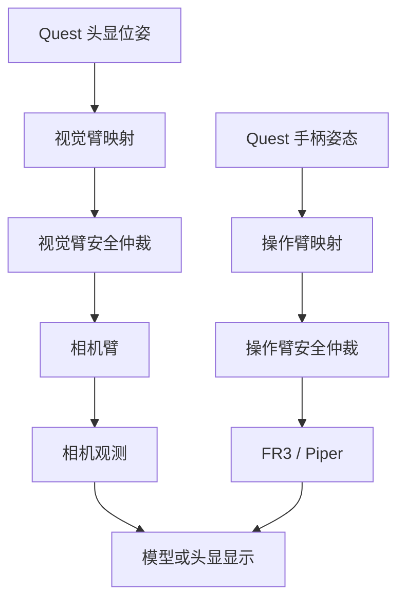
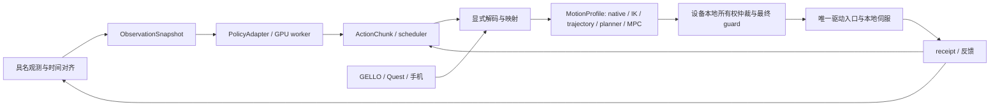

# 具身智能实验室机器人软件 Infra：调研与建设方案

2026-10-24候选增量：仅在输入边界增加可选WebRTC连接，复用现有输入包、机器人端采集状态机和物理gateway；不新增命令体系或网页权威状态机。S0/S2已获批准，S1暂缓。见[流程与连接说明](webxr-workflow-and-transport.md)、[ADR0019](adr/0019-optional-webrtc-input.md)、[计划021](../plans/021-transport-semantics-and-live-validation.md)。正式部署仍018，现场结果不自动推广成跨环境保证。

v0.18候选增量（2026-10-23）：图像接收/预览抽成共享组件，原始记录与最新帧预览槽独立；预览按需编码、JPEG归档显式开启；有界分段计时与相机独立对照可复现。Image QoS可显式配置、默认保留best_effort/5；不改控制协议、物理gateway与QC。候选020尚未替换018正式部署，完整并发仍需验证。见[通信/QuestArm对照](communication-and-performance.md)、[验证](validation/2026-10-23-communication-performance.md)、[ADR0018](adr/0018-bounded-profiling-and-demand-preview.md)。

v0.17运行时增量（2026-10-22）：collect-configure从既有设备身份生成独立采集配置；可选gripper.teleop_start=follow_trigger只在TELEOP有效扳机输入时立即映射，旧配置默认preserve。正式示例为三RGB MP4＋仅头部原始depth，不改变原始时间/深度数值，不默认RGB对齐。相机独立记录与deep通过，完整双臂/头显并发仍需首条验收。见[ADR0017](adr/0017-collection-presets-and-gripper-entry.md)、[操作](episode-collection.md)、[验证](validation/2026-10-22-formal-collection.md)。

方案 v0.18（更新2026-10-23；正式部署仍为018）。近期优先范围：A4-S双Piper静态子集 + 双D435腕部 + D435/D435i/D455固定相机 + PICO优先/Quest3备选（Ubuntu24.04），然后A1 FR3 + D405/D435 + GELLO/手机（Ubuntu22.04）、A2 Piper + CamBot + D435i + Quest3（Ubuntu20.04）。原A3仿真、A4双臂轮式完整场景、A5 XLeRobot、A6待确认G1-D保留ID。原有D1/PiperX仍为后续审计项。**M1固定fake与单组多端点fake采集保留；v2 session基础上增加机器人本地启动、相机消费者分支、异步原始MCAP episode、A保存/X丢弃与QC。双臂遥操此前现场通过；本轮三RGB原生30fps、独立夹爪及A保存/X丢弃已有现场证据，首个26.179秒保存episode通过deep QC；真实策略与完整M2未完成。** 实际边界以[状态](project-status.md)、[ADR-0005](adr/0005-m1-fake-contract-and-evidence.md)及[本机报告](validation/2026-10-15-m1-windows.md)为准。

2026-10-20计划014：native ReplaySource和AsyncPolicySource共用ExecutionSession→LiveGateway→既有驱动。A4-S首3秒真机回放/起始对齐已现场通过，假模型独立进程HTTP/fake设备通过；后者不代表真实策略或相机闭环。workflow-session/1仅绑定native执行子集，experiment-graph仍是逻辑模板；共享停止/ownership路径，不能把模型写入权交给worker。见[操作](replay-and-mock-inference.md)、[验证](validation/2026-10-20-replay-and-mock.md)、[ADR0016](adr/0016-native-workflow-execution-and-policy-fixtures.md)。

Updated 2026-10-19: plan013 adds a ROS/model-independent real-episode reader, read-only audit outputs, explicit training-view/1 causal observations and published-target labels, and experiment-graph/1 typed plans for collection/replay/inference. These plans do not launch physical graphs. Journal segmentation preserves all evidence; native-FPS recording avoids receive-time rate filtering. See [training format](training-data-format-report.md), [three workflow graphs](three-workflow-graphs.md), [ZeroWAM review](research/2026-10-19-zerowam-deployment.md), [audit](research/2026-10-19-new-test-audit.md) and [ADR0015](adr/0015-training-targets-and-workflow-plans.md). LeRobot writer, physical replay and model bridge remain pending.

v0.14增加可选具名末端观测源及`pose-feedback/1`：Piper已连接SDK的原生XYZ/Euler整数、单位、时间单独记录；驱动转换Quaternion另流且显式conversion。通用订阅/存储不猜frame/TCP或时钟，不将FK当原生，不改命令通路；新流进入index、对齐/QC及整episode事务。旧数据不回填，实时新增流未验；详见[数据报告](collection-data-format-report.md)、[ADR0014](adr/0014-native-pose-observations-and-provenance.md)和[计划012](../plans/012-cartesian-feedback-and-data-dictionary.md)。

v0.13新增独立 `ImageStorage` 协议与raw_mcap/MP4后端，配置/CLI可选择；沿用同一有界worker、episode生命周期和事件MCAP，不改变机器人/VR控制。MP4为real-episode/2视频文件组与逐帧原始时间/PTS索引，旧raw v1兼容；深度保持原样。Windows/Ubuntu无硬件测试与真实样本离线编码通过，实时MP4采集及完整LeRobot v3导出未验。见[ADR0013](adr/0013-pluggable-image-storage-and-mp4.md)、[视频说明](recording-storage-options.md)、[验证报告](validation/2026-10-18-mp4-storage.md)和[计划011](../plans/011-pluggable-image-storage.md)。以下v0.12为此前原始采集切片的证据。

v0.12数据与部署边界见[操作手册](episode-collection.md)、[技术说明](episode-storage-and-configuration.md)、[ADR0012](adr/0012-real-episodes-and-camera-fanout.md)和[计划009](../plans/009-local-deployment-and-real-episodes.md)。原生capture、VR preview、record分别配置；核心存储不依赖ROS，独立磁盘线程写原始RGB/depth与事件，离线时间对齐和QC不篡改原始时间戳。WSS控制与HTTPS预览分开；网络尾延迟仍需实测，不能将相机30fps等同于头显低延迟。独立扳机夹爪已现场确认，验收与边界见[2026-10-18报告](validation/2026-10-18-a4s-link-and-episodes.md)。当时仅实现原始MCAP，后续MP4增量见上文v0.13。以下v0.11及更早段落为历史记录。

v0.11会话分层、线程/进程与操作见[session手册](teleop-session.md)、[ADR-0011](adr/0011-session-workflow-and-pinocchio-workers.md)和[计划008](../plans/008-session-workflow-and-pinocchio.md)。profile升为live-teleop/2，输入仍webxr-input/1，诊断仍live-teleop-event/1；不改变M1及fake collection协议。启动只连接/自检，操作者A才回位；home和hold不写夹爪。最新现场确认覆盖A流程、位置/朝向跟随、夹爪、松键保持、暂停及反转扳机方向，证据见[session验证](validation/2026-10-16-a4s-session.md)。以下v0.10及更早内容保留历史范围。

v0.10新增[通俗数据流图](a4s-dataflow.md)、[现场控制证据](validation/2026-10-16-a4s-live-control.md)、[部署/停止](live-teleop.md)及[ADR-0010](adr/0010-live-gateway-and-position-teleop.md)。live-teleop/1与独立JSONL诊断不改变fake-only collection契约。两臂真实运动已有现场/反馈证据；IK时间预算拒绝、近限位测量、停止收敛与原始episode仍需打磨。三轮原始诊断缺结束摘要的bug已修复并通过隔离ROS退出验证，未重新标成完整采集。以下v0.9及更早段落为历史增量。

v0.6新增[本地参考源码索引](reference-repositories.md)、[A4-S/A1/A2现场手册](validation/a4s-a1-a2-playbook.md)、[M2计划](../plans/002-a4s-teleop-acquisition.md)和[ADR-0006](adr/0006-a4-static-subset-and-incremental-validation.md)。用户报告Ubuntu24.04已可分别控制两台Piper+夹爪；这不是本项目独立验证结果。PICO型号待补，Quest3可能占用；先遥操数采，再策略推理。

遥操/推理证据见[专题调研](research/2026-10-11-teleop-inference.md)，远程开发见[跨机器工作流](development-and-validation.md)；设计决定见 [ADR-0001](adr/0001-host-and-transport-boundaries.md)、[ADR-0002](adr/0002-policy-scheduling-and-motion.md)、[ADR-0003](adr/0003-gui-as-graph-client.md)、[ADR-0004](adr/0004-experiment-loop-and-quickstart.md)。v0.5新增[完整工作流与定位核验](research/2026-10-11-workflow-positioning.md)、[定位和快速入门验证协议](positioning.md)及§15。§11保留2026-09-15的历史比较，当前PhyAgentOS README的更新与证据边界见新调研，勿将旧比较当作当前版本结论。

v0.9明确[双臂VR graph](a4s-graph.md)、[端点/驱动批次与共同执行面](adr/0009-a4s-graph-and-shared-execution.md)。用户确认双臂均执行、框架提供映射/IK、复用现有ROS驱动；旧负责人对旧IK的经验不等于当前IK已定位问题。未发布源码增量已实现独立collection-plan/1与collection-event/1的单组多端点fake、流式MCAP和双来源共用执行入口，[运行/审查](collection-review.md)与[验证](validation/2026-10-16-a4s-shared-execution.md)见链接；Windows/Ubuntu隔离全套各165项通过。没有真实IK/ROS命令，M1契约不变。以下v0.8/v0.7为历史增量。

v0.8新增[独立输入/观测](live-input.md)、[实测报告](validation/2026-10-16-a4s-live-observation.md)与[ADR-0008](adr/0008-independent-live-input-and-identity-namespaces.md)。包0.3.0、Windows125项/Ubuntu隔离切片45项通过。WebXR原始输入、ROS相机采样及SocketCAN接收分离，未建立物理命令链。RealSense SDK serial与USB descriptor serial分命名空间且显式关联，旧相机serial失配结论已纠正。PICO浏览器UA自报4 Ultra Enterprise OS5.11.2；时序、持续记录、模型/映射与动作执行仍待验收。下段v0.7为历史增量。

## 1. 目标与可检验的定义

v0.7补充[通用设备发现与绑定](device-discovery.md)、[远端代码索引](remote-code-index.md)、[发布/部署流程](release-and-deployment.md)及[ADR-0007](adr/0007-discovery-and-explicit-device-binding.md)。包0.2.0已实现被动Linux枚举和显式身份绑定，M1控制契约不变；不代表M2真实backend完成。用户已确认can0左臂/can2右臂、双D435左右serial及固定D455，具体身份在本地profile，PICO仍疑似4 Ultra待设置确认。Windows105项、Ubuntu发现19项通过；完整Linux M1/硬件未验证。

目标是同一个实验应用能完成遥操采集、人工接管、策略推理、回放与评测。用户声明设备节点、端口与连接，框架校验后启动系统；更换机械臂优先复用应用流程，替换驱动与运动映射并重新核验工具、控制模式和策略兼容性；增加/移动相机需核验设备清单、标定与策略观测；GELLO改Quest 3需替换输入适配器及映射并重测时序。**跨形态的策略权重、动作维度及任务成功率不能仅靠统一 API 保证复用**；基础设施解决实验流程复用、语义清晰的数据和可配置的运动转换，不能承诺所有迁移仅修改一份配置。

近期首个物理目标调整为A4-S，复用现有能工作的双Piper环境并增加三相机/VR、控制权与记录证据；PICO先做输入能力检查，Quest3作为备选。固定相机三型号用独立profile适配，实际测试哪个型号才确认哪个分支。随后A1先GELLO、手机WebXR另验；A2保持Ubuntu20.04/Quest3 WebXR需求。候选桌面任务与至少20完整episode在盘点后固定。fake/最小模型、映射/仿真或shadow验证仍为物理前置，不要求先完成整个A3。便捷采集与推理部署同为核心目标，当前先采集，GUI低优先级。

## 2. 现成方案与取舍

| 方案 | 可直接复用 | 对本实验室的缺口与决定 |
|---|---|---|
| [ROS 2 + ros2_control](https://control.ros.org/) / [Franka ROS 2](https://github.com/frankarobotics/franka_ros2) | 通信、命名空间、驱动生命周期、控制器；Franka 提供现成硬件插件和示例 | 作为设备侧通信与 FR3 控制底座；上层另建实验 API、数据约定和遥操映射。Franka FCI 的 1 kHz 实时环应留在专用 Linux 主机/控制器内，不能让 Python 策略直接承担这个环。 |
| [LeRobot](https://huggingface-lerobot.mintlify.app/) / [Bring Your Own Hardware](https://huggingface-lerobot.mintlify.app/tutorials/bring-your-own-hardware) | 机器人/遥操/相机扩展接口、采集、Parquet + MP4 数据和训练部署 | 作为训练数据及策略的出口；保持实验室自己的多设备时间戳、动作语义和安全控制面。某个设备出现在外部生态中，不等于其所有型号和固件都已兼容。 |
| [GELLO 软件](https://github.com/wuphilipp/gello_software) | 同构关节遥操的输入方式 | 输入设备插件；GELLO 为目标机械臂的运动学复制体。对不同自由度/尺寸的机械臂须重新映射或切换到末端任务空间模式。 |
| [XLeVR](https://xlerobot.readthedocs.io/zh-cn/latest/simulation/getting_started/vr_sim.html) / [Open-TeleVision](https://github.com/OpenTeleVision/TeleVision) | Quest 3 姿态/按钮流及沉浸视频遥操参考实现 | 优先参考 XLeVR 的本地 WebSocket/HTTPS 数据流；先做头显+手柄的状态插件，VR 坐标转换、离合器、IK、延迟监控由实验室实现并实测。Open-TeleVision 的示例涉及视频流和网络隧道，不直接照搬为控制通道。 |
| [RealSense SDK](https://github.com/realsenseai/librealsense) / [ROS Wrapper](https://github.com/realsenseai/realsense-ros) | 彩色、深度、标定、设备序列号和 ROS 2 图像流 | 统一 Camera 插件和稳定的相机角色名；D405 与 D435i 不能假定相互硬件同步。 |
| [MCAP](https://mcap.dev/) / [rosbag2](https://docs.ros.org/en/rolling/Tutorials/Beginner-CLI-Tools/Recording-And-Playing-Back-Data/Recording-And-Playing-Back-Data.html) | 多通道附时间戳原始日志及回放 | 原始记录使用 MCAP；训练用途再导出 LeRobot。若高带宽视频另存容器，则保留逐帧原始时间戳、索引及校验和，避免仅以 MP4 帧号代替采集时间。 |
| [DORA](https://dora-rs.ai/) | 在 YAML 里声明节点、输入输出和数据流；提供节点替换与回放思路 | 借鉴图配置及可观测性；目前官网说明 1.0 为候选版，先不引入第二套必需中间件或引用其官网性能比较作为本实验室的基线。 |
| [CamBot](https://github.com/open-thought/cambot) | 自制 6-DOF 相机臂、ZED Mini、WebXR 头显控制、WebRTC 视频；有 URDF/IK/串行舵机控制 | 作为复合设备和第三方驱动接入的验收案例；它的头显跟踪→相机臂，以及相机视频→头显，是两条不同方向的边。 |
| [MuJoCo](https://mujoco.readthedocs.io/en/stable/modeling.html)、[Isaac Sim ROS 2 Bridge/URDF 导入](https://docs.isaacsim.omniverse.nvidia.com/latest/ros2_tutorials/index.html)、[LeRobot EnvHub](https://huggingface-lerobot.mintlify.app/simulation/envhub) | 机器人模型导入、仿真传感器及接口/环境封装 | 仿真执行端作为设备插件试点；图和算法能复用，但实体场景、接触物理、标定和时间语义需要另外建模，不能将设备 YAML 自动当作高保真数字孪生。 |

这是组合式建设选择，不是上述项目宣称的端到端兼容保证。尤其 [AgileX pyAgxArm](https://github.com/agilexrobotics/pyAgxArm) 官方说明支持 Piper 的 CAN、状态和运动控制；[Piper ROS](https://github.com/agilexrobotics/piper_ros) 的公开说明是 ROS 1 Noetic，故不能把它直接视为 ROS 2 `ros2_control` 插件。Unitree D1、PiperX 的型号和接口需依据现有机器实测，不以 G1/Z1 等其他型号 SDK 推断。XLeRobot 的[原项目](https://github.com/Vector-Wangel/XLeRobot)包含软件、XLeVR 与硬件目录，接入时须确认实验室的具体双臂/底盘配置。

本地新增参考中，agx_arm_ros为另一份ROS2驱动（README列Humble/Jazzy），与上述piper_ros不可混称；QuestArm快照已含双Piper WebXR、Pinocchio/CasADi、CamBot/RealSense和策略边界，但dirty来源、自动enable、固定TCP/坐标与关闭碰撞检查等配置需重审。agx_arm_urdf submodule本轮为空，应补齐版本匹配模型。PICO可比较现有WebXR输入与televuer/XRoboToolkit原生路线，具体型号适用性先验证，不继承Quest3结论。详见参考索引，不把全部参考仓库装进核心依赖。

## 3. 架构

### 3.1 三类目录，能力可重叠

分类有助于设备盘点、界面筛选和分工，但不应成为互斥继承树。建议称为 **执行端**（原“交互类”：会改变物理/仿真世界的机械臂、夹爪、灵巧手、轮、腿、云台/相机臂）、**意图源**（原“控制类”：GELLO、Quest 3 的头显/手柄、3D 鼠标、键鼠、人、VLA/WAM/其他策略）、**观测源**（原“数据类”：相机、关节/TCP 状态、触觉/力觉、IMU 等）。一台设备可实现多个能力；相机自身主要为观测源，同时具备 `configure_stream` 等配置端口，不能因可启动视频流就与机械臂归为同一执行端。安装在可运动机械臂上的相机，应表现为“臂的执行端口 + 臂的状态观测端口 + 相机的 RGB/depth 观测端口 + 安装关系”，而非单一万能设备类。

| 实体 | 能力/端口例子 | 分类与含义 |
|---|---|---|
| FR3 | `joint_command` 输入；`joint_state`,`tcp_pose`,`wrench` 输出 | 执行端 + 观测源；状态是机械臂内置观测。 |
| D435i/D405 | `stream_config` 配置；`rgb`,`depth`,`camera_info` 输出 | 观测源；配置不等同运动命令。按具体型号声明支持的流。 |
| Quest 3 | `head_pose`,`left/right_hand_pose`,`buttons` 输出；VR 视频输入 | 意图源 + 显示消费者；头显和手柄作为同一物理设备的多个逻辑端口。 |
| GELLO/3D 鼠标/键鼠 | `joint_intent` 或 `pose_delta/buttons` 输出 | 意图源；是否能驱动腿由连接的映射与被控设备能力决定。 |
| VLA/WAM | 图像/状态/任务文本输入；`action_intent` 输出 | 意图源中的软件节点，需声明动作空间、频率、上下文与模型版本。 |
| CamBot | 相机臂命令与状态 + 立体图像；`mounted_on` 关系 | 复合执行端 + 观测源；必要时拆为 `arm`、`stereo_camera` 两个子节点。 |

“人”作为操作者身份、授权及接管来源；实际可机器读取的意图由键鼠/VR/GELLO 等设备端口输出。对腿、轮与灵巧手分别建立 `LocomotionCommand`、`BaseTwist`、`HandSynergy/HandJointCommand` 等动作语义，拒绝把所有执行端硬塞进 `ArmCommand`。触觉可挂在灵巧手上但仍有独立观测流。

### 3.2 端口图是系统配置，不是现场连线的直接放权



参考 [DORA 的 YAML 数据流图](https://dora-rs.ai/)及 [ROS 2 launch 的声明式部署](https://design.ros2.org/articles/roslaunch_xml.html)，但做实验室自己的 *端口图 schema*，编译为 ROS 2 launch/驱动进程/录像任务。图中节点不仅是实体设备，还包括映射、融合、时钟同步、仲裁、录像、策略和仿真等服务；边区分 `observation`、`intent`、`command`、`configure`、`feedback`、`video_display`。`mounted_on`/`T_parent_child` 是**坐标与安装关系**，保存在另一张 frame/asset 图，不与数据流边混淆。视觉机械臂是用户给可运动相机臂的任务角色名，不表示普通 D405 可直接运动。

图编译器按三步工作：① 解析设备 manifest、图 schema 与模型资产版本；② 检查有无端口、类型/单位/坐标/频率/时间域兼容、必需观测、唯一写入者、资源独占、CPU/GPU/USB/CAN 预算和安全路径；③ 显式插入用户批准的 mapper/transform/synchronizer/arbiter，生成执行计划与 diff，`dry-run` 后才能部署。**不能仅凭类型相近自动猜测语义转换**。GELLO `JointIntent<FR3,7>` →机械腿的 `LocomotionCommand` 应在预检时报不兼容；如果用户开发了明确的映射插件，须逐项验证其状态和限制。Quest 头显→视觉臂、手柄→操作臂是两条分离的控制链，分别拥有控制权与故障处理。

边在语义图里可以包含闭环反馈；编译器要求反馈经过显式状态/延时节点，拒绝没有时序边界的组合环。执行端必须只有一个真正命令入口（安全仲裁器），多意图源先进入仲裁策略：人工接管优先、策略暂停、控制权交接重校准。相机图像到多个消费者可扇出，消费者慢时各边独立队列/丢帧策略，不能拖慢执行环。将图配置的哈希、编译结果及实际运行设备能力保存到每个 episode，保证“同一个 YAML”可追踪到具体部署。

设备主机：FR3 通过匹配版本的 franka_ros2/libfranka 在独立实时 Linux 主机运行；Piper 的 CAN 总线由单个设备进程独占；D1/G1-D 用实际型号对应的接口独立接入；XLeRobot 的左右臂与底盘分别暴露为具名子设备；相机依序列号绑定。ROS 2 只作为已验证设备域内的可选传输，核心不导入 ROS/厂商 SDK；跨主机/跨 distro 走显式协议边界（§13）。上层 Python typed API / CLI 操作 session，映射/安全/执行常驻，采集脚本不能发原始 CAN/FCI 命令。

### 3.3 核心契约（v0.2）

```python
class DevicePlugin(Protocol):
    def manifest(self) -> DeviceManifest: ...  # identity, API range, typed ports, modes, dependencies
    def probe(self) -> RuntimeCapabilities: ...  # actual firmware, permissions, streams, health
    def configure(self, config: Mapping) -> None: ...
    def start(self) -> None: ...
    def stop(self) -> None: ...

class ArmDevice(Protocol):
    def describe(self) -> Capabilities: ...  # DOF, joint names, limits, control modes, feedback, tool
    def read_state(self) -> TimedArmState: ...
    def enable(self, lease: ControlLease) -> None: ...
    def execute(self, command: ArmCommand, lease: ControlLease) -> CommandReceipt: ...
    def stop(self, reason: str) -> None: ...

class CameraDevice(Protocol):
    def describe(self) -> CameraCapabilities: ...
    def configure_streams(self, streams: dict) -> StreamReceipt: ...
    def frames(self) -> Iterator[TimedFrame]: ...  # RGB/depth、内参、序列号、状态

class IntentSource(Protocol):
    def intents(self) -> Iterator[TimedIntent]: ...  # 操作者姿态/关节/按键或 policy 动作

class MotionMapper(Protocol):
    def map(self, intent: TimedIntent, state: TimedArmState,
            capability: Capabilities) -> ArmCommand | Rejection: ...
```

`ArmCommand` 是有标记的联合类型：`JointPosition`、`JointVelocity`、`CartesianPose`、`CartesianDelta` 和夹爪命令；底盘、腿、灵巧手另有命令族。每条带 `frame_id`、SI 单位、`target_time`/有效期、`source`、`seq`、控制模式。能力列表决定合法指令：例如没有可靠笛卡尔伺服或夹爪反馈的设备不能伪装具备该能力。FR3 的外力/力矩反馈可以作为可选字段，不强迫低成本臂提供同等字段。所有关节状态明确 joint name 顺序，左右臂和底盘用不同命名空间，不把双臂拼成不明语义的向量。`DeviceManifest` 为静态声明，`probe` 是实机动态协商结果；实际能力的交集才可连接。

### 3.4 输入到动作的映射

GELLO 读取关节及夹爪输入；同构臂用校准后的关节位置映射，异构臂需要已验证的关节重定向或 FK→目标 TCP 位姿→目标臂 IK。Quest 3 插件仅负责头显/手柄姿态、扳机、摇杆与按键；映射层根据 `T_world_vr`、`T_base_world`、操作者激活时的相对参考位姿，生成目标 TCP 的 **增量**，做位移比例、手柄离合器、速度约束、工作空间裁剪、IK/奇异性检查；扳机映射夹爪，底盘摇杆仅在显式选择 XLeRobot 底盘模式时生效。每次遥操设备切换须释放旧控制权、检查机器人状态并重新校准，不在运行的 episode 中静默热切换。

推理与遥操最后收敛到同一版本化意图/命令语义；策略原生 tensor 先按 adapter 明确解码，不能因为维度相同就直接当作 ArmCommand。观测、模型计算、chunk 调度、运动映射/规划、设备侧跟踪与最终 guard 分层（§12）。人工接管/设备失联优先，旧 epoch 的异步结果不得恢复执行；高层不能绕过本机硬停及厂家机制。

### 3.5 第三方设备插件与验收协议

插件有两层：可单独安装的厂商/自制 `DevicePlugin`（负责真实 I/O）和框架提供的映射/后处理插件（负责语义转换）。插件包发布 `manifest.yaml`：稳定 `plugin_id`、接口协议版本区间、设备及子设备 ID、输入/输出端口 schema、命令/观测能力、单位/坐标/控制频率、线程和停止语义、支持固件/SDK/OS、USB/CAN/网络资源、URDF/MJCF/USD 等资产路径及其 hash、需要的校准项。`probe()` 读出真实固件/序列号后缩小能力，不把 manifest 当作硬件事实。复杂驱动可通过 ROS 2 原生包、独立 Python 进程或厂商 C++ SDK 的桥接进程实现，外部只见同一协议和安全命令入口。

接入路径：`plugin scaffold` 生成示例 → 只读 `probe/describe` → 基于录制流的端口契约、时间戳、故障注入测试 → 仿真/空驱动 → 实机低速准入。新灵巧手实例应声明 `hand.joints/hand.tactile/hand.command`，安装在某臂的 `tool_frame`，通过手指关节/协同动作 mapper 与策略/遥操连接；没有触觉时 port 不出现，不能填假数据。[CamBot](https://github.com/open-thought/cambot) 例：把 Feetech 串行舵机臂接为 `ArmDevice`，ZED Mini 接为 `CameraDevice`，导入 URDF 和标定；Quest 头显位姿接 `IntentSource`，立体视频回头显为显示边。其原项目的 WebXR/IK/WebRTC 和默认 watchdog 提供参考，最终控制安全语义仍经本实验室准入验收。

插件 API 用语义版本，只对契约层作向后兼容承诺；保留测试样本/假设备，允许第三方只实现其声称的端口。新设备接入成功的衡量是：不改 `apps/record`、`apps/infer` 的源码即可被 `discover` 和图编译器识别，能通过只读、录像及故障测试；有命令能力的插件还须完成单独真机准入。

## 4. 数据契约与时钟

设备发现与运行状态分开：`device-discovery/1`枚举USB/CAN/串口/视频元信息，`device-bindings/1`通过配置绑定角色，详见独立文档。被动Collector不导入SDK或打开设备，不把CAN适配器认定为Piper，不猜测左右；厂商识别/固件查询/实时状态由后续插件声明副作用与时间有效期。资源冲突、缺失、歧义与未确认分别报告，身份绑定通过不等于命令准入。平台规则、场景角色、模型/TCP和设备backend分别维护，不写死serial/IP/USB顺序。

每个 episode 记录：任务文本、场景/物体、成功/失败标签、操作者、robot/固件/驱动版本、关节/工具模型、相机序列号和角色、内外参版本、控制模式、遥操类型、策略 commit/权重 hash、限位及失败事件。原始 MCAP 同时保存设备状态、GELLO/VR 原始意图、映射后的目标、**实际下发命令和执行反馈**、RGB/depth 帧与安全事件，记录序号和丢帧计数；`manifest.json` 包括流规格、时间域和文件校验和。`episode_id` 在开始时生成，异常结束依然保留 `aborted` 状态。

每条数据保留 `device_time`（若硬件提供）、`host_monotonic_time` 和 `receive_time`，以及时钟域；跨主机用可测的 PTP/NTP 偏差建模。采集后离线生成固定采样率的训练视图：状态按时间插值，图像按邻近帧选取并写入原始帧时间及对齐差值，超阈值标无效，不默默复制旧帧。RGB/depth 与 IMU 分流并显式定义单位和 alignment。D405 缺少 D400 系列其他部分型号的多机硬同步支持，和 D435i 混用时依软件时间对齐并实测误差；详见[RealSense D400 系列产品资料入口](https://dev.realsenseai.com/)及[官方 SDK](https://github.com/realsenseai/librealsense)。MCAP 是证据与排错的原始层；LeRobot Parquet/MP4 是经过 schema 映射、过滤和压缩的训练层，两者之间保留可重复执行的转换脚本和版本。

## 5. 安全与执行路径

上电前校验 URDF/运动学、夹爪、TCP、零位、关节限位和工作空间；控制权采用每台执行器独占 `lease`（短期续租），只有仲裁器拥有写权限。每条动作验证 enable 状态、源心跳/新鲜度、边界、速度/加速度与碰撞限制；失联/超时触发本机安全停或驱动规定的安全处理，具体停止方式按设备控制模式验证，不能统一假设直接保持当前位姿一定安全。FR3 的实时环与安全机制由其本地系统负责；急停、碰撞/错误恢复按厂商流程。VR 网络采用局域网，持续测端到端延迟；头显或 Wi-Fi 失联自动撤销控制权，首次接入在无负载低速模式测通。

采集和推理共用 session 生命周期：`discover → preflight → calibrate → arm → run → stop/fault → finalize`。日志记录拒绝原因；任何错误恢复都要重新 preflight 和人工使能。策略评测先在离线回放及仿真验证动作维度/坐标，再低速、空载、单次动作上线；避免将回放的原始命令直接发给不同形态的真机。

### 5.1 通信是可替换传输，命令语义保持稳定

| 用途 | 首选传输 | 注意点 |
|---|---|---|
| 厂商实时伺服/总线 | libfranka/FCI、SocketCAN、厂商 SDK，在设备本机 | 控制频率和停止语义由设备驱动保证，网络和 Python 不进入 FR3 1 kHz 环。 |
| 已验证 ROS 设备域内的状态/命令/图像、控制器管理 | 可选 ROS 2/DDS，具名 namespace | 指定 QoS、命令有效期、状态新鲜度；图像用有界队列，录制与控制不同服务质量。ROS 1 老驱动采用限域边界，不承诺跨 ROS distro 透明互通。 |
| Quest 3 位姿和离合器输入、状态面板 | WebSocket/HTTPS 或原生 XR SDK 对接插件 | 时间戳/心跳、重连和控制权状态由协议定义；WebSocket 是数据传输，不提供机器人安全保证。 |
| VR 立体视频显示 | WebRTC（CamBot 的参考方式） | 压缩/网络拥塞与控制链分离；视频回传单独延迟测量，避免挤占命令通道。 |
| 模型隔离/跨机推理 | gRPC + 显式消息 schema 为候选；上游 ZMQ adapter 可试点 | 无 ROS 强依赖；测试截止期、队列、鉴权和过期处理，禁止任意网络 pickle；不提供第二个硬件写入口。具体实现待 fake 网络切片验证。 |
| 配置与运行管理 | HTTPS JSON / WebSocket 事件为候选 | CLI 与 GUI 共用 API；部署预检、版本与授权在后端检查；该通道不承担实时伺服。 |

通信和数据协议不等同：ROS 2、WebSocket、ZMQ 是传输，typed port 是稳定的业务契约；MCAP 是原始记录容器，LeRobot 是训练数据出口。定义 `TransportAdapter` 实现 send/receive、时间域、QoS、指标，不让图 schema 存厂商 topic 名称作为其唯一语义。控制链单独测高分位端到端延迟、丢包、抖动、队列长度、心跳和执行反馈；参数是设备 profile 的实测值，不设全平台统一常数。

### 5.2 版本与兼容矩阵

至少分五个独立版本：**配置图 schema**、**typed ports/命令协议**、**插件 API**、**数据/episode schema**、**policy artifact/推理协议**；不能用一个 `schema_version` 掩盖全部。图运行前导出 `plan.lock`：框架 git commit、各插件包与 hash、各 host 的 OS/架构/内核/Python/GPU/CUDA、ROS distro/`rmw`（有时）、控制器/SDK/固件、libfranka 兼容版本、RealSense SDK/ROS wrapper、VR 页面协议、模型/normalization/预处理/推理后端 hash、调度与 motion profile、仿真资产和标定 hash、实际能力及预算。FR3 按[官方兼容矩阵](https://frankarobotics.github.io/docs/compatibility.html)完成确认。

升级规则：同一 major 内端口只允许明确的可选字段扩展，单位/动作语义/坐标约定变动必须升 major 或提供显式迁移器；记录事件 schema ID，旧 episode 通过带版本的 decoder 读取，导出训练视图记录转换版本。驱动与应用依赖各自 lockfile/container，但 FR3 实时内核与网络约束独立验证，不能因为容器镜像可复现就认为真机可控。Isaac Sim 的[迁移指南](https://docs.isaacsim.omniverse.nvidia.com/latest/overview/release_notes.html)提醒要逐版本验证资产、传感器与 ROS Bridge；其版本更新不应迫使设备侧升级。每次升级先在录制回放和虚拟插件上测行为 diff，再做低速真机回归；对版本不匹配给出具体端口、插件、固件和修复建议。

## 6. 仿真边界：共用系统图，替换执行与观测后端

目标是 **graph-level portability**：`record/infer/evaluate`、mapper、policy、动作/观测契约和任务语义复用，执行端与观测端由 `real` 插件替换成 `sim` 插件；`SimBackend` 暴露 `reset/step/clock`、状态和 RGB/depth/触觉能力，可带 Gymnasium 式接口。仿真配置除了设备图，还需要 `RobotAsset`（关节、碰撞网格、执行器和工具）、`SensorAsset`（镜头、内外参、渲染模式）、`SceneAsset`（台面、对象、接触/光照）与物理参数；现有设备 YAML 只能证明“谁连谁”，不能生成可靠摩擦、柔顺性或遮挡。

分层支持：① **回放/假设备**最先做：MCAP 流换设备节点，验证原策略对历史观测的动作、图校验与接口；不是闭环物理仿真。② **MuJoCo**先做 FR3/Piper 的关节与 RGB 验证：[MuJoCo](https://mujoco.readthedocs.io/en/stable/modeling.html)原生 MJCF，也能载入 URDF，但仍需补执行器、传感器和接触配置。PyBullet作为另一个轻量 adapter 可接入，若其模型/功能覆盖不了所需传感器就显式缺能力，不让不同引擎假装等价。③ **Isaac Sim**用于多相机、复杂场景及后续高保真方向，[URDF Importer](https://docs.isaacsim.omniverse.nvidia.com/latest/importer_exporter/ext_isaacsim_asset_importer_urdf.html)与[ROS 2 Bridge](https://docs.isaacsim.omniverse.nvidia.com/latest/ros2_tutorials/index.html)提供基础，需校验导入模型与真实系统一致性；[LeRobot EnvHub](https://huggingface-lerobot.mintlify.app/simulation/envhub)提供可复现环境分发思路。仿真引擎选择看验收任务而定，不在首个真机 MVP 同时维护三套高保真场景。

**真机→仿真**：固定图与资产版本、标定、场景尺寸和动作语义，生成仿真图；对比 joint name/零位、TCP、自由度、相机视野、帧率及命令响应曲线。**仿真→真机**：先将 sim-only privileged observation（真实系统没有的物体真值、完美位姿等）剔除；再通过 `plan.lock` 和图预检对真实传感器/动作能力做交集检查，补实机标定、资源/安全验证和 shadow mode，最后低速上机。即便契约对齐，视觉域差、摩擦、延迟、接触与碰撞也需实测和评估，绝不将模拟器配置视为实机准入证明。

## 7. 端口图配置示意与迁移实验

这是**拟议框架 schema**，不是现有 ROS 2/DORA 可直接运行的 YAML；`cambot.*` 插件也须按 §3.5 接入后才能运行。设备 manifest 单独定义端口类型，部署文件引用实例与 profile；以下例子令 Quest 3 头显控制视觉相机臂、右手柄控制 FR3，返回立体视频并采集另一台 RealSense。此图应先 `infra plan --dry-run` 得到兼容性报告和 `plan.lock`。

```yaml
graph_schema: 0.2
task: tabletop_pick_place
runtime: real
nodes:
  quest: {plugin: xlevr.quest_input, instance: quest3_01, profile: quest_to_lab_v1}
  viewer: {plugin: webxr.stereo_viewer, instance: quest3_01, profile: local_webrtc_v1}
  vision_arm: {plugin: cambot.arm, instance: cambot_01, asset: cambot_urdf_v1}
  stereo: {plugin: cambot.camera, instance: zed_01, mounted_on: vision_arm.camera_frame}
  work_arm: {plugin: franka.fr3, instance: fr3_01, namespace: /lab/fr3_01}
  overhead: {plugin: realsense.d435i, instance: camera_01, serial: "<实机序列号>"}
  head_mapper: {plugin: mapper.pose_delta, profile: head_to_cambot_v1}
  hand_mapper: {plugin: mapper.pose_delta, profile: right_to_fr3_v1}
  vision_guard: {plugin: runtime.safe_arbiter, target: vision_arm}
  work_guard: {plugin: runtime.safe_arbiter, target: work_arm}
  recorder: {plugin: data.mcap_episode, profile: raw_v1}
edges:
  - {from: quest.head_pose, to: head_mapper.intent, kind: intent}
  - {from: vision_arm.tcp_pose, to: head_mapper.feedback, kind: feedback, sampling: latest, max_age_ms: 100}
  - {from: quest.buttons, to: head_mapper.clutch, kind: intent}
  - {from: head_mapper.arm_target, to: vision_guard.intent, kind: intent}
  - {from: vision_guard.command, to: vision_arm.command, kind: command}
  - {from: quest.right_hand_pose, to: hand_mapper.intent, kind: intent}
  - {from: work_arm.tcp_pose, to: hand_mapper.feedback, kind: feedback, sampling: latest, max_age_ms: 100}
  - {from: quest.right_trigger, to: hand_mapper.gripper, kind: intent}
  - {from: hand_mapper.arm_target, to: work_guard.intent, kind: intent}
  - {from: work_guard.command, to: work_arm.command, kind: command}
  - {from: stereo.left_rgb, to: viewer.left_eye_video, kind: video_display}
  - {from: stereo.right_rgb, to: viewer.right_eye_video, kind: video_display}
  - {from: overhead.rgb, to: recorder.overhead_rgb, kind: observation}
  - {from: stereo.left_rgb, to: recorder.stereo_left, kind: observation}
  - {from: stereo.right_rgb, to: recorder.stereo_right, kind: observation}
  - {from: work_arm.joint_state, to: recorder.robot_state, kind: observation}
record: {raw: mcap, export: lerobot, training_fps: 30}
```

`xlevr.quest_input` 与 `webxr.stereo_viewer` 是拟议的两个插件：前者可参考 XLeVR 的手柄/头显流，后者需参考 CamBot 的 WebXR/WebRTC 实现；不能以 XLeVR 的输入插件冒充已支持立体视频回传。两个插件共享 Quest 实体，但其网络/显示/跟踪资源分别声明与检测。例子省略了录像节点对全部命令/反馈/故障的自动订阅：编译器必须为运行图的每个执行节点与意图源创建这些记录边，并在 `dry-run` 里显示；不允许因为用户只写几个显式观测边而丢关键控制证据。深度流通过 `configure` 端口显式申请 `depth`，依相机能力进行流、分辨率/帧率与带宽校验。`mounted_on` 会关联相机姿态和运动臂状态，而不是把相机物理装在机器臂上的事实留在备注里。反馈边的 `sampling/max_age_ms` 是示意值，需依现场测试确定，保证闭环有明确的时间边界。

三项变化的边界：① FR3→Piper：改执行节点、其连接的 mapper/profile 和资产，重新校准及能力确认；FR3 七关节策略可能须重训。② 加两台 D435i：加相机节点、角色及观测边；采集/录像应用不变，需测 USB 带宽、磁盘吞吐与时间对齐，策略想用新视角则更新观测契约。③ GELLO→Quest：替换意图节点和映射边，重新校准/申请控制权；运行流程不变。双臂/多输入系统：每个执行端单独仲裁，可配置人机切换，但不能出现 Quest 和策略两条边同时直达同一个 arm.command。

历史 v0.2 推理 overlay 简写为 `policy.action_intent` → `work_guard.policy_intent`；v0.4 实际设计必须展开 §12 的观测快照、chunk scheduler、显式动作 mapper与motion profile。人工接管仍进入相同所有权服务；模型输出不能凭 tensor 维度直连 guard。替换模型需验证输入/输出契约、调度/采样器与 motion profile，不绕过 guard。

## 8. 建设顺序与验收

原六项场景保留ID，增加A4-S子集并置前，当前七个验收项全部 `not_validated`。近期先遥操数采，再策略推理。采集验收包含原始意图、命令/反馈、相机/标定、异常episode、只读回放与可重复训练导出；推理完成离线、shadow、受控闭环与接管，不把“模型服务能启动”当作部署完成。

| 当前顺序中的场景ID | 目标平台与最小可用范围 | 关键未知与专项验收 |
|---|---|---|
| A4-S：双Piper+夹爪，双D435腕部+固定D435/D435i/D455，PICO/Quest3 | Ubuntu24.04；A4静态子集，PICO首选、Quest3备用；三相机+双臂遥操采集优先 | 已有控制为用户报告；PICO型号、固件/SDK、serial与安装/TCP待补。左右端点/组授权、三相机带宽/时间/标定、局部watchdog与碰撞；固定相机/VR各分支独立验收，不覆盖底盘。 |
| A1：FR3 + D405腕部 + D435第三人称 + GELLO/手机 WebXR | Ubuntu22.04；先GELLO再手机，分别数采；同一采集/推理应用 | FCI/固件/夹爪/实时内核、主臂运动学、手机追踪；两台相机角色不得互换；至少20完整episode为拟议首轮目标；故障停止/接管证据。 |
| A2：Piper + CamBot + 安装于相机臂的D435i + Quest3 WebXR | Ubuntu20.04；头显→CamBot，手柄→Piper，两条授权链；单目RGB回传为首版建议 | 本地QuestArm快照有RealSense与旧环境经验，仍需核对dirty SDK/驱动和独立Python；D435i不默认立体彩色替代；动态外参、失联协调停止。Quest3占用不改写请求为PICO通过。 |
| A3：MuJoCo任一机械臂 + Quest3/可选手机WebXR | Windows、Ubuntu20.04/22.04；先固定一种资产，不承诺任意模型即插即用 | 引擎/渲染/输入OS差异；sim clock与wall clock、暂停/重置换epoch；分别验证三个OS；手机仍独立检查。 |
| A4：双Piper + 自制轮式 + 头部固定D435 + Quest3 WebXR | Ubuntu24.04；A4-S结果可复用部分接口，再底盘单独/协同 | 轮式运动学/里程计、移动补偿、整机碰撞/停止；软件协调不冒充硬件原子同步。相机角色/安装与A4-S不同，另验。 |
| A5：XLeRobot + Quest3 | OS unknown，先资产/能力盘点再数采/推理 | 具体版本、双臂/底盘/电机、末端/相机、物理停止；复用XR输入，重做mapper与motion profile。 |
| A6：Unitree G1-D | OS unknown，先核对产品与厂商接口 | 不按D1或公开G1条目推断；手臂遥操与行走/全身控制分别准入，首版不实现全身MPC。 |

研发阶段与场景顺序分开：M1固定fake已在Windows通过 → M2.0冻结A4-S已有环境/PICO路线，同时M2.1–2.2多端点/组授权fake与目标Ubuntu核心验证 → 独立VR/三相机/反馈采集，明确模型/FK/IK/最小sim或shadow → A4-S单臂、双臂现场遥操采集 → A1/A2相应适配与分项验收 → 明确策略部署/评测 → 其余完整场景。完整A3不阻塞小范围控制验证，GUI仍低优先级。没有实测基线不承诺周数或分钟级硬件接入。

建议代码结构：`contracts/`、`graph/`、`plugins/`、`drivers/`、`mappers/`、`runtime/`（session、lease、safety、clock、transport）、`data/`、`policies/`（artifact、adapter、worker）、`scheduling/`（chunk/TE/RTC协议）、`motion/`（IK、轨迹、planner、controller）、`sim/`、`apps/`（record/infer/evaluate/replay）、`api/`、`ui/`、`profiles/`、`configs/`、`tests/`。这些均是拟议目录，先只实现 B 所需部分。每个驱动有只读/能力/故障和独立低速验收；无硬件 CI 不会执行真机命令。

## 9. 建设前必须确认的事实

1. 两台“Unitree D1”具体是 D1、D1-T 还是其他配置？有无原厂 SDK、夹爪及控制授权、通信介质与控制频率？本调研未找到足以确认实验室机器接口的公开官方 D1 驱动资料，**不能承诺即插即用**。
2. “PiperX”是何厂商、产品版本、关节数、固件及夹爪？公开 [AgileX pyAgxArm](https://github.com/agilexrobotics/pyAgxArm) 的说明不能自动覆盖这个名称。
3. FR3 的系统镜像、libfranka/franka_ros2 兼容矩阵、FCI 许可、夹爪、实时主机与安全区；[官方 ROS 2 仓库](https://github.com/frankarobotics/franka_ros2)说明需按机器版本部署和实测。
4. XLeRobot 是哪一版底盘、双臂和电机，是否有物理急停；GELLO 是 FR3 型号还是其他同构件；Quest 3 头显/手柄实际可获取的追踪数据和部署网络。
5. D405/D435/D435i 各自数量、安装位姿、可稳定工作的分辨率/帧率、USB 控制器和磁盘写入基线；角色应绑定具体型号与序列号而非 `/dev/video*` 顺序。
6. 用户所说的 VLA/WAM 模型各自的观测、动作及时间语义是什么？第一批要求哪一种模型权重/训练数据格式？按模型具体实现注册插件，而非假定名字相同就有通用动作空间。
7. CamBot 已纳入第二场景需求，需确认实际硬件、D435i支架/负载、单目或立体显示要求及 Ubuntu20.04 部署方式。手机 OS/浏览器、第一批策略权重、GPU/网络和自制底盘运动学仍待盘点。
8. A4-S用户报告Ubuntu24.04可分别控制双Piper+夹爪：需锁定实际SDK/ROS/固件、左右CAN/工具、双基座安装和三相机serial。PICO准确型号/OS及输入路线、固定相机实际型号待补，不能照搬Quest3按钮/追踪假设。

## 10. 迭代规则与待定设计决策

每次新增需求先给出 *使用场景、涉及端口/命令语义、既有图能否表达、兼容与真机风险、最小验收*，然后修订 `DeviceManifest`、图 schema、mapper、transport 或数据 schema 的对应一层；为改变动作语义/安全路径的设计写简短 ADR（背景、决定、后果和替代方案），并提供配置迁移脚本及回放/真机门禁。建设方案和可运行配置分开版本，避免讨论中的想法自动变成已交付特性。

沿用v0.2草案的重叠能力、端口图、guard、意图源策略和real/sim边界。v0.4决定主机分离、推理时序/motion与低优先GUI；v0.5补充实验闭环与条件化效率目标；v0.6按新任务加入A4-S优先与已有台架渐进验证。M1发布实验性0.3.0-m1严格fake子集，不覆盖§3.3/§7的完整历史示意。M2拟扩展具名多端点、真实观测/时钟/组授权，需要实施前确定独立0.4草案和迁移策略，目前没有该schema/CLI或硬件adapter。

## 11. 竞品定位：PhyAgentOS 与研究者需求（2026-09-15）

比较应以 [PhyAgentOS 1.0 当前框架说明](https://github.com/PhyAgentOS/PhyAgentOS-core/blob/main/docs/en/01-framework-introduction.md)和[当前接入开发指南](https://github.com/PhyAgentOS/PhyAgentOS-core/blob/main/docs/user_development_guide/README_en.md)为实现基线。其[2026 年 7 月论文](https://arxiv.org/html/2607.16636v1)描述了旧的 State-as-a-File/SESSIONS.md 架构；当前文档明确采用 Forge Tool API、Gateway 和 Dora，不能把论文旧接口当作 1.0 接入协议。论文设备表中 Piper 为真机已测试，FR3 与 XLeRobot 列为仿真支持而非真机测试；紧接着的正文又称 FR3 用作主要操作平台，**设备覆盖叙述存在冲突**，所以不能仅凭论文断言当前发行版已可即插即用连接本实验室设备。1.0 文档明确说明具体机器人/模拟器 Skill、节点和模型资产不随核心发行版提供。

| 维度 | PhyAgentOS 1.0 文档所述已实现能力 | 我们 v0.3 拟建设的能力 | 判断 |
| --- | --- | --- | --- |
| 基本用户入口 | Agent 根据目标选 Forge Query/Action/Session 工具；任务级成功判定、证据、有限恢复和经验更新 | 研究者显式组合执行端、意图源和观测源，创建采集/推理/回放 session | 起始工作流不同；用户也可能同时需要两者。 |
| 设备与数据流 | Dora profile 已声明节点输入输出；Gateway ToolSpec 含 JSON 输入输出 schema、坐标系、单位、就绪条件；以 Bundle/节点接入新设备 | 设备端口图再加跨设备命令边、映射器、操控权和资源检查；无需编写新的上层采集应用便可换臂、增相机、改遥操 | **明显重叠**；“图配置/插件”本身不能作为独有卖点。要实测配置改动量和可复用程度。 |
| 执行/安全与版本 | ToolEndpoint 限并发、异步执行记录、未知结果调和；Skill/节点哈希绑定与前后图像/状态证据 | 每执行器控制权 lease、离合器/接管、运动级 guard、逐设备校准和数据 manifest | PhyAgentOS 当前文档明确没有跨 Tool 资源 lease；但其已有任务绑定、执行事实和验证，不能声称只有我们才做安全/可追踪。 |
| 数据采集 | 任务前后 best-effort 图像/状态证据、Task/经验 SQLite；接入指南讨论了 Query/Action/Session，未把多视角逐帧遥操数据集管线定义为核心实现契约 | 多相机、原始意图→映射→实际命令→反馈的连续时间线；MCAP 原始记录、episode 校验与 LeRobot 可重复导出 | **可形成主要差异**；“核心文档未定义”不等于第三方 Skill 一定不能做。 |
| 策略与仿真 | 论文已有策略适配、仿真/真机跨形态实例；1.0 提供 real/sim Dora profile 的安装、启动和测试路径 | 把模型视作意图源；同一个设备端口图接实机、回放与模拟执行端，显式审查物理资产和观测差异 | 重叠；我们的“真正双向迁移”仍需硬件、仿真模型与性能验证。 |

**建议定位**：面向操作与具身学习实验室的 *实验台软件底座*，服务多设备组装、可重复的数据采集、策略部署和设备替换；将“用户目标理解→语义验证→自动恢复→经验进化”留给 PhyAgentOS 或其他上层 agent。在集成上，我们的 session/设备图可暴露具备所有权和执行状态的 observe/action/record 端点；PhyAgentOS Gateway 的 ToolEndpoint 可调用这些端点，复用其任务级验证，同时由本系统保有设备命令、时钟、原始数据和安全事实。不要在首版复制其 Planner、verifier 或 Skill Runtime。

研究者覆盖判断需要分人群，而非宣称“满足大部分 researcher”：① 多设备真机操作采集人员，痛点匹配强；② 训练模型并上机的人员，匹配强，但还需模型输入动作 schema、shadow mode、延迟和接管；③ 仿真/RL 开发者，匹配中等，环境重置、批量运行、sim-only 观测和物理资产仍需建设；④ 长时任务 agent 研究者，匹配部分，更适合接 PhyAgentOS；⑤ 腿足、触觉、多机器人研究者，现有设备与控制频率、力控、实时安全及同步需求覆盖不足。没有用户访谈或用量数据时，不能把前两组外推为机器人研究者的多数。

建议以四个对照实验验证定位：同一任务在 FR3→Piper、GELLO→Quest、两台新增 D435i 后，上层采集/推理应用无需修改代码，报告配置改动、标定耗时与失败原因；头显控制相机臂、手柄控制操作臂并发运行，通过图预检证明控制权、坐标和带宽冲突可见；异常掉帧/急停后仍能通过 episode ID 追溯原始输入、目标、实际命令和反馈并无损转成训练视图；在独立部署环境中新增自制相机臂或灵巧手插件，只实现 manifest、驱动及必要映射即可过模拟/真机准入测试。邀请至少 5–10 名不同方向的研究者走完真实实验流程，测任务完成时间、代码修改行数、配置改动、调试耗时和数据有效率，并与本实验室原有脚本及现成工具链作同场比较。上述均为**验收目标，而非当前项目已具备的优势**。

参考资料均为相关项目/厂商的官方仓库、文档或原始论文：[GELLO 原始论文](https://arxiv.org/abs/2309.13037)、[Franka FCI](https://frankarobotics.github.io/)、[XLeRobot](https://github.com/Vector-Wangel/XLeRobot)、[ROS 2 control](https://control.ros.org/)、[LeRobot 文档](https://huggingface-lerobot.mintlify.app/)、[RealSense SDK](https://github.com/realsenseai/librealsense)、[MCAP](https://mcap.dev/)、[PhyAgentOS 当前框架说明](https://github.com/PhyAgentOS/PhyAgentOS-core/blob/main/docs/en/01-framework-introduction.md)、[Forge 接入协议](https://github.com/PhyAgentOS/PhyAgentOS-core/blob/main/docs/forge/README.md)、[PhyAgentOS 原始论文](https://arxiv.org/html/2607.16636v1)。

## 12. 推理部署：观测、模型、时序与运动分层

### 12.1 部署单位与最小用户流程

`PolicyArtifact`（拟议独立版本）包含：权重 URI/hash、adapter 和依赖版本、robot embodiment/asset、必需的具名观测与历史窗口、图像角色/尺寸/色彩/预处理、normalization及动作解码、动作空间/单位/frame/joint order、动作周期、预测 horizon、允许执行 horizon、最大动作年龄与延迟预算、推理后端/精度、采样器能力和 warmup 验收。artifact 不存机器私钥，不含厂商写权限。

研究者选择 artifact → 绑定相机/状态/任务文本 → 选 host 和 scheduling/motion profile → `preflight/dry-run` → offline replay → sim/shadow → 用户明确安排并使能低速物理测试。拟议 CLI 可表达 `infer preflight`、`infer run --mode=shadow`、`infer run --mode=sim`；**目前没有这些命令**。shadow 只生成与记录动作，不写设备，也不冒充闭环任务成功。真实运行必须在当前状态重新预检，不能重用离线时的运动授权。

部署报告列出缺失观测、动作不兼容、资产/标定不一致、依赖、显存/网络和实测延迟；不自动替换相机、不静默填零补状态、不猜测 normalization。保留人工输入与接管链，采集和推理用相同 session/data 管线。

### 12.2 两条共享最终入口的动作链



这是逻辑关系图，反馈流必须有状态采样/延时边界。所有权管理器在调度/映射前给源授予 epoch/lease，最终 guard 每条命令再次检查并独占驱动入口；图中简写不允许多源同时进入执行。RTC guidance 在模型 adapter 内，普通 scheduler 不代替其采样器。MotionProfile 是明确选择的一条可执行链，不是依次跑所有算法。每个阶段与 guard 事件自动进入原始记录。

### 12.3 时间契约、队列与接管

| 契约（均拟议） | 必需语义 |
|---|---|
| `ObservationSnapshot` | session/epoch、snapshot ID；每流原始时间/clock domain/接收时间、对齐偏差/不确定性、valid mask；采样规则和预处理 hash |
| `InferenceRequest/Response` | request ID、snapshot ID、policy/artifact版本、reset token/epoch、生成耗时、deadline；结果归属原观测，不以收到时间冒充动作起点 |
| `ActionChunk` | chunk ID、source、session/授权 epoch；动作 schema、起始执行时刻/设备时间域、dt或显式时间数组、horizon、valid mask、有效期；原始/解码数据关联 |
| `ExecutionReceipt` | 对应 request/chunk/action索引、lease/epoch；accepted/rejected/modified、真正下发时间和反馈；scheduled/sent/acknowledged/executed 区别保留，缺执行确认时明确 unknown |

策略计算在 GPU 主机或独立本地进程；**权威动作队列与执行进度在设备侧**。推理服务重启、session/reset、故障与接管均换 epoch，撤销旧 lease，清空策略/融合/规划/跟踪状态并取消旧请求；即使请求无法取消，迟到结果也拒绝。初次启动须先有通过预检的首段动作与现场使能；Wi-Fi/推理断开、队列欠载、状态过期和超截止期按设备已验证停止规则处理，不能重复旧 chunk 或永久沿用末动作。

TE 对同一执行时刻的预测融合，窗口/权重/有效性显式记录；旋转在声明的流形方法中处理，离散事件单独选择。RTC 需 adapter 明确支持前缀 guidance；输入前缀以当前承诺目标和 receipt 校对。若 guard 修改、轨迹 retiming、跟踪偏差或延迟使其前缀失效，撤销相关结果并重新观测，必要时停止；不能把模型“假定将执行”当成硬件事实。

区分 sensor FPS、policy request rate、action sample rate、trajectory update rate、hardware servo rate；不设一条 `hz` 覆盖全部。端到端预算、队列覆盖时间、低水位、并发请求上限和 deadline 配在部署 profile，均须基线测量。过长 chunk 虽能覆盖慢推理，也可能违反最大动作年龄/反应时间限制，预检要同时检查。

### 12.4 可选运动 profile

| Profile | 输入 → 输出 | 准入与失败规则 |
|---|---|---|
| `native` | 已声明的策略动作 → 同语义 command proposal | 无语义规划重写；仍做数值、单位、模式、有效期及最终 guard；不支持对应控制模式即拒绝 |
| `cartesian_servo_ik` | TCP pose/delta + 当前状态 → 关节位置/速度 proposal | 模型/TCP/frame、IK限位/奇异性/碰撞/时限；失败拒绝，不能写上次或 NaN 解 |
| `joint_trajectory` | 关节目标/序列 + 当前状态 → 受限时间轨迹 | 速度/加速度/jerk、position与碰撞约束分别验证；retiming超过有效期拒绝，不默默改变策略时域 |
| `goal_planner`（后续） | 任务目标/waypoint + 新鲜场景 → 路径/轨迹 | 规划状态/场景版本、求解时限、可取消；不对所有接触策略帧自动全局重规划 |
| `mpc_tracker`（后续） | 目标轨迹 + 状态估计/模型 → 控制 proposal | 控制模式、模型、cost/constraint、deadline与残差；求解不可行/超时走停止/经验证回退，不能绕过 guard |

Mink/Pinocchio、Ruckig、MoveIt/cuRobo、OCS2 是候选库，尚未选为实现依赖，证据与限制见调研。trajectory executor 和 MPC 职责不重复叠加；RTC与TE首版互斥，后续组合必须独立验证。厂家自带插值/滤波也应纳入 latency/motion profile，避免二次平滑。

数据层新增 policy raw output、chunk生成/合并/消费、映射/规划结果、guard修改、下发与反馈事件。导出训练动作明确选择 human intent、目标、最终下发或状态哪一种；记录 profile/hash 和修改率，不能把经过 MPC/裁剪的动作标成原策略输出。中期 UMI 导入数据另标 demonstrated trajectory，不能伪造设备命令/反馈。

## 13. 跨 OS、跨主机与远程验证

### 13.1 主机职责与兼容范围

| 主机角色 / 当前目标 | 可以承担 | 单独验证范围 |
|---|---|---|
| 开发/管理端：本 Windows | 文档、schema/图编译、fake/replay、UI、可选 MuJoCo与stub policy；通过SSH在远端开发 | 核心安装/文件/进程/时间语义；当前不是物理控制验收平台 |
| FR3设备端：Ubuntu22.04 | 匹配版本驱动、本机guard/伺服、相机与本地录制 | libfranka/FCI/固件/内核与实时资源；Humble 是候选，不以 apt成功代替控制验证 |
| Piper/CamBot设备域：Ubuntu20.04 | Piper SDK/已有驱动、独立视觉臂、相机、guard | CAN/串口独占、停止、CamBot新版Python移植；不强制系统Python/ROS升级 |
| 双Piper设备端：Ubuntu24.04 | 优先A4-S静态双臂/夹爪/三相机；以后A4底盘/整机 | 保留已工作的控制栈，核对CAN/SDK/安装/TCP/停止、PICO与组授权；完整A4另验里程计/移动碰撞。Jazzy候选但不强制升级 |
| 推理端：GPU主机，OS按模型依赖选择 | preprocessing/model worker、warmup、latency report | GPU/CUDA/后端/精度与网络；模型不持有设备写权限 |
| 仿真端：Windows/Ubuntu20.04/22.04 | 固定MuJoCo资产、虚拟相机/执行器与sim clock | 每个OS独立报告；paused/reset不得继续发送真机动作 |
| XLeRobot/G1-D：未知 | 先盘点/只读，再决定profile | 不能以已知其他实验台环境代填 |

兼容矩阵至少包含 `declared / build-tested / fake-tested / sim-tested / read-only-tested / physical-tested` 和报告引用。依赖缺失为 unsupported，未测试为 not_validated；上游“支持Windows”并不覆盖本实验室总线/控制组合。容器用于用户空间依赖复现，宿主内核、设备权限与时延另验。不要将所有组合都写进承诺支持表。

ROS发行版与OS基线见[REP-2000](https://github.com/ros-infrastructure/rep/blob/master/rep-2000.rst)：20.04 上不能以已经结束生命周期的Foxy作为新核心基础，22.04/Humble与24.04/Jazzy可各自形成候选设备域。跨域观测/推理/管理通过版本化边界转换，避免让老驱动升级迫使所有模型与实验台一起改环境。

### 13.2 开发与运行分离

开发在Windows写核心，或直接用Codex SSH远程项目在目标Ubuntu上写/测；通过Git、环境profile与证据报告交接。桌面SSH/handoff与远端CLI的具体条件见[开发工作流](development-and-validation.md)。当前本地工具已可SSH到ranger-piper做只读审计与隔离的发现测试，但未注册桌面远程项目/迁移聊天。用户要求先准备本地Git基线，远程仓库尚未创建；部署前检查排除文件、文档和锁文件，保留供应商工程独立。

设备runtime的supervisor、watchdog和现场停止独立于Codex/SSH/GUI。开发测试按static → fake → sim → read-only → 用户明确安排physical逐级推进。每次跨机器验证固定源码与依赖hash；profile变化重新预检，不靠“在另一台机能跑”宣称支持。所有性能结论必须附机器、配置、时间域与任务证据。

双臂/底盘以及Piper/CamBot可定义 `ControlGroup`：组资源申请失败回滚，启动前全部ready；任何成员fault使组旧epoch失效并执行指定停止策略。逐设备lease仍保留，软件组协调不能宣称具有硬件原子同步。移动臂意图明确在base/world frame，底盘运动补偿不能从全向TidyBot默认迁移到差速自制底盘。

## 14. 低优先级图形化配置与前端

前端包含设备/策略/mapper/recorder/guard节点目录、具名端口连接、配置表单、观测绑定和部署选择；已有CLI/YAML必须仍能完成全部核心流程。前端是同一schema、validator/compiler/session API的客户端，不能直接调用硬件SDK或创建第二命令入口。

三个视图分别呈现**数据流**、**frame/安装关系**、**host与资源部署**。拖线只形成草稿；显示端口类型、单位/frame、频率/时间域、目标机能力与具体不兼容原因，候选转换由用户明确选profile后才加入。节点坐标/颜色存editor metadata，执行图语义hash不因布局变化；资源、标定和motion profile参与hash。YAML→GUI→YAML的语义应保持不变。

优先顺序：只读状态/延迟/队列/录像健康面板 → 配置表单和preflight结果 → 节点编辑器/部署diff。工作流为draft → validate → compiled plan/diff → staged → stopped/preflight → 现场使能/run；运行中拖动连接不热改命令路径。保存草稿、部署与使能是不同动作；目标端重新检查版本、epoch和能力，过期plan不能启动。

界面清楚展示sim/shadow/real、控制权、人机接管、episode完整性和拒绝原因。软件stop是辅助入口，不能标成硬件急停；浏览器关闭/断网不能使本地guard失效。前端框架和图编辑库暂不选型，先实现后端契约；后续验收GUI与CLI生成相同语义plan与错误报告，不提前建设庞大可视化平台。

## 15. 实验闭环、定位与效率验收（v0.5）

### 15.1 设施复用与学习循环

完整工作流为任务/评测定义 → 设施盘点/连接/标定/准入 → 观测/动作/时间契约 → 示教或已有策略基线 → 数据QC/版本/划分 → 外部训练/微调/RL → 完整策略资产 → 离线/仿真或影子检查 → 授权真机评测 → 失败归因与定向补采。设施和推理环境应跨迭代复用；失败也可能返回标定、配置、时序或任务定义，而不必每次重训。

框架核心覆盖连接/预检、采集运行、推理部署、接管/安全、原始记录/回放及最小评测证据。机械/电气装配、专用标定算法、训练器、标注平台、高保真仿真和任务智能由外部工具承担。预训练策略适配、仿真学习、真机HIL/RL是可选上游路线；任务级经验更新与策略权重学习是不同过程。

### 15.2 薄的实验与数据质量契约

在现有session/episode/PolicyArtifact上补充versioned metadata草案：

- `TaskSpec/EvalSpec`：任务、场景/初态/评测分布、成功/超时/中止/干预规则、复位协议。
- `DatasetManifest/QCReport`：原始证据与导出版本、过滤/标注/数据划分、语义与归一化统计谱系、掉帧/对齐/拒绝动作等质量结果与profile阈值。
- `RunReport`：实际软硬件/图/标定/策略版本，各次结果、接管/停止、延迟/动作年龄、复位和证据引用。
- `FailureTag/CollectionRequest`：标注者及版本、置信或待诊断状态，设施/契约/时序/场景/策略原因与修复/补采请求。

保留策略原意图、实际控制者与实际命令，不默认将人工/策略混合episode当纯专家示范。划分以episode/场景/任务为单位，避免相邻帧跨训练评测泄漏；未知结果不填成成功。人工判定可为首版结果来源，自动判定插件另验。成功率完整计入失败/超时，中止原因和辅助成功单列。离线回放可验证数据和语义，不能证明闭环策略任务成功。

这些字段为后续契约设计，不新增必需训练/数据平台；fake首切片及§8场景顺序保持不变。详细字段、范围与实现边界见[定位协议](positioning.md)。

### 15.3 定位与可测收益

目标用户是反复组合、切换机器人/输入/传感器/策略的实验室研究者。价值假设为减少每轮实验的集成、迁移、诊断和有效采集成本。GUI、插件、图配置、远程推理或统一接口本身不能证明差异；需要精确参考组合、指南、契约/故障测试与独立复现证据。

建议定位：**复用经过验证的设备组合，快速建立可观测、可接管、可复现的采集与推理实验链路，把更多时间用于策略与任务设计。** 当前A4-S已有具体验证配置下的遥操、三RGB采集与短native回放证据；真实策略、其它台架及分钟级效率承诺仍未验证。

控制链、采集链、推理链和任务能力分别验收。10分钟为已准备fake体验/已验证实验台复用的候选目标，半小时为条件明确的参考实验台首次软件配置目标；未知设备和新映射无分钟级承诺。必须计入该档位内的配置、校准、排错和等待，并单独公开装配、安装、下载等准备成本。定义及结束条件以[计时合同](positioning.md)为准，不把端口连接成功等同于控制链通过。

与实验室现有最佳脚本及适用官方流程公平比较：首次配置、重启、换输入/相机/主机/策略及故障诊断。报告时间、成功/失败/帮助次数、改动量、数据有效率、复位/有效episode吞吐和维护成本；不只取成功样本。未经测试不能宣称快于LeRobot、DROID或其他方案。型号/OS/固件/输入路径分别取证，统一API不保证权重复用、任务表现或跨OS实时控制等价。
