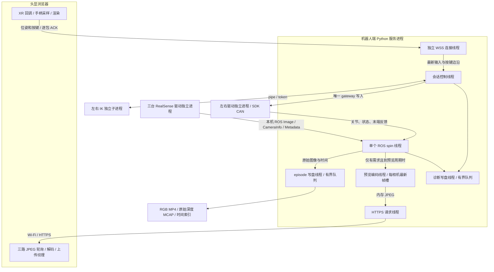

# 通信、进程与性能定位

2026-10-24更新：用户批准S0/S2，暂缓S1。现有采集已经是机器人端状态机；不需要再增加命令体系。通俗流程、QuestArm差异和最小WebRTC改动见[本轮说明](webxr-workflow-and-transport.md)。以下10月23日“待审核”段落为历史提案，不能覆盖最新决定。

2026-10-23待审核增量：[TCP/UDP逐段选择与改进审核稿](transport-review.md)、[计划021](../plans/021-transport-semantics-and-live-validation.md)。用户要求审核通过后再执行；下面020是已完成证据，021的语义拆分、异步WSS/WebRTC与新真机A/B尚未实施。

2026-10-23，计划020。本文对照本地 `relevant-repo/questarm-real-robot-deployment` 源码；描述的是这份快照，不代表上游最新版本或已在同一硬件上完成性能对比。用户今天报告 Quest 3 可以正常操作；此前独立现场证据主要来自 PICO。两者的时延/稳定性不能直接互相继承。

## 当前链路与线程



| 进程               | 应用显式线程/任务                                                                                         | 共享与阻塞点                                           |
| ---------------- | ------------------------------------------------------------------------------------------------- | ------------------------------------------------ |
| 启动器              | 主线程管理子进程                                                                                          | 自检/日志/退出；不是控制循环                                  |
| 左右 Piper 驱动各一进程  | ROS 回调、约5ms等待的反馈发布循环、SDK 自身接收线程                                                                   | 约200Hz是循环目标，不是实测新反馈或底层伺服率                        |
| 三个相机驱动进程         | ROS/SDK 自身线程                                                                                      | USB/驱动→DDS，订阅使用 sensor-data QoS；回调前丢失不进入writer计数 |
| Python 服务        | ROS spin；teleop-control；watchdog；preview-encoder；episode-disk-writer；diagnostic-writer；HTTP/WSS线程 | 仍共享 GIL、CPU、内存和部分锁；有线程不等于有资源隔离                   |
| 左右 SolverProcess | 每臂一进程，pipe传目标与结果                                                                                  | 最新未发目标替换，token拒绝旧结果；结果由控制线程轮询                    |
| 浏览器              | XR动画回调、异步fetch/解码、状态轮询、WSS事件                                                                      | 异步任务不代表各自独占CPU线程；GPU/浏览器内部调度未直接测量                |

`TeleopSession.start()` 当前是 tick 后等待 `1/control_hz`，实际周期包含工作耗时与调度等待，不能把配置60Hz当实际60Hz。020只增加测量，没有改变控制调度、ACK策略、位置映射、夹爪或物理gateway。

## 与 QuestArm 的具体区别

QuestArm存在两条输入路径，不能混为一谈：

- `oculus_reader.py`：Android APK / ADB 路径，独立读取线程维护最新手柄数据。
- 当前对照重点是 WebXR 路径：Cambot 网页→WebSocket→Cambot服务→本机newline JSON socket→WebXRPiperBridge→ROS位姿/按钮→每臂delta节点→每臂IK节点→驱动。

| 环节 | 本项目018与020保留的主链 | QuestArm本地WebXR源码 | 借鉴与边界 |
|---|---|---|---|
| 浏览器位姿发送 | 约33ms采样门限；一个输入请求在途，等ACK后继续 | 8ms门限调用`ws.send`，无逐位姿业务ACK等待 | 借鉴连续样本与状态命令不同策略；120Hz门限不是实测120Hz，也不能照搬后放任TCP队列增长 |
| 本机输入桥接 | WSS线程交给同进程session | bridge有accept/连接线程、锁内最新值缓存；ROS timer默认100Hz，姿态有效期0.30s | 接收与消费解耦；timer能重复发布最新姿态，不会凭空增加新的输入信息 |
| 映射/IK | session中映射、每臂独立IK进程 | launch把左右delta与左右IK各自作为Node进程启动 | 借鉴进程职责拆分；不能复制坐标/TCP/缩放假设。我们已有IK进程隔离，不是所有计算都堆在服务线程 |
| episode协调 | session与recorder同服务进程 | 独立episode_coordinator节点，3线程executor和服务ack | 协调不承担图像编码，适合后续独立编排模块 |
| 机器人状态记录 | 独立写线程但同服务进程；MCAP与图像共用episode队列 | 独立piper_episode_recorder节点，20,000项队列与JSONL writer线程 | 进程隔离值得借鉴；其队列满也可能丢样本，生命周期事件可等1s，不能认定完全无阻塞 |
| RGB-D记录 | ROS接收→独立writer；3 RGB MP4＋仅固定深度原值MCAP | Cambot capture线程→episode writer；MP4、depth PNG等，图像执行器辅助写入 | 借鉴采集/编码/落盘职责；它某些视频队列满时丢旧帧，我们原始采集不能把这种预览策略直接搬过来 |
| 视频传输 | 独立控制WSS＋HTTPS JPEG轮询；8fps，拥塞时2fps | WebRTC可用时H.264优先/VP8备选；另有WS JPEG fallback，最新帧、发送耗时/RTT背压与序号时间 | 视频需单独演进；不能仅以多线程或换头显代替低延迟媒体通道。QuestArm也有降速/丢预览帧策略 |
| 通用性 | 驱动、输入、gateway、记录与policy边界保留 | 实用流程有较多设备/场景绑定 | 借鉴机制，不直接引入其硬件名、话题、坐标或auto-enable默认行为 |

源码入口：

- 本项目：[live_teleop](../src/robot_infra/live_teleop.py)、[session](../src/robot_infra/teleop_session.py)、[solver](../src/robot_infra/solver_worker.py)、[记录器](../src/robot_infra/real_episode.py)、[浏览器输入](../src/robot_infra/web/xr-transport.js)。
- QuestArm：[双臂WebXR launch](../relevant-repo/questarm-real-robot-deployment/ros2_ws/src/oculus_reader/launch/teleop_double_piper_webxr.launch.py)、[输入桥](../relevant-repo/questarm-real-robot-deployment/ros2_ws/src/oculus_reader/scripts/webxr_piper_bridge.py)、[协调器](../relevant-repo/questarm-real-robot-deployment/ros2_ws/src/oculus_reader/scripts/episode_coordinator.py)、[状态记录](../relevant-repo/questarm-real-robot-deployment/ros2_ws/src/oculus_reader/scripts/piper_episode_recorder.py)、[网页](../relevant-repo/questarm-real-robot-deployment/python/cambot/cambot/teleop/client/index.html)、[视频发送](../relevant-repo/questarm-real-robot-deployment/python/cambot/cambot/teleop/server.py)、[WebRTC](../relevant-repo/questarm-real-robot-deployment/python/cambot/cambot/teleop/webrtc.py)、[采集写入](../relevant-repo/questarm-real-robot-deployment/python/cambot/cambot/teleop/capture.py)。参考仓库被Git忽略，其他机器阅读这些链接前需准备同一快照。

## 020已经实现的定位与隔离

新增 [CameraIngress](../src/robot_infra/camera_ingress.py)、[PreviewWorker](../src/robot_infra/preview.py)、[Performance](../src/robot_infra/performance.py)；正式服务和相机独立诊断复用相同图像接收、记录与预览组件。

- 原始记录独立于预览需求，关闭页面预览不停止 RGB-D 记录。
- 每相机只有一个待编码最新帧，慢预览替换预览旧帧，不影响原始记录队列；不建立无界预览积压。
- 默认无人请求时不编码JPEG；HTTP请求续租预览需求。第一次请求可能503，下一次轮询可拿到新帧。关闭预览/离开页面后，租约到期停止编码。
- 默认不归档JPEG；显式`archive_jpeg=true`才保存侧车与对应诊断事件。原始输入、意图、命令、反馈、停止、episode与深度数据保留原有路径，不减少必要证据。
- 自检改为检查原始相机接收是否新鲜，不再依赖有人打开网页、是否编码出了预览。预览错误单独暴露为健康状态，原始ROS或记录错误仍走既有停止/失败路径。
- 指标有固定序列数与每序列窗口上限。长期保留count/mean/max；p50/p95仅代表最近窗口，不能当整集分位数。

会话配置可增加：

```json
{
  "performance": {"enabled": true, "window_samples": 512, "max_series": 128},
  "preview_runtime": {"enabled": true, "on_demand": true, "lease_s": 2.0, "archive_jpeg": false},
  "camera_transport": {"image_reliability": "best_effort", "image_queue_depth": 5}
}
```

缺省值就是上述配置。`enabled=false`是完全关闭预览；`on_demand=false`用于固定编码负载对照。两者都不改变相机capture/record分辨率、fps、深度或QC阈值。旧real-episode/1与/2及输入协议不变；新性能输出是独立`performance-snapshot/1`，不作为训练数据或控制条件。

`camera_transport`只配置Image订阅，默认保留既有best-effort、深度5；CameraInfo/Metadata保持sensor-data QoS。可显式选择`reliable`与1–128的队列深度，但必须先确认发布端支持RELIABLE。可靠传输也可能带来重传/缓存时延，不能只看是否缺帧；本轮正式部署文件未自动改为RELIABLE。

## 看什么指标

打开`https://机器人地址:8445/api/performance`，或退出后读取run/episode下的`performance.json`。相机诊断汇总在其输出目录`result.json`。

| 指标前缀 | 范围 / 单位 | 不能据此断言 |
|---|---|---|
| `camera.source_gap.角色.流` | 相邻收到图像ROS header源时间差，ms | 中间帧未曝光；需要设备frame_counter/metadata才能区分 |
| `camera.receive_gap.角色.流` | 主机回调入口相邻时间差，ms | USB或DDS中哪一环丢帧 |
| `camera.callback.角色.流` | 回调入口至复制/入队/预览offer结束，ms | executor调度前等待；序列化与到回调前传输耗时 |
| `record.queue.角色.流` / `.event` | 入记录队列至worker取出后，ms | 存储介质单独时延 |
| `record.write.角色.流` / `.event` | writer处理该项，包括编码/MCAP/index，ms | GPU编码或磁盘flush的单独耗时 |
| `preview.queue/encode/archive/receive_to_publish.角色` | 预览各段host单调时钟耗时，ms | 曝光到眼睛的端到端时延 |
| `preview.http_write.角色` | HTTP响应头/本机write耗时，ms | 头显已经收到/显示；socket write可能先进入缓冲 |
| `control.tick_interval` / `control.tick_work` | 控制线程实际周期与工作时长，ms | 硬件伺服频率 |

图像响应增加`X-Frame-Sequence`、`X-Capture-Sequence`及`X-Frame-Age-Ms`；网页把它们带回输入诊断。Age是服务端发送前计算的接收帧年龄，不与浏览器时钟相减，不宣称测到了单向网络时延。

## 无机械臂的可复现对照

在独立候选源码的`src`优先加入PYTHONPATH，并source部署文件指定的ROS环境后：

```bash
python3 -m robot_infra.camera_benchmark \
  --deployment "$HOME/robot-infra/profiles/formal-018/deployment.json" \
  --output "$HOME/robot-infra/runs/my-camera-off-test" \
  --duration 60 --preview-mode off
```

每次必须用新的output目录，禁止覆盖旧诊断。依次比较`off`、`encode`、`archive`，再反序重复；三路RGB MP4和头部原始depth配置保持一致。结果同时报告QC、队列、时间、进程CPU时间和子进程退出；CPU百分比用`process_cpu_s / recording_wall_s × 100`，以单核100%为基准，不含独立相机驱动进程。

`--image-reliability reliable --image-queue-depth 5`用于仅改变订阅方式的对照；结果保存实际RMW和图像publisher QoS。它不写相机参数，不自动改变机器人端正式session配置。

加`--serve --preview-mode demand`可在原网页测试头显连接/图像。这个入口只构造相机与输入回显，**没有机械臂模型、Piper驱动、控制发布器或物理执行后端**；A/侧握/扳机也不会驱动机械臂。相机运行期间不要再启动正式collect与其他相机服务。输出是诊断任务，不能混进fill_pen_holder训练示范。

测试结果、候选部署和尚未完成的范围见[020验证记录](validation/2026-10-23-communication-performance.md)。当前框架仍不是任意图解释器；本轮通过可替换组件和显式测试入口实现隔离，没有把全部原型改造成分布式系统。

## 不接设备的网络对照与离线缺帧审计

[profile_input_transport.py](../tools/profile_input_transport.py)使用生产WSS listener与假回显，提供server/client两种模式。例：先在机器人用诊断证书启动限时server，再在机器人回环与开发机运行相同client。客户端`--cert`需要信任的公钥证书，私钥只在server；`--origin`应匹配同一主机及web-port。不要把此回显端口同时用于真实控制。

```bash
python3 tools/profile_input_transport.py server --cert /path/to/diagnostic-cert.pem \
  --key /path/to/diagnostic-key.pem --duration 120 --output /new/path/server.json
python3 tools/profile_input_transport.py client --cert /path/to/diagnostic-cert.pem \
  --url wss://127.0.0.1:8446/input --origin https://127.0.0.1:8445 \
  --duration 30 --output /new/path/loopback.json
```

这不是实际控制闭环基准；它隔离图像、模型与ROS负载，保留TLS/WSS、ACK和网络往返。`camera_benchmark --serve`也能配合同一client，比较图像负载下的同进程回显。目标30Hz但逐包等ACK，实际完成率可能更低。

[audit_camera_delivery.py](../tools/audit_camera_delivery.py)离线流式读取完成episode的index与MCAP元数据，输出大间隔两端及内部设备帧号证据，有最大gap/metadata样本上限，不修改原数据或QC。保留可用的meta clock_domain，检查capture/record帧率与writer计数；元数据存在只能证明驱动观测到相应帧，不能证明ROS Image已成功发布。

```bash
python3 tools/audit_camera_delivery.py --episode /path/to/completed/episode \
  --gap-ms 150 --output /new/path/camera-delivery.json
```
