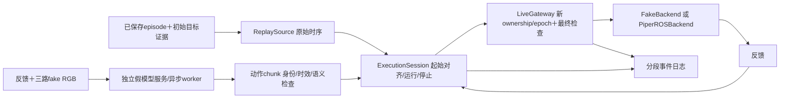

# 轨迹回放与假模型操作手册

2026-10-20，计划014。物理验证结果以[验证记录](validation/2026-10-20-replay-and-mock.md)为准。只读旧命令`replay`、`trajectory-check`保持不变；新命令`workflow-run`才是执行session。

## 1. 共同的数据流



本轮绑定native joint_absolute子集：不调用VR映射/IK，不把旧lease、绝对单调时钟或ROS消息字节原封不动重发。采集入口没有改变。`experiment-graph/1`仍是逻辑图模板，`workflow-session/1`指定本轮可运行绑定；这不是任意节点图解释器。物理回放只启动双臂驱动，**不启动相机**；假模型只允许fake设备，尚未接真相机/真实模型。当前model/base/tip/关节顺序与源不一致会拒绝，不自动跨机器人映射。

## 2. 真机回放

先准备`configs/workflows/a4s-replay.example.json`的台架副本，设置episode、training_config、journals、graph路径；相对路径均以该配置文件目录解析。使用当前设备的deployment加载驱动、CAN、ROS域与模型；命令中的`--deployment`是必填。不要直接运行仍含占位路径的模板。

```bash
~/robot-infra/bin/robot-infra workflow-run /absolute/path/to/replay.json \
  --deployment ~/robot-infra/deployment.json \
  --output ~/robot-infra/runs/replay-check --check-only

~/robot-infra/bin/robot-infra workflow-run /absolute/path/to/replay.json \
  --deployment ~/robot-infra/deployment.json \
  --output ~/robot-infra/runs/replay-unique-name --execute
```

输出目录必须是新目录，且不在原episode里面。`--check-only`不构建ROS/SDK/驱动、不使能；没有`--execute`不会执行物理回放。预检核对saved/QC、MCAP hash、完整具名端点、模型hash/base/tip/关节顺序及整个片段目标范围，不靠向量长度猜语义。

流程：自检/等待双臂新鲜反馈和唯一驱动订阅 → 申请新控制权 → 用配置的时长平滑移动到片段起始关节目标（**此时夹爪不动**）→ 反馈到位并稳定 → 按片段时序播放关节/夹爪目标 → 完成后保持新鲜实测关节位置并退出。回放开始时会恢复该片段的已知夹爪目标，可能开/闭；现场确认夹爪内物体、双臂工作空间与起始对齐路径。Ctrl+C停止本次session并清理本次子进程，不自动回home、不下电、不额外闭夹爪。实体急停仍由现场操作者掌握。

| 配置 | 含义 |
|---|---|
| source.start_s / duration_s | 原episode中显式选取的片段，不能超出结束时间 |
| source.speed | 播放时钟倍率，1原速，0.5半速；明确记录，不改变保存的原始数据 |
| source.journals | 按时间排序的前序session日志分段，用于补全已确认的初始目标 |
| source.max_lag_s | 迟到/控制循环停顿容限；超出即停止，禁止突发追赶 |
| execution.control_hz | 本地目标更新率，与相机/模型/硬件伺服频率区分 |
| execution.alignment_* | 起始对齐时长、反馈到位容差、稳定时间和总超时 |
| execution.max_tick_gap_s | 本地执行线程最长允许间隔；本机watchdog另独立运行 |

绝对目标采用零阶保持，每个控制tick最多下发每侧一组最新目标；同一tick间的源更新合并，`source_progress`保留其证据。稀疏夹爪延续已确认目标；找不到初始目标必须提供前序日志或改选有证据的片段，不用当前反馈冒充旧action。重跑应从新session重新对齐，不支持暂停后直接补发积压动作。

## 3. 假模型推理

先跑无网络的基础链：

```bash
robot-infra workflow-run configs/workflows/mock-inference.example.json \
  --output runs/mock-unique-name
```

再在终端1启动独立模型进程，终端2运行客户端；使用已安装包的Python环境，或在机器人端设置`PYTHONPATH=~/robot-infra/current/src`：

```bash
python3 -m robot_infra.mock_policy_server \
  --workflow configs/workflows/mock-inference-http.example.json \
  --host 127.0.0.1 --port 29057

robot-infra workflow-run configs/workflows/mock-inference-http.example.json \
  --output runs/mock-http-unique-name
```

HTTP endpoint在source.transport中配置。服务仅为CPU mock，不是ZeroWAM兼容协议；可用它验证分进程传输和超时，不代表已连GPU服务器。默认监听localhost，客户端与服务端使用相同mock配置/模型语义。

输入是实际生成的三路48×64×3 RGB字节和FakeBackend的测量反馈，HTTP中RGB用base64；输出是具名双臂绝对关节rad与夹爪m目标。mock只对首关节生成可预测的小正弦变化，夹爪保持明确的初始目标；不下载权重。policy-chunk/1包含request_id、epoch、observation_ns、action_encoding、action_spec（关节名字、base/tip、单位）、带本地session相对时刻的actions及输入图像hash。

单个后台请求最多在途一个；本地执行不等待HTTP。请求deadline、观测年龄、动作间隔、预取窗口、lead、action_dt、chunk长度、delay与幅度均配置化。新chunk只替换尚未执行的未来后缀；旧request/epoch、过期观测、已过执行时刻、错单位/关节顺序、空chunk、无效数值、网络/模型异常均拒绝。队列耗尽停止，不无限持有最后一个预测，不假装模型会自动续上。

可将delay_s设为大于deadline_s或fail_request设为正整数做故障实验；成功终点应为FAULT且撤销控制权，CLI返回非零。mock_policy不允许绑定piper_ros，真实策略需要后续明确的模型adapter和现场准入。

## 4. 结果与证据

每次输出包含workflow.json、effective-profile.json、preflight.json、events/events*.jsonl及journal-summary.json、result.json。真机另有左右driver日志和processes.json。日志区分policy_request/policy_prediction、source_progress、最终guard/command/receipt、反馈与workflow_state；ROS receipt仍是published_not_acknowledged，不把发布当成硬件执行成功。

正常完成应为COMPLETED、cleanup_errors为空，事件中有RUNNING→COMPLETED，driver正常退出。真机是否确实跟随需结合反馈与现场观察。原始episode及其QC、未完成第三条均不改写；本轮事件运行记录不冒充新的相机采集episode。

当前台架已准备本轮配置`~/robot-infra/profiles/replay.validation014.json`，源为new_test第二集前3秒；部署和模型配置使用`~/robot-infra/deployment.json`。本次已现场验证，完整日志位于`~/robot-infra/runs/replay-014-physical-01`。重跑请使用新output目录，按上方命令先check-only，再在现场明确安排execute。COMPLETED表示源时间窗结束并停止更新目标，不保证截点已精确达到最后目标；20%驱动速度下的瞬时跟踪差见验证记录。
