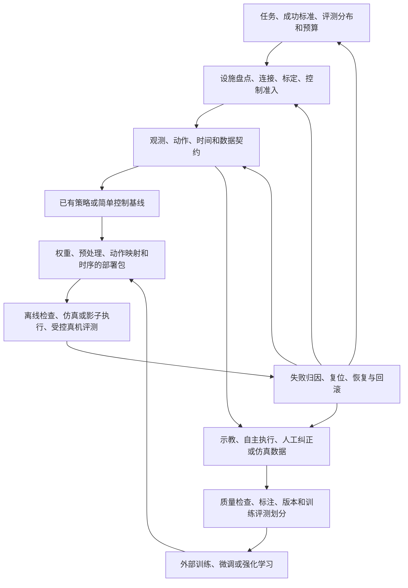

# 真机具身智能工作流与项目定位核验

调研日期：2026-10-11。结论基于公开论文、作者仓库和官方文档，不代表对所有企业内部流程的调查。上游 main 文档会变化；下列日期是访问日期，不是能力发布或本项目验证日期。本仓库仍只有设计文档，没有经过验证的实现。

## 1. 对用户工作流的评价

硬件搭建 → 连接/标定 → 采集设施 → 采集 → 训练 → 推理设施 → 部署/评测 → 再采集，是正确且仍然实用的真机示教学习主线。它已经包含多数入门示例忽略的软硬件准备，没有落后于现有公开工作流。

需要提升的主要是流程的分支、质量门槛和反馈依据。硬件/运行设施属于可复用底座，通常不必每轮重建；训练也可能从预训练策略适配开始，或先部署已有模型获得基线。推理所需的观测、动作和时序约束必须在采集前定义，避免采完才发现数据与模型不匹配。

### 一手证据与架构含义

| 公开方案 | 实际展示的路径 | 对我们的启示与证据边界 |
|---|---|---|
| [LeRobot 总览](https://huggingface.co/docs/lerobot/index)及[真机教程](https://huggingface.co/docs/lerobot/main/il_robots) | 遥操、记录、训练、部署；校准为前置步骤，训练数据和策略接入已有生态 | 用户主线成立；这些步骤已有成熟入口，重新包装同一链路本身不足以形成优势。教程适用支持的设备，不能外推全部机器人。 |
| [DROID 数采工作流](https://droid-dataset.github.io/droid/example-workflows/data-collection.html) | 相机标定、场景/任务配置、演练、采集、复位；改变相机位置需重新标定 | 设施搭建后仍需运行质量检查，场景变化要触发校准失效判断。DROID 固定平台经验不等同于异构系统即插即用。 |
| [openpi](https://github.com/Physical-Intelligence/openpi) | 预训练权重、自有数据适配、归一化、训练/推理输入输出映射、独立策略服务器 | 学习不必从零开始；权重只是部署资产的一部分。README 声明测试 Ubuntu 22.04，跨系统需要我们自己的设备/策略边界及证据。 |
| [HIL-SERL](https://github.com/rail-berkeley/hil-serl) | 示范与人工纠正、奖励分类器、真机 RL；actor/learner 异步交换数据与权重 | 推理期间的接管与成功/失败标签可能成为下一轮学习输入；我们的职责可止于安全接管和数据契约，RL 训练仍外接。 |
| [PI 的 RECAP / π*0.6 论文](https://arxiv.org/abs/2511.14759) | 将示范、自主执行数据和专家干预结合，通过强化学习提升 VLA | 再采集应包含真实部署的失败、纠正和结果信息，而非只有更多成功示教；这是一条公开前沿路线，不能据此说所有任务都必须 RL。 |
| [Isaac Lab 齿轮装配训练及 ROS 部署](https://isaac-sim.github.io/IsaacLab/main/source/policy_deployment/02_gear_assembly/gear_assembly_policy.html) | 仿真任务/接触/执行器建模、随机化、训练、真机部署；动作空间需匹配控制器 | 另一条主线为仿真学习后迁移，真机观测仍可反向改进仿真。统一设备 API 不消除接触、控制器、视觉和延迟差异。 |
| [PhyAgentOS-core README](https://github.com/PhyAgentOS/PhyAgentOS-core) | 规划、物理执行、任务验证与经验反馈；环境能力由 Skill Runtime 提供 | 任务级经验更新也是反馈环，但不能等同于策略权重训练。我们可作为底层实验执行/证据服务。README 标明 v1.1.0（2026-10-09）；并非已在本实验室运行。 |

PI 官网博客/PDF直读返回403，RECAP结论改由作者 arXiv 论文核对。未构建、运行或全面代码审计上述项目。PhyAgentOS 框架介绍页仍标1.0.0，不能混用为统一版本的全部能力证据；旧架构 §11 保留历史比较，本次依据 README 更新定位，而不搬用其榜单数值。

## 2. 更完整的实验闭环

下面是针对实验室的综合设计建议，不是某篇论文规定的标准流程。

需要明确补足的环节：

1. **先定义实验，再采购或改造设施。** 固定任务、物体/场景范围、成功判定、时间限制、干预规则与复位方法。明确评测的是控制链、数据质量还是策略能力。
2. **采集前对齐训练与部署。** 相机角色/内外参、图像预处理、关节顺序、动作相对/绝对含义、坐标系、控制频率及延迟预算必须匹配。换相机位置或夹爪可能影响模型输入和动作，不能只改设备名称。
3. **从“录到数据”升级为“可用且可追溯的数据”。** 检查掉帧/观测年龄、跨时钟对齐质量、饱和/拒绝动作、人工接管、标注可信度；保留原始证据而非只保留训练张量。训练/评测按episode、场景或任务分开，不能把同一轨迹相邻帧随机分到两边。
4. **区分学习路径。** 从零模仿、预训练 VLA 适配、仿真 RL、真机 HIL/RL 都可产生策略资产，不要求用户先自建训练平台。奖励学习/自动标注是可选上游组件。
5. **部署需要逐步放行。** 资产和契约检查 → 离线输入输出测试 → 仿真或影子运行 → 明确授权的受控真机评测。离线回放能查语义/时间问题，不能证明闭环任务成功；仿真通过也不能替代真机验证。
6. **评测必须可比较。** 记录策略/数据/配置/标定版本、初态、场景、运行次数、成功判定、超时、中止、人工干预及复位成本。策略独立成功率与有人辅助的成功率分开统计。
7. **再采集由失败归因驱动。** 断网、坐标错误、动作过期、控制器饱和、视觉偏差和策略缺失需要不同修复。证据不足可标“待诊断”，不自动把所有失败送进训练。
8. **把维护与复位纳入效率。** 布线/USB/CAN、固件与OS依赖、存储吞吐、场景复位、校准有效性、人工接管和回滚影响实际吞吐。停止后的恢复可能需要用户确认现场状态，不能用自动重试替代。

部署设施应在早期确定可行配置，然后跨迭代复用。模型升级、环境变化和故障可返回契约/设施层，而不只返回数据层。

## 3. 当前设计覆盖审计

下表的“覆盖”均指文档覆盖，绝不是实现完成度。

| 环节 | v0.4设计覆盖 | 潜在效率收益 | 仍需补足/外部承担 |
|---|---|---|---|
| 任务与评测定义 | 较弱：§8有场景、任务候选与阶段门槛 | 可共用实验协议 | 固定成功规则、初态、分布、超时、接管和复位 |
| 硬件制作/装配 | 外部：§9资产审计、§8验收组合 | 清单和安装指南可减少遗漏 | 机械设计、电气安装、现场检查；软件无法自动完成 |
| 连接、标定、校准 | 部分：manifest/probe、frame图、标定元数据 | 更早发现设备/语义/依赖不匹配 | 专用标定算法、残差验证、有效期/失效条件 |
| 采集设施与采集 | 核心：输入/映射/执行分离，session、MCAP、时间戳、接管 | 一条链复用为遥操、录像、纠正 | 数采质量门槛、标签、导出验证仍待实现 |
| 数据处理与训练交接 | 部分：MCAP→LeRobot、episode manifest | 减少反复写转换脚本 | QC报告、划分、谱系；标注平台和数据仓库外接 |
| 训练/微调/RL | 外接：策略与数据适配 | 硬件依赖与训练依赖分离 | LeRobot/openpi/HIL-SERL等训练器、算力与模型研究 |
| 推理设施与部署 | 核心：§12/13资产、主机、调度、运动profile、guard | 更换策略无需重写设备控制；减少依赖冲突 | 首策略适配、锁版本、端到端延迟和真机证据 |
| 评测、诊断与再采集 | 部分：回放/安全事件/原始证据已有设计，统计较弱 | 可归因和复现，减少盲目重采 | EvalSpec/RunReport、失败标签与复位记录；任务判定插件 |

最重要的范围补足是**薄的实验协议和运行报告层**。它把已有记录/部署接成可比较的闭环，不要求扩建训练、标注或智能体平台。字段建议见[定位与验证协议](../positioning.md)。首切片仍为 fake 控制、仲裁、记录/回放及策略stub，后续逐步加入这些字段。

## 4. 类似方案已经提供什么

| 方案 | 现有公开价值 | 我们应复用/比较的范围 |
|---|---|---|
| LeRobot / [LeLab](https://huggingface.co/docs/lerobot/main/lelab) | 数据、策略、硬件接口与采集训练部署；LeLab图形界面含校准、采集、本地/云训练及部署，文档当前限定SO-ARM101 | GUI、插件、快速开始和“一条龙”并非独有。匹配其支持硬件时应与官方最短路径比较，并优先复用训练/数据能力。main文档不等于稳定版承诺。 |
| DROID | 可复现的平台建设与采集工作流、校准、GUI | 验证过的参考组合和操作手册价值很高；我们希望将组合范围扩至实验室异构设备。 |
| ROS/厂商SDK组合 | 通信、驱动和运动控制已有底座 | 围绕底座减少实验层反复集成；需对比实验室现有最佳脚本，而非人为笨重流程。 |
| openpi / HIL-SERL | 策略学习及部署/分布式学习已有实现 | 外部学习系统应通过明确适配器使用我们的运行设施；不能假定上游直接驱动路径已遵守本项目guard。 |
| Isaac Lab | 仿真任务、训练与真机迁移路线 | 复用其学习/仿真成果，不承诺自动生成高保真数字孪生。 |
| PhyAgentOS | 规划、执行Skill、验证、经验循环及版本化运行包 | 图、运行包、恢复和证据理念都有重叠；我们的候选价值在实验设备/数据/时序的细粒度组合与真机验证，不能声称对方没有机器人接入能力。 |

没有直接运行对照，因此不能认定我们已经胜过任何方案。也不能把上游公开列表的缺项当作其根本不支持某类设备的证据。

## 5. 定位结论

建议目标用户为**已有或正在建设多种实验台、需要反复切换机器人/输入/相机/策略的实验室研究者**。单一成熟设备只做一次标准任务时，官方脚本或LeRobot可能更省事。真正痛点是组合变化后的集成、语义一致性、可追溯性和诊断，而不只是首个电机运动。

候选核心优势：经过验证的参考组合；跨OS主机边界；可组合但显式的观测/动作/时间契约；同一session采集、推理、接管、回放、评测；故障证据和迁移差异可定位。这些都是待实现和实验验证的价值假设。

复用分层：软件API/实验流程 → 配置和资产 → 数据与动作语义 → 模型权重/任务表现。越向后条件越强。FR3换Piper可能保留session/录像/评测脚本，但自由度、夹爪、动作空间和视觉分布均需重新检查。场景迁移也要区分换主机、换机器人、移动相机/物体和换任务，不能统称“一键迁移”。

“面对各种机器人系统，10分钟/半小时跑通控制链路，让用户专注智能设计”方向合理，但无条件的时间和机器人范围过宽。更稳妥的表达为：

> 面向异构机器人实验台的采集与推理运行基础设施，让研究者复用经过验证的设备组合，快速建立可观测、可接管、可复现的实验链路，把更多时间用于策略与任务设计。

“10分钟/半小时”留作限定前提的验收目标。它们不意味着拆箱装配、未知驱动适配、训练或任务成功也能在该时间完成。具体计时和比较方法见[定位与验证协议](../positioning.md)。
