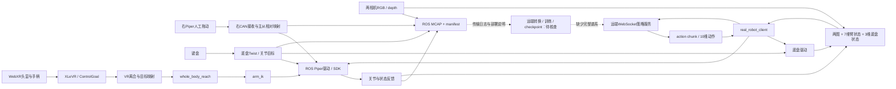
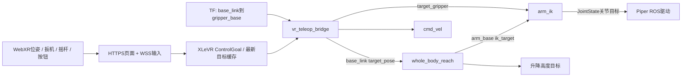
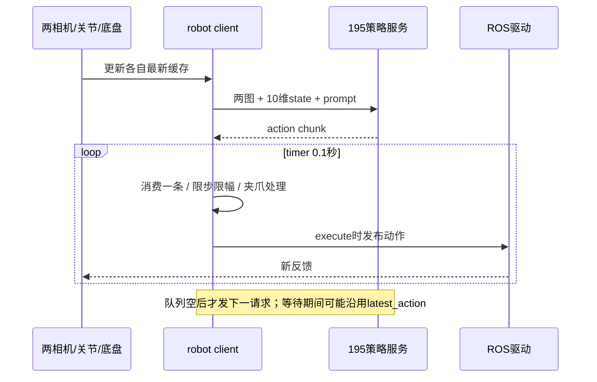

# ranger-piper既有遥操、采集与推理工作流研究

审查日期：2026-10-16。对象：机器人主机ranger-piper，Ubuntu24.04.4 / ROS Jazzy / Python3.12.3。作者依据本次只读SSH获取的源码、安装副本、历史日志、数据清单和一次离线bag读取作判断。相关[实施计划005](../../plans/005-existing-robot-workflow-research.md)、[工程位置索引](../remote-code-index.md)。

## 1. 结论：已有实验原型和真实使用记录，完整学习闭环仍缺证据

**这套系统值得成为优先参考。它已经超出“零散代码尚未使用”的阶段，存在遥操采集和策略EXEC执行的历史证据；但还不能认定已有可复现、可追溯且任务效果经过评测的完整学习闭环。**

后续用户转述原负责人反馈：最早有双臂VR，但效果不好、IK不佳，建议改为主从。这补充了历史使用经验，不等于本次定位了IK根因。用户仍确认优先双臂VR，由本框架提供映射/IK、复用已有驱动，见[当前graph](../a4s-graph.md)；不要将“历史运行过”误写为“效果已验证良好”。

需要把几种“闭环”分开判断：

| 闭环或阶段 | 本次取得的证据 | 判断 |
|---|---|---|
| 人操纵机器人→观测→继续操纵 | 主从桥源码；历史MCAP中变化的右臂输入、左臂目标/反馈、底盘指令和两路图像消息 | 主从+底盘数采有很强历史证据；本次仅离线检查，未重新驱动机器人 |
| VR→映射→IK→驱动 | 完整调用链；旧vr/wbr/ik日志有右手离合、目标接收和关节解更新 | 曾运行过右侧VR/IK链；缺同次物理反馈/任务结果，不能升级为双臂VR验收通过 |
| 观测→远程策略→动作发布→下一轮观测 | real_robot_client源码；至少30份历史日志含EXEC action | 策略执行分支确实使用过；未证明当前源码版本、具体权重或每条动作实际执行结果 |
| 采集→转换→训练→同一模型部署 | 原始数据、传输日志、远端训练/部署路径说明 | 有跨机流程线索，训练侧代码、数据转换与模型谱系未检查 |
| 推理评测→失败归因→定向补采→再训练 | 未找到可关联的Eval/成功率/干预/补采记录 | 未证实 |

最准确的定位是：**实验室已有一套面向“左Piper+移动底盘+两相机”的集成原型，另有VR/双臂控制代码；我们的A4-S是“双臂均执行+三相机+PICO”的另一份组合，不能直接继承旧原型的通过状态。**

本报告中的“历史证据”不等于本项目已独立复现。此次没有启动旧bringup、VR桥、recorder、replay或策略客户端，没有连接195策略服务，也没有查询/使能/移动任何执行器。

## 2. 系统实际上由哪些工程构成

下面路径全部是**机器人端绝对路径**，不是本地同名参考仓库。`ros2 run/launch`消费install目录中的内容；直接python执行src文件则消费源码。本次抽查的六份关键安装文件与源码SHA256一致，见附录。

| 文件或目录 | 功能 | 输入→输出 | 使用入口/注意点 |
|---|---|---|---|
| `/home/ros/ros2_ws/src/mm_bringup/launch/bringup.launch.py` | 组合底盘、升降、双臂驱动、TF和关节聚合 | CAN/串口反馈→ROS；ROS命令→设备 | `ros2 launch mm_bringup bringup.launch.py`；默认启用底盘、升降和双臂，auto_enable=false不代表SDK不发送查询 |
| `/home/ros/ros2_ws/src/piper_ros/src/piper/piper/piper_ctrl_single_node.py` | ROS与Piper SDK之间的实际驱动 | JointState/enable/PosCmd→SDK/CAN；SDK→关节/状态/末端反馈 | bringup以left_arm/right_arm namespace启动；是动作落到硬件的边界 |
| `/home/ros/piper_sdk` | Piper CAN协议与接口库 | SDK调用↔CAN帧 | 已审版本0.6.1；构造/connect可能打开CAN并发初始化/查询，不能当纯被动枚举 |
| `/home/ros/ranger_air/src/ranger_ros2` | 移动底盘驱动 | `/cmd_vel`→底盘；轮速/里程计→ROS | 由agx_bringup启动；不属于当前静态A4-S必需组件 |
| `/home/ros/ros2_ws/src/mm_bringup/launch/cameras.launch.py` | 启动RealSense | USB→RGB/depth/CameraInfo | `ros2 launch mm_bringup cameras.launch.py`；默认top+left_wrist，第三路需参数开启，当前物理角色与命名有差异 |
| `/home/ros/ros2_ws/src/mm_bringup/mm_bringup/mm_teleop_keyboard.py` | 键盘控制底盘、升降、选定机械臂/夹爪 | 按键→Twist/高度/JointState/enable | `ros2 run mm_bringup mm_teleop`；主从采集时主要用它控制底盘，不能同时手动覆盖执行臂 |
| `/home/ros/XLeRobot/XLeVR/vr_monitor.py`、`xlevr/inputs/vr_ws_server.py`、`web-ui/index.html` | 原生WebXR页面、HTTPS/WSS、输入解析及最新目标缓存 | 浏览器位姿/按钮→ControlGoal | VR桥内部创建VRMonitor；不是必须再手动启动一份monitor；旧配置为HTTPS8443/WSS8442 |
| `/home/ros/ros2_ws/src/mm_bringup/mm_bringup/vr_teleop_bridge.py` | VR控制语义：离合、相对位置、腕部角度、夹爪、底盘 | ControlGoal+TF→target_pose/target_gripper/ik_home/cmd_vel | `ros2 run mm_bringup vr_teleop_bridge`；默认仅right，sides可配置 |
| `/home/ros/ros2_ws/src/mm_bringup/mm_bringup/whole_body_reach.py` | 整机几何分配：目标转到臂底座，必要时调整升降 | base_link目标+高度→ik_target+升降目标 | `ros2 run mm_bringup whole_body_reach`；不是通用全局规划器，含实验台尺寸假设 |
| `/home/ros/ros2_ws/src/mm_bringup/mm_bringup/arm_ik_node.py` | Pinocchio微分IK、位置优先/姿态次任务、关节限幅 | ik_target+关节反馈→joint_ctrl_single | `ros2 run mm_bringup arm_ik`；默认right、auto_enable=true；URDF绝对路径固定 |
| `/home/ros/ros2_ws/src/mm_bringup/scripts/right_to_left_master_bridge.py` | 右Piper作人工输入、左Piper执行跟随 | can2原始反馈+左反馈→左命令+master输入topic | 由recorder的--master-slave启动；右臂不再是独立任务执行器 |
| `/home/ros/ros2_ws/src/mm_bringup/scripts/ros_episode_recorder.py` | episode目录、清单、rosbag2 MCAP及可选示教/主从生命周期 | ROS话题→metadata.json+rosbag | 不只是录像器：特定参数会切示教模式并启动使能/控制桥 |
| `/home/ros/ros2_ws/src/mm_bringup/scripts/record_episode.sh` | recorder简短包装 | task/episode→recorder --master-slave | `bash .../record_episode.sh '任务' 新编号`；默认数据根目录~/datasets/mm_episodes |
| `/home/ros/audit_episode_vla.py` | 离线数据QC原型 | MCAP→频率、关节范围、重复率、状态、命令/反馈近邻误差、共同覆盖区间 | `python3 ... BAG目录`；只打印统计；缺话题/样本太少时部分代码会报错 |
| `/home/ros/export_episode_demo.py` | 两相机演示视频 | MCAP图像→top/wrist编码→并排MP4 | 不是LeRobot转换器，不产生state/action表或训练用对齐索引 |
| `/home/ros/ros2_ws/src/mm_bringup/scripts/replay_left_arm.py`、`replay_chassis.py`、`replay_episode.py` | 将历史轨迹再发布到设备 | MCAP命令或反馈→ROS动作 | 默认预览，execute才发动作；与本项目无设备的只读回放不同 |
| `/home/ros/replay_episode_both.sh` | 并发启动左臂与底盘回放 | 同一bag→两个动作进程 | both指**左臂+底盘**，不是双Piper；脚本直接传execute并pkill冲突进程 |
| `/home/ros/real_robot_client.py` | 两图+10维状态的远程策略客户端 | ROS观测→WebSocket策略→10维动作→左臂+底盘 | 默认DRY；--execute发布动作；不走旧VR IK链 |
| `/home/ros/openpi_client/` | WebSocket/msgpack-numpy客户端与通用策略工具 | numpy字典↔WebSocket二进制 | real_robot_client直接用WebsocketClientPolicy；ActionChunkBroker/runtime目录不等于实际被该入口使用 |
| `/home/ros/gripper_control.py` | 策略运行期间人工夹爪输入 | 终端0/1→Float32 gripper_manual_cmd | 10Hz重复发布，real_robot_client订阅；不是直接连接Piper |
| `/home/ros/start_cam_stream.sh`、`https_mjpeg_proxy.py` | VR观看视频的显示路径 | ROS图像→web_video_server8080→HTTPS代理/页面 | 与MCAP记录、模型输入各自独立；启动脚本会清理旧视频服务 |

`mm_bringup/setup.py`列出的真实console_scripts为joint_state_aggregator、whole_body_reach、arm_ik、vr_teleop_bridge和mm_teleop。不要根据文件名猜不存在的ROS命令。

## 3. 总数据流：三条动作来源，共用旧ROS驱动



图中的多条动作边表示**替代运行模式**，不是建议同时启动。旧工程主要靠人关闭冲突进程，没有本项目拟议的统一所有权/执行组。驱动反馈和下一次采样构成运行反馈；图中没有证明动作原子同步或任务成功。

### 3.1 主从遥操采集：历史证据最完整的一条

1. 右Piper人工拖动，`right_to_left_master_bridge`通过SocketCAN读取0x2A5–0x2A7六关节及可选0x2A8夹爪反馈。关节mdeg转rad，夹爪原值除1e6。
2. 首次数据就绪时保存右臂零点和左臂当前姿态。之后按`左目标 = 左初姿 + joint_sign × (右当前 − 右初姿)`生成目标，限制相对范围和每次更新增量；夹爪限制在0–0.08m。
3. 右输入另发布到`/right_arm/master_joint_states`；左命令发`/left_arm/joint_ctrl_single`。使能走`/left_arm/enable_flag`，最终由已有Piper驱动发CAN。
4. 键盘程序通常20Hz发`/cmd_vel`，底盘反馈包括轮速和`/agx/wheel_odom_raw`。
5. rosbag2同时订阅左状态/动作、右主输入、底盘和两相机，形成原始episode。

这是一套双硬件臂的**主从单执行臂**系统。不能因为有两台Piper、两份关节topic，就称为双执行臂示教。

源码默认桥50Hz、speed15%、max_delta0.35rad、max_step0.008rad；但38份历史清单全部写100Hz、speed100%、max_delta10rad、max_step0.02rad。历史产物对应的是后者，不能拿源码默认值描述历史实验，也不把历史数值直接当作新profile推荐值。`--slave-can-port`在recorder中是记录用途的保留字段，实际执行通道由左ROS驱动决定，不会自动重配桥。

### 3.2 VR路线：输入、空间映射、整机几何和IK是四层



VR桥默认40Hz。按下扳机接合时读取当前EE位姿和手柄位置，之后把手柄相对位移经固定矩阵M、scale0.6和平滑转换为base_link目标；松开停止更新目标，下次重新建立零点。摇杆上下给夹爪开/合，A/X触发ik_home；右B+摇杆用于底盘。旧XLeVR自身还可能有输入尺度/原点处理，因此不能只复制桥里的一层scale就认为已知最终映射。

**注释与实现有差异**：文件头写完整相对四元数经M共轭、世界系左乘；实际执行分支在约L242–266使用roll/flex两轴角、死区/限幅，并用`R_ee0 * dR`工具系右乘。`quat_from_md`存在不等于该完整四元数映射已启用。follow_orientation默认false时保持接合姿态。

whole_body_reach依据硬编码默认的台面/升降/臂间距等几何，把目标变为臂底座坐标。超出球形近似可达范围时可能调整升降并投影目标；它不是带场景碰撞检查的运动规划器。静态A4-S应提取明确的固定安装变换，不能把这一整机分配器直接当通用mapper。

arm_ik用Pinocchio读取Piper URDF，对位置做阻尼伪逆、姿态和限位规避放在位置零空间，再限步和限位。其qcmd主要从命令内部积分，反馈用于起点和差异过大时重同步；不是每周期基于新鲜反馈闭环求解的跟踪器。位置误差进入死区时会hold，即使姿态还存在误差。代码注释中的“永不拒绝”应理解为best-effort，不能等同目标一定可达。这里没有发现RTC、TE、MPC或全局碰撞规划；只有局部IK、低通、限幅和几何规则。

### 3.3 记录保存什么，没保存什么

目录结构：

```text
~/datasets/mm_episodes/episode_NNNNNN/
  metadata.json             # 任务、设备描述、预期topic、示教/主从参数、结束状态
  rosbag/
    metadata.yaml           # bag实际topic、条数、持续时间等
    rosbag_0.mcap            # ROS CDR序列化原始消息
```

默认CORE_TOPICS包含左臂反馈/控制/状态/使能、target_pose/ik_target/target_gripper及底盘相关topic；主从模式增加右输入和桥状态；相机列表为top与left_wrist的color/depth/CameraInfo及预期aligned depth。**预期订阅列表不代表每个topic都有消息**。

实查36份可解析bag metadata：都有两路RGB/depth、左命令/反馈、右主输入及底盘话题；没有right_wrist图像或右执行臂反馈，也没有VR原始姿态/按钮话题。`target_pose/ik_target/target_gripper`和aligned depth未在这些bag的实际话题清单中出现。桥状态topic虽列出，只有2个bag有非零消息，说明启动前发生的状态不能保证被后启动的bag捕获。

原始MCAP保留bag时间和ROS消息自身header；旧manifest没有本项目要求的命令epoch、策略request/chunk谱系、最终发送receipt、逐流时间质量和实际标定版本。一个bag内同存多流，不等于已经完成训练用同步重采样。

### 3.4 QC与导出：视频预览和训练转换不能混称

`audit_episode_vla.py`可读取bag并统计消息频率、dt分布、7维关节范围/步长/重复率、底盘非零比例、arm_status、命令时刻最近反馈的绝对误差，以及各流共同时间覆盖。它是有用的原型，但不是完善的验证器：部分分支假定话题存在且至少两条数据，没有统一通过阈值或机器可消费的QC报告，也没有精确延迟估计。最近时间反馈差不能直接称为伺服误差或执行时延。

`export_episode_demo.py`只接受640×480 rgb8/step1920的两路图像，以固定15FPS交给ffmpeg，最后横向拼接MP4。bag时间戳没有用于逐帧同步/保留掉帧间隔，因此是演示查看工具。它**没有**生成训练行、state/action、数据划分或normalization统计。

脚本README提出以后按15Hz统一时间线转换LeRobot，命令优先作action、纯拖动可用下一反馈作为action。这是设计说明；本次机器人端可见文件中没有找到与当前这批bag对应的完整转换实现和导出数据。不能把这段README当作训练转换已经完成的证据。

### 3.5 策略推理：两图、10维状态和10维动作

`real_robot_client.py`订阅并缓存如下观测，不经过VR/IK：

| 策略请求键 | 来源 | 当前客户端表达 |
|---|---|---|
| `observation/image` | `/top_camera/color/image_raw` | H×W×3 uint8 RGB，处理row stride和bgr8，客户端不负责模型resize |
| `observation/wrist_image` | `/left_wrist_camera/color/image_raw` | 同上 |
| `observation/state` | 左反馈+底盘odometry twist | `[q1..q6, gripper, vx, vy, wz]`，10维 |
| `prompt` | CLI `--prompt` | 任务字符串，默认tidy the cabinet and tables |

WebsocketClientPolicy构造时连接服务器，先收server metadata，之后用msgpack-numpy序列化请求，阻塞等待返回字典。`reset()`为空实现；连接拒绝会循环等待，当前没有明确的推理请求deadline/自动重连协议。

返回`out['actions']`，客户端只取前replan_steps条（默认5），以0.1秒timer逐条消费。动作按`[六关节绝对目标, 夹爪米, vx, vy, wz]`解释。注释声称服务器已将训练时前六维delta变回绝对目标；**本次未读取服务端transform，故这条关键语义仍待验证**，不能由客户端注释推断所有OpenPI权重都这样输出。

每次tick做三种改写：六关节目标限制在当前状态±max_joint_step（默认0.04rad）；夹爪按阈值0.06m二值化至0或0.08m（或由人工覆盖）；底盘线速度/角速度限幅。execute时发布enable_flag、joint_ctrl_single和cmd_vel。旧Piper驱动将`JointState.velocity[6]`解释为整臂速度百分比，并将`effort[6]`用作夹爪力度参数；它们不是标准意义的“第七关节速度/力矩”。新框架应在adapter内明确表达这个厂商约定。



这个实现使用线程避免阻塞ROS回调，但**不是异步提前补队列的RTC**。旧chunk耗尽才触发下一推理，间隙继续持有latest_action；action_timeout默认3秒只清零底盘部分，机械臂目标仍可能继续发布。action_age从本地消费动作计时，不是源观测年龄。请求中的关节/里程计没有ready/fresh检查，初始数组为零；两路图像只要求曾经收到，未作时间对齐。

`gripper_control.py`发布人工开/合到`/left_arm/gripper_manual_cmd`；客户端manual_gripper_only模式屏蔽策略夹爪，其他情况下仍按策略夹爪处理。manual_gripper_timeout虽有CLI参数但当前未应用，人工夹爪状态会保留。实验是否使用人工夹爪会影响“自主成功”的解释，现有日志/产物没有一致干预标签。

## 4. 原工程怎么使用

这里解释原程序的运行关系，**所有启动/运动示例本轮均未执行**。当前设备接线、相机角色、命令所有权和配置差异必须先解决；不把下面的历史用法当作本项目已通过的A4-S启动方案。尤其--master-slave、IK默认auto_enable、带execute的回放和推理会进入物理命令路径。

### 4.1 公共环境

机器人侧ROS程序通常在加载以下环境后使用：

```bash
source /opt/ros/jazzy/setup.bash
source /home/ros/ros2_ws/install/setup.bash
```

源码与install一致性、依赖和CAN配置应核对；本报告不运行activate_can脚本。旧bringup默认整机全部启动，Documents/data_collection.txt的主从用法明确关闭right_arm ROS节点，因为右CAN由输入桥消费。静态双执行臂场景需另一份启动profile。

### 4.2 主从采集的进程顺序

先是左臂/底盘驱动与相机，再启动键盘底盘输入，最后启动episode recorder。原用法示意：

```bash
# 整机历史主从分支示例；use_chassis/use_lift默认true
ros2 launch mm_bringup bringup.launch.py use_right_arm:=false auto_enable:=false
ros2 launch mm_bringup cameras.launch.py
ros2 run mm_bringup mm_teleop
python3 /home/ros/ros2_ws/src/mm_bringup/scripts/ros_episode_recorder.py \
  --episode <尚不存在的编号> --task '<任务标签>' --master-slave
```

这些是多个终端中的长驻进程。recorder会先将右臂切到拖动示教，再启动主从桥，随后启动rosbag；退出会停止bag/桥并尝试恢复右示教模式。源码只等待桥进程存活0.5秒，并未等待明确的桥ready消息，因此README描述的严格“先确认全就绪再录像”比实际实现更强。

不要再同时手动启动第二份right_to_left_master_bridge，也不要同时运行IK/VR/策略去覆盖左臂命令。`--arm-teach`是另一分支：帮助文字默认can-port=can2面向右输入，而该分支传side=left，使用前必须显式核对can-port；不能把帮助文本当作身份绑定。

### 4.3 VR路线的必要进程

原系统通常需要bringup、whole_body_reach、arm_ik和vr_teleop_bridge四部分，并保持TF/模型和升降假设一致：

```bash
ros2 run mm_bringup whole_body_reach
ros2 run mm_bringup arm_ik --ros-args -p sides:="['left', 'right']"
ros2 run mm_bringup vr_teleop_bridge --ros-args -p sides:="['left', 'right']"
```

这是Documents/start.txt中双侧用法的结构；没有对应双臂VR物理验收证据。VR桥内部启动XLeVR HTTPS/WSS，头显访问旧8443页面；不要与本项目计划004的独立8445诊断页混淆。需要视频时另启动ROS图像显示服务，XLeVR的同源代理把8080的snapshot/stream转给HTTPS页面。记录仍需单独启动recorder，但默认topic配置不覆盖右执行臂和三相机，更不会自动记录WebXR原始输入。

### 4.4 离线查看与回放

下列前两项处理文件，不驱动机器人；输出视频可能覆盖同名文件，应给新路径：

```bash
python3 /home/ros/audit_episode_vla.py /absolute/episode/rosbag
python3 /home/ros/export_episode_demo.py /absolute/episode/rosbag \
  /new/path/demo.mp4 --episode 1
python3 /home/ros/ros2_ws/src/mm_bringup/scripts/replay_episode.py \
  --bag /absolute/episode/rosbag
```

第三项不带execute时只汇总预览。单臂replay_left_arm默认选左反馈轨迹，可重采样并以当前姿态做relative平移；replay_episode使用左命令+底盘指令；两者动作来源不同，不能当作同一回放验证。replay_episode_both.sh直接执行“左臂反馈轨迹+底盘”，两进程启动有0.5秒间隔且各有独立起点，不是统一时钟下的严格同步双臂回放。

### 4.5 推理客户端与服务器

机器人侧还需让`/home/ros/openpi_client`可导入：

```bash
export PYTHONPATH=/home/ros:$PYTHONPATH
python3 /home/ros/real_robot_client.py \
  --host <经确认的策略服务器地址> --port 8000 --prompt '<任务描述>'
```

没有execute时客户端仍连接策略服务器、发送真实观测并计算动作，只是不发布执行命令。Documents/inference.txt给出的旧做法直接加execute且先pkill旧client，本轮没有照做。执行入口与人工夹爪开关应作为明确的实验模式选择。

`/home/ros/deploy_checklist.md`留下服务器侧线索：

| 项目 | 文档写明的服务器路径/约定 | 本次状态 |
|---|---|---|
| OpenPI工程 | `/data0/fangerqi/mm_bench/pi05_env/openpi` | 未登录服务器核验 |
| 策略启动器 | `/data0/fangerqi/real_robot_pi05/deploy_policy_server.sh` | 文档建议传latest或具体step；源码未读 |
| 权重根 | `/data0/fangerqi/ckpt_real_robot/pi05_mobile_piper/tidy_cabinet_tables_v1/` | 是否存在、来自哪批数据、norm stats均未核验 |
| 服务检查 | 文档给`http://127.0.0.1:8000/healthz`，客户端WebSocket端口8000 | 健康检查/当前可连通性未测试 |
| 图像方向 | 文档要求原始正向RGB，不套LIBERO rot180 | 作为该旧模型约定，需与实际训练transform核对 |

这里的pi05_mobile_piper和数据集/任务名字只是部署文档线索，不是已经读到checkpoint内容的证明。固定step比latest更利于复现；模型训练侧是否真的用了LeRobot、怎样切action/delta、10Hz和15Hz如何对应，须读那边配置才能下结论。

## 5. 本次拿到了哪些历史证据

### 5.1 数据集：38份清单，36份具备正常结束结构

只枚举`/home/ros/datasets`深度4，122个文件，未触及2000文件上限；未复制原始MCAP/图像/视频。看到episode_000001–000030、000083–000090，共38个episode；另外有7个演示MP4和1张预览JPG。视频里出现的其他episode编号不能证明那些原始bag仍存在，也不能证明视频与当前同编号bag同一批次。

38份manifest全部标complete，task分布greedy30份/staging8份，全部master_slave，无arm_teach。创建时间字段落在2026-08-31至09-02（UTC），不是本次复测数据。MCAP总大小266,613,607,370字节，约266.6GB（248.3GiB）。

36份非空bag metadata给出的时长合计5496.46秒（91.61分钟），每份97.46–322.71秒；它们都有两路RGB、左命令/反馈、右主输入和底盘命令/反馈。两路RGB合计分别82,301和82,314条，左命令549,284条、左反馈825,587条、右主输入549,229条。这里是metadata计数，不是对全部消息校验后的质量承诺。

异常非常具体：

| episode | metadata.yaml | MCAP大小 | 文件头/尾magic | manifest |
|---|---|---|---|---|
| 000085 | 0字节 | 10,966,859,776字节 | 头正常，正常结束尾缺失 | complete |
| 000088 | 0字节 | 1,438,900,224字节 | 头正常，正常结束尾缺失 | complete |

其余36个MCAP的头/尾magic正常；这只验证结束结构，未做全文件CRC和消息完整性扫描。两份异常可能包含可恢复消息，但本轮不修改原件、不重建metadata。应先隔离为待恢复/待QC，不能计为有效训练数据。

原因在recorder约L281–285可追踪：只用metadata.yaml是否**存在**和退出码0/2/-2判断complete，不检查文件非空、可解析、MCAP正常结束或必需topic覆盖。实查退出码35份为2、1份为0、2份为-2；不能将所有非零码一概当采集失败，也不能仅有文件就当成功。

### 5.2 独立离线读取一份历史MCAP

本次以rosbag2_py过滤读取episode_000001前18,000条数值消息，约覆盖最初48.7秒；只反序列化JointState和Twist，不启动ROS节点、不发布消息、不调用SDK。得到：

| 流 | 本次读取条数 | 记录频率约值 | 有变化的相邻样本 |
|---|---|---|---|
| 左关节反馈 | 7276 | 149.56Hz | 3602 |
| 左关节命令 | 4876 | 100.00Hz | 2729 |
| 右主输入 | 4876 | 100.00Hz | 2734 |
| cmd_vel | 972 | 20.00Hz | 25 |

这些选定数值均有限；底盘指令中vx/vy范围±0.15m/s、wz±0.3rad/s。可证明该bag中存在真实变化的输入/命令/反馈序列，而非只有空topic或静态全零。不能单凭这些统计推断完成了“greedy”任务、图像清晰、全episode有效或动作跟踪误差合格。

夹爪反馈还出现轻微负值，右主输入范围也超过命令的0–0.08m区间；后续转换应保留原始值并明确标定、异常/裁剪规则，不直接把输入、命令和反馈当同一动作标签。

### 5.3 VR与策略执行历史日志

旧mm_logs的完整文本中：vr.log有right离合接合3次、跟随调试5条、脱开3次；wbr.log有22条right目标接收；ik.log有187条right关节更新和3251条HOLD。它们支持旧右侧VR/IK代码曾运行，但没有对应双臂VR episode或同次完整执行反馈。文件内容与当前源码不一定同版本，不能借日志给当前代码做完整验收。

最初只抽查最新60份ROS日志未找到推理记录；扩大到`.ros/log`深度2的2170份日志后，按每文件头尾各最多8000字节检索，共读取约5.68MB（含重叠），找到并保留前30份匹配文件摘要，**全部含real_robot_pi05_client的EXEC action**。因此“没有找到执行记录”的初步判断已撤回。检索结果只保留前30份，不声称匹配总数恰好为30。

例如`/home/ros/.ros/log/python3_4213_1788504953006.log`含2026-09-04 14:55:53–14:56:16（北京时间）变化的10维EXEC动作。按当前源码结构，EXEC发生在动作发布分支之后，且latest_action来自策略结果；这对“历史上策略执行入口使用过”是有力证据。当前real_robot_client.py的mtime为2026-09-04 17:15:18北京时间，晚于该示例日志，不能保证其与现存代码逐行一致。

这些日志没有一并给出checkpoint hash、训练数据版本、观测序号、执行receipt、同次反馈bag和任务成功标签。它们证明使用过程，不能单独证明正确权重、所有硬件收到动作、无人干预成功率或完整学习闭环。

### 5.4 跨机传输与失败记录

机器人主目录有rsync_transfer.log、rsync_to_195_69_85.log、rsync_86_90.log；末尾有大量字节传输和文件清单统计，结合部署说明支持“原始数据往外传、服务器训练/部署、机器人回连推理”的流程推断。但传输成功不证明目的端校验、数据转换或训练完成。

vla_logs中还保存过CAN DOWN、相机Permission denied/找不到设备的失败启动；Documents/cam.txt中有回放脚本参数换行和环境变量错误。这说明有过排障迭代，不能把某份失败日志当作整个系统从未工作，也不能只用成功示例描述当前随时可启动。

## 6. 当前相机角色差异：有效serial不等于正确角色

本轮重新核对cameras.launch.py：

| SDK serial | 旧launch逻辑名 | 用户当前确认角色（经USB端口关联） |
|---|---|---|
| 254922307547 | top_camera | 固定D455 |
| 342522071110 | left_wrist_camera | **右腕D435**，USB serial342123026960 |
| 022422072252 | right_wrist_camera，默认关闭 | **左腕D435**，USB serial022523021289 |

因此，旧launch在**当前安装状态**下默认启动的是固定+物理右腕，并将后者叫left_wrist_camera。直接给当前左臂策略沿用，会出现观测角色不符。

上一轮已纠正“USB descriptor serial不同于SDK serial，所以旧serial失效”的误判；本次更细的核查补充发现角色名称仍相反。两点同时成立：serial有效，但角色不符。此前若读者将“旧serial匹配”理解为“旧左右配置也正确”，应以此表为准。**不能反推历史采集时也装反**，因为当时相机可能安装在不同位置；历史角色需用当时视频、安装记录和维护者说明另核验。

## 7. 对本项目最有价值的借鉴，以及如何迁移

将这套实验室工程登记为独立参考来源，比继续只读通用上游更贴近当前设备。建议优先级如下：

| 借鉴对象 | 可复用的知识/资产 | 我们如何接入 | 必须重新核验 |
|---|---|---|---|
| 当前Piper ROS/SDK与消息约定 | 实验台已用过的驱动版本、关节/夹爪编码、topic | 作为可配置ROS backend候选，保持唯一执行入口 | connect/stop行为、控制权、缺失关节/单位、反馈年龄 |
| 主从桥 | 无初始跳变的相对关节映射、独立人工输入topic | 提取为意图源+mapper；作为离线映射回归样例 | 零点/符号/夹爪标定；不能替代双执行臂VR |
| VR桥/whole_body/IK | 离合、当前位置接合、输入/几何/IK分层 | 提取可配置mapper、显式模型/TCP与局部IK profile | 实际执行算法、台架外参、误差/失联/不可达行为 |
| MCAP+manifest、38份数据 | 实验室真实topic/采样率/缺流/异常案例 | 先做离线导入/QC与语义适配，用作框架回归输入 | 两份未结束bag、历史相机角色、动作标签、时间/完整性 |
| 推理客户端和OpenPI边界 | 两图/10维观测、chunk、人工夹爪、远程模型隔离 | 用PolicyArtifact/adapter显式声明；保留原始输出与改写 | 服务端transform/norm、10Hz/15Hz、模型数据谱系、动作年龄 |
| 历史运行说明与失败日志 | 现有人员实际怎么启动和排障 | 转成profile/preflight/run report和可复现参考流程 | 不继续依赖pkill、绝对路径、同名角色和latest权重 |

对A4-S的关键迁移不是复制一个launch：旧策略是`7维左臂+3维底盘=10维`、两图；A4-S若使用双6关节+双夹爪则是候选14维、三图的另一动作/观测定义。旧权重不能通过简单补零/复制相机变成双臂策略。旧原始bag也缺右执行臂与第三相机，不是A4-S完整示教集。

建议接续时先做两件能直接减少重复工作的事：

1. 用旧MCAP建立一个**历史原型的离线参考profile**：明确topic、物理角色待核验项、单位、时间采样和缺失数据；对36份具备结束结构的数据做QC，对85/88隔离，不一上来重写导出/训练全链。
2. 在新的具名多端点runtime/执行组中，优先封装现有ROS驱动边界，并将现有VR映射/IK拆成可配置组件；通过fake、FK/IK和shadow后验证双臂。保留旧工程以便对比，不在现场原地改坏它。

随后再取得195侧工程的只读资料，打通bag→转换配置→dataset版本→checkpoint/norm→部署step→执行/评测报告的关联。如果该链完整，就把它作为本项目的首个真实推理参考profile；如不完整，只补缺口，避免另造一套相同的模型服务。

本次是研究和资料登记，未修改M1/M2契约或正式选择新依赖/控制backend，也没有因为外部原型存在就跳过当前计划的端点、单位和映射验证。

## 8. 要把“完整闭环已成型”坐实，还缺哪些资料

| 需要的证据 | 要回答的问题 |
|---|---|
| 195侧转换器与训练配置/版本 | 具体哪些episode进入训练？如何过滤85/88、对齐两图与状态、定义action/delta、训练Hz？ |
| 导出数据info/features/stats/划分 | 训练消费格式、相机物理角色、维度、归一化和评测划分是否一致？ |
| checkpoint与norm stats、训练run/hash | 权重来自哪批数据/配置，现存模型究竟支持什么动作语义？ |
| deploy_policy_server.sh及实际服务transform | 客户端假设的“已转绝对关节”是否成立，图像resize/方向和action dt是什么？ |
| 同次推理原始观测/动作/反馈与干预记录 | EXEC动作是否真正执行、是否过期、夹爪是否人工控制？ |
| 可复现任务与评价记录 | 成功/失败/超时/接管次数、初态/复位与失败后补采如何形成下一轮？ |

目前用户也不清楚历史实验情况。以上是下一次访问训练服务器或与原维护者对接的具体清单，不阻塞本次研究结论，也不把资料暂缺当作系统一定没训练过。

## 附录A：本次证据与审查边界

原始审计产物位于本地gitignored的artifacts/preflight/，不会随仓库发布：

| 文件 | 内容 |
|---|---|
| existing-workflow-audit.json | 当前28份源码/文档内容、SHA256/mtime，目录清单及76份manifest/bag metadata |
| existing-workflow-notes.json | Documents四份实验便笺、mm_logs/vla_logs/传输日志有限头尾 |
| existing-workflow-installed.json | 六份install hash与最初60份日志抽查范围 |
| existing-workflow-dataset-summary.json | 38份清单、36份可解析bag metadata的汇总 |
| existing-workflow-bag-sample.json | 一个历史MCAP的18,000条数值消息离线检查，无ROS节点/发布 |
| existing-workflow-evidence.json | 38个MCAP头尾检查、VR/IK日志计数、2170份ROS日志的有限检索及前30份匹配摘要 |
| existing-workflow-inference-log-summary.json | 已保存推理日志摘要的EXEC分类与时间字段 |

定点源码快照在artifacts/workflow-source/；之前SDK/驱动审计快照在artifacts/remote-source/。没有复制原始数据集或权重，没有读取SSH私钥，没有登录195服务器。目录/日志检索有明示深度/大小限制，不能据此断言机器其他位置绝无另一个实现。

关键当前文件SHA256（对应行号/函数可在快照定位；dirty源码以hash为准）：

| 远端相对/home/ros路径 | SHA256 |
|---|---|
| real_robot_client.py | a6db9c8f67a300eb4a57ce95ae898e8c34254e861bfb1def18c046d1fbae4ecd |
| ros2_ws/src/mm_bringup/scripts/ros_episode_recorder.py | 7834b639952d1703f94cd7737a14eab0e2b74e347febf90dd7aeab8eeac1af0a |
| ros2_ws/src/mm_bringup/scripts/right_to_left_master_bridge.py | dbb836e16e89c94c24ef62cd76d3628e9ff8b3efd83e3c49d25bdb53d382840d |
| ros2_ws/src/mm_bringup/mm_bringup/vr_teleop_bridge.py | a9ec103c2c9fbc2a919fa63602ea3fd2a48cac4713f08417192278bea6b9f050 |
| ros2_ws/src/mm_bringup/mm_bringup/whole_body_reach.py | 000b674f68f22e5f099fb35f46415cfaad63de25f181489a611eca22cd4d138c |
| ros2_ws/src/mm_bringup/mm_bringup/arm_ik_node.py | ed0e44943802fedb8c9835fce600d368e10b3e82f50b41c71d1048a36ae605ad |
| ros2_ws/src/mm_bringup/launch/cameras.launch.py | 84f0ec8428e3303f4cb192017cc4b2f701a60b8209878096d28bd5eb55074c04 |
| openpi_client/websocket_client_policy.py | 36557cb0b91ccf31cd4fb4b508306850d76ed0feb4028dac5182d0f5a5d88005 |

VR桥、IK、键盘、recorder、主从桥及相机launch六份安装副本与上表相应源码hash一致。历史日志与旧数据没有绑定这些hash，因此只作历史证据。项目0.3.0先前的125项Windows/45项Linux结果不作为旧工程测试结果；本轮只做研究、离线数据审查与文档校验。
