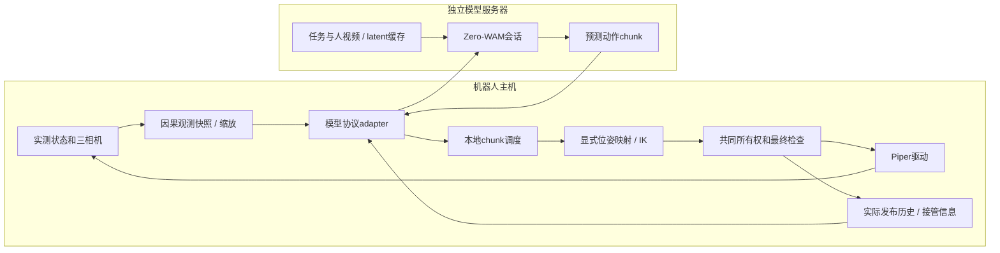

# Zero-WAM代码核查与双Piper接入方案

2026-10-19。用户确认模型运行在独立服务器；GPU/显存尚未知。本轮阅读论文及官方源码，未下载权重、未安装GPU依赖、未运行模型或机器人。

## 研究对象和可复现身份

对象为[Zero-WAM论文](https://arxiv.org/abs/2608.26103)及[官方仓库](https://github.com/robbyant-research/Zero-WAM)。本次main提交`08e2c4ae41e2b63573a299825cebe6753481407c`；官方源码归档SHA256 `006c3780347f74905cd53e9e6fb50824ed8f5346f0e71b2a7d19fcd90b934077`，文本研究副本位于`artifacts/research/013-zerowam`。只读源码，没有把其模拟器安装脚本直接执行到实验台。

论文研究通过人类演示视频/语言提供任务上下文的因果video-action模型。其跨任务泛化不能理解为任意机器人零标定即用：真机实验是双Franka，并用同形态的已见任务示范适配运动学，保留未见任务配置评测。没有本项目双Piper直接可用的实验证据。[论文§3–4](https://arxiv.org/html/2608.26103v1)。

官方提供pretrain与RoboTwin后训练权重，README标注约10.8B参数、约35GB checkpoint；这是文件规模，不是已测显存需求。没有当前服务器吞吐测量，不能承诺30Hz或某张显卡可运行。[模型说明](https://github.com/robbyant-research/Zero-WAM/tree/08e2c4ae41e2b63573a299825cebe6753481407c#model-checkpoints)。

## 真实接口，而不是从模型名字猜接口

| 项目 | 已读源码中的行为 | 接入含义 |
|---|---|---|
| 网络 | WebSocket + msgpack-numpy；服务端healthz，初次握手metadata | 可复用现成模型服务协议，外加我们自己的请求/时钟/生命周期adapter |
| 控制流 | reset→infer action chunk→执行→compute_kv_cache→下一chunk | **有状态会话**，不是每帧独立HTTP预测 |
| 观测 | cam_high/cam_left_wrist/cam_right_wrist三RGB；config各224×288，latent按宽拼接 | 当前三相机数量相同，但必须校验画面方向/分辨率/相机语义；depth不是这个公开模型的必需输入 |
| state | 客户端format_obs带observation.state；ICL初始化编码主要读RGB | 字段存在不等于分支确实使用了关节反馈，不能宣称直接喂14维就完成对齐 |
| task context | reset包含prompt、use_icl、模型服务器可访问的人视频或latent路径 | 提前上传/缓存；不能把机器人本地路径发过去期待远端自动读到 |
| 输出 | 内部action_dim=30，选择16有效通道；返回[C,F,A] | 必须解析维度与通道顺序，不能按平坦joint14消费 |
| 时序 | frame_chunk_size=2、action_per_frame=16 | 常规输出16×2×16；首轮官方客户端跳过第一个F块。不能仅由shape推断真实机械臂action dt |
| 归一化 | 使用Robotwin指定q01/q99与通道映射 | 不能直接替换成Piper米/弧度范围而不审查模型artifact |

来源分别为[机器人配置](https://github.com/robbyant-research/Zero-WAM/blob/08e2c4ae41e2b63573a299825cebe6753481407c/wan_va/configs/va_robotwin_cfg.py)、[客户端](https://github.com/robbyant-research/Zero-WAM/blob/08e2c4ae41e2b63573a299825cebe6753481407c/evaluation/robotwin/eval_policy_client_openpi.py)、[WebSocket client](https://github.com/robbyant-research/Zero-WAM/blob/08e2c4ae41e2b63573a299825cebe6753481407c/evaluation/robotwin/websocket_client_policy.py)。

关键区别：公开客户端的16维是每臂`[xyz, quaternion_xyzw, gripper]`，不是6关节+夹爪。它还将位姿相对episode初始末端参考做复原：平移加初始平移，旋转按`R_init * R_pred`组合。这里只是在复述客户端算法，尚未证明这一参考系/工具点约定能直接用于Piper。原生Piper Euler、URDF gripper_base和模型末端之间需要显式标定/映射。

更危险的混淆是14维：上游客户端也有14维分支，含每臂XYZ/Euler/gripper；它与我们的`12个关节+2个夹爪`恰好长度相同，但语义完全不同。**不能用向量长度判断动作类型。** action_encoding、coordinate_names、units、frame/TCP必须成为artifact和端口契约。

## 缓存回路限制了“直接上RTC”的做法

公开ICL实现缓存`last_predicted_actions`，在`compute_kv_cache`时配合新真实图像更新缓存；它不是直接用传入state重建所有已执行动作。若我们截断chunk、因IK/限位拒绝部分动作、被人工接管，模型缓存可能仍认为完整预测已执行。必须reset或补充经过验证的实际执行历史接口，不能默默继续。

官方服务共享模型/cache对象，同步执行一次infer；默认客户端等待/超时策略面向模拟评测。不能将无限等待的调用放进本地机械臂控制线程。需要隔离模型worker、有限请求队列、请求/epoch关联及本地动作有效期。推理超时、重连、换任务、换人视频、参考重置和人工接管后重置缓存。[实际模型server](https://github.com/robbyant-research/Zero-WAM/blob/08e2c4ae41e2b63573a299825cebe6753481407c/wan_va/wan_va_server.py)、[网络server](https://github.com/robbyant-research/Zero-WAM/blob/08e2c4ae41e2b63573a299825cebe6753481407c/wan_va/utils/Simple_Remote_Infer/deploy/websocket_policy_server.py)。

论文描述语言可选；当前代码的ICL reset仍要求非空prompt，且空text embedding/CFG设置可让目标视频分支不使用实际任务文本。adapter应遵循选定代码版本，不能将论文概念接口与代码参数混为一谈。

## 分机部署与依赖隔离

模型服务器使用上游测试的Python3.10/PyTorch2.9/CUDA12.6环境；机器人维持Ubuntu24.04/Python3.12/ROS Jazzy和已验证驱动。官方依赖含LeRobot0.3.3，因此v3转换使用独立数据环境，而非升级机器人系统包或强行将所有依赖合并。[安装说明](https://github.com/robbyant-research/Zero-WAM/blob/08e2c4ae41e2b63573a299825cebe6753481407c/INSTALL.md)、[依赖版本](https://github.com/robbyant-research/Zero-WAM/blob/08e2c4ae41e2b63573a299825cebe6753481407c/requirements.txt)。

三部分部署边界：

机器人以本地monotonic控制动作时效；模型server墙钟不作为物理deadline时钟。跨机消息需要request_id、session/epoch、snapshot_id、观测源时间、目标周期、动作语义和错误状态；bridge在现有上游协议外围补这些元信息。旧epoch结果不能在新会话落地。

## 优化顺序和可测指标

1. 先离线/影子推理：固定真实episode快照，不接硬件，测模型准备、视频预处理、上传、infer、返回、IK总耗时与p95/p99。记录输出shape/有限值/单位、动作范围和cache行为。
2. 模型输入与VR preview、原始record分支分开；模型用其224×288三RGB，原始采集不降成模型分辨率。人视频/文本embedding按任务缓存；不每帧上传整段上下文。
3. 本地执行器不等网络响应；chunk按已声明dt排程，过期/接管即撤销。最初先复现完整chunk与缓存更新，再优化为重规划，不能先截断却保留错误cache。
4. 减少denoise步数/缓存、混合精度或编译仅作为可配置实验，在固定任务和动作误差下测收益；不直接承诺质量保持。上游默认50步不是我们的实时保证。
5. RTC/temporal ensemble要作为模型或调度插件：RTC需要推理支持固定已执行前缀，不能只在外面给旧chunk改时间；ensemble须匹配同一未来时刻，四元数不能普通算术平均，夹爪离散切换不宜无条件平滑。
6. MPC/规划若加入，应明确objective/model/约束和计算预算。当前先使用已验证Pinocchio IK及本地目标执行，不把视频预测自动当物理动力学模型。

首个可执行策略不必是完整WAM：先用同一接口做本地mock或低开销VLA影子预测，验证新epoch/超时/单位/队列；再接ZeroWAM。这些验证可复用在所有模型，不要求采集或驱动认识模型名字。

## 下一步准入清单

需要提供服务器GPU/显存、实际checkpoint和任务/演示上下文；先复现官方离线样例，再用当前三路图像完成影子请求和缓存回路。双Piper部署还需要确定模型EEF/TCP坐标、初始参考、gripper0/1或米映射、动作dt、归一化统计与是否需要同形态数据适配。待人工标注的new_test仅用于工程测试，不足以验证任务泛化。

本轮交付三图配置/静态编译和离线时间线，并未实现ZeroWAM网络adapter或运行物理推理；具体共同执行层的改动顺序见[三图设计](../three-workflow-graphs.md)。
