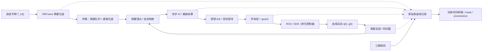
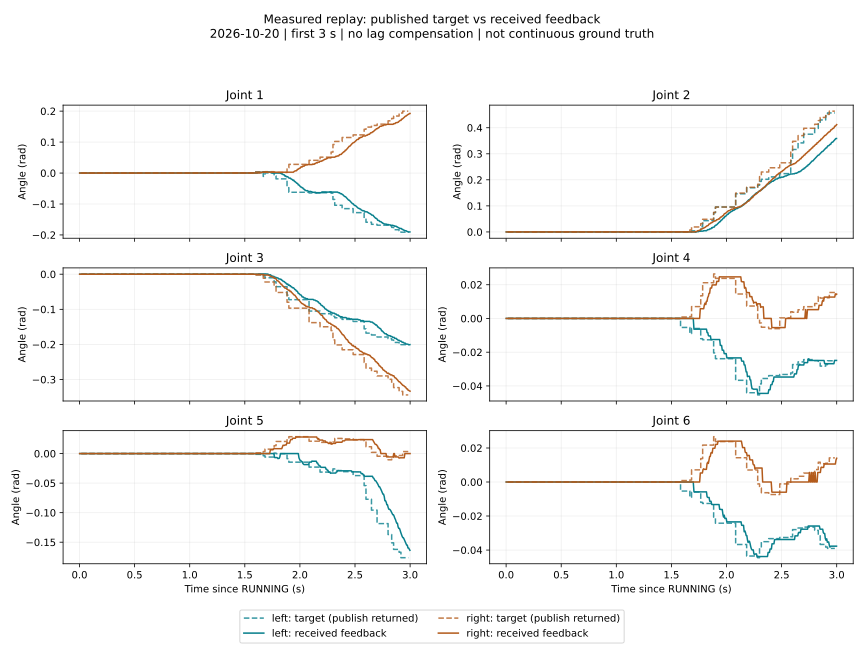

# 从手柄到策略：遥操信号、采样与时间契约

**阅读对象：** 实验操作员、数据与模型研究人员、框架开发者。  
**证据范围：** 当前本地源码、10 月 19 日三条采集审计、10 月 20 日三秒真机回放日志、原始论文。此次研究没有启动机器人或改变控制参数。

[打开完整离线交互报告](../signal-timing-report.html) · [真实数据与统计](../assets/signal-timing/evidence.json) · [CSV](../assets/signal-timing/replay-series.csv) · [实施计划](../../plans/015-signal-timing-and-policy-research.md)

> [!abstract] 先读这五句话
> 1. 物理运动近似连续；程序拿到的手柄和编码器反馈已经是离散、带噪声和延迟的观测。
> 2. 手柄位姿、IK 目标、发出的关节命令、实际关节运动是不同变量，不能互相替代。
> 3. 插值可以构造一条经过采样点的曲线；它既不自动恢复丢失的运动，也不保证机器人重走原轨迹。
> 4. 训练时最重要的是动作语义和时间对应一致。Flow Matching 的“连续流”不等于连续时间机器人控制。
> 5. 我们应保留多速率原始证据，再产生带明确时间规则的训练视图；采集、回放、推理共用执行面，但各自有不同的时序责任。

## 1. 先给每一种“信号”命名

用户所说的 $\tau_{\mathrm{hand}}$ 可以理解为手柄的整段轨迹。为避免与机器人动力学中的力矩 $\tau$ 混淆，下文把它写作 $\mathcal T_h=\{T_h(t)\}$，其中 $T_h(t)\in SE(3)$ 是手柄位置与朝向。

| 符号 | 含义 | 连续还是离散 | 当前系统可观察到什么 |
|---|---|---|---|
| $T_h(t)$ | 真实手柄运动 | 连续物理量 | 没有无限精度的真值 |
| $\widetilde T_h[n]$ | WebXR 估计的位姿 | 离散 | grip position、quaternion、浏览器时间、frame 序号 |
| $T_d[k]$ | 映射后的末端目标 | 离散 | `intent`，包括目标、seed、token、输入 seq |
| $q_{\mathrm{IK}}[k]$ | IK 求出的关节位置 | 离散 | `motion_result`、求解耗时、残差、是否接受 |
| $u_q[j],u_g[j]$ | 发往驱动的关节与夹爪目标 | 离散更新、目标保持 | `command`、guard、receipt |
| $q(t),g(t)$ | 实际关节角、实际夹爪开度 | 连续物理量 | 只能由反馈近似观测 |
| $y_q[m],y_g[m]$ | 编码器/SDK/ROS 反馈 | 离散 | feedback 和来源/接收时间 |
| $D_{\mathrm{raw}}$ | 原始事件、图像和索引集合 | 多速率、不规则 | MCAP、MP4、JSONL |
| $D_{\mathrm{train}}[i]$ | 训练样本 | 统一网格或显式不规则时间 | 当前 `training-view` 是固定网格 JSONL，尚非完整 LeRobot v3 |

WebXR 提供的是某一 XRFrame 的跟踪状态估计，并有预测显示时刻语义，不能把它视作直接访问连续 IMU 真值。当前网页记录 `xr_frame_time_ms` 和 `performance.now()`；未单独记录 `predictedDisplayTime`，也没有校准 PICO 跟踪管线的延迟。[W3C WebXR 规范 §4–5、§9](https://www.w3.org/TR/2026/CRD-webxr-20260609/)



这个图描述逻辑关系。反馈经过采样，IK 有队列和计算延迟，不是无延时的代数环。视觉预览还有“相机→编码/传输→显示→人类反应→手柄”的人机闭环；预览延迟即使不降低原始录制 FPS，也会改变示范者的行为。

## 2. 我们现在究竟以多少 Hz 工作

### 2.1 一张频率表比一个 FPS 更有用

| 层 | 当前实现/配置 | 正确解读 |
|---|---|---|
| PICO 跟踪内部更新 | 未知 | 不由网页 FPS 推断 |
| 浏览器取位姿 | XR 渲染回调 | 受头显、渲染负载、可见性影响；不是承诺的固定频率 |
| 位姿提交 | 通常间隔至少 33 ms；关键按键边沿可提前 | 约 30 Hz 提交上限，需考虑回调量化 |
| 控制网络 | 一个请求在途；等待 ACK；普通位姿只保留最新一条 | RTT 大时提交样本会被替换；边沿队列与位姿策略不同 |
| 遥操控制线程 | `session.control_hz=60` | 当前是 `tick()` 后再等 $1/60$ 秒，周期包含工作耗时，实际低于或接近 60 Hz |
| IK | 每臂独立进程，最新请求覆盖等待请求 | 无新输入不重新求解；不是每 tick 必有新解 |
| 关节发布 | 活跃侧按控制 tick 发布最近接受目标 | 重复同一个目标不增加新的运动信息 |
| 驱动反馈发布 | 每轮工作后等待 5 ms | 名义上限约 200 Hz；不是硬件内部伺服频率 |
| 真实回放控制 | 本轮实测约 60 Hz | 与遥操线程的循环机制不同，不能用回放实测替代遥操实测 |
| 三相机捕获/原始 RGB | 配置 640×480、30 FPS | 每流分别检查帧间隔；已有三集无 depth |
| VR 预览 | 独立缩放和拥塞降频 | 不等于记录 FPS；共享 CPU/网络资源仍可能相互影响 |
| 原始状态/命令记录 | 事件到达即入队，异步写盘 | 没有统一“只按 30 Hz 保存所有信号” |
| 当前训练示例 | 30 Hz，action offset 一步 | 是离线视图规则，不是硬件频率或经标定的延迟补偿 |

源码：[网页采样](../../src/robot_infra/web/xr-session.js)、[传输](../../src/robot_infra/web/xr-transport.js)、[遥操循环](../../src/robot_infra/teleop_session.py)、[IK worker](../../src/robot_infra/solver_worker.py)、[驱动缓存发布](../../src/robot_infra/adapters/piper_driver.py)、[记录](../../src/robot_infra/real_episode.py)、[训练视图](../../src/robot_infra/training_view.py)。

### 2.2 一个容易忽视的瓶颈：等待 ACK

在持续发送、单请求在途的近似下，网络交付能力满足：

$$
f_{\mathrm{delivered}}\lesssim \min\left(f_{\mathrm{submitted}},\frac{1}{L_{\mathrm{RTT}}}\right).
$$

这不是所有网络系统的定律，而是**当前 stop-and-wait 实现的上界估算**。若一次往返花 100 ms，就算页面准备了 30 份位姿，每秒能完成的请求也约为 10 份；剩余普通位姿被最新值替换。好处是不会把旧手柄动作排成长队，代价是轨迹细节减少、更新不均匀。WebSocket 本身不要求每帧等待应用 ACK，这属于我们的传输设计。

10 月 19 日的已保存审计，输入事件数除以 episode 时长如下。它们不是严格等间距采样率，也不是只针对侧握有效期间的统计：

| Episode | 输入事件/秒 | 接收间隔 p95 / 最大值 | RTT 中位 / p95 / 最大值 | 采集 QC |
|---|---:|---:|---:|---|
| 0 | 20.99 | 119.38 / 187.14 ms | 13 / 89.3 / 165.9 ms | 通过 |
| 1 | 14.45 | 206.75 / 538.85 ms | 21.5 / 191.3 / 557.7 ms | 通过 |
| 2 | 17.42 | 150.28 / 305.31 ms | 19.8 / 138.3 / 271 ms | 固定相机间隙失败 |

**QC 通过不等于高动态训练质量通过。** 第 1 集最大输入间隔超过半秒，但已有采集 QC 并不把所有控制质量因素列为失败条件。第 2 集的固定 RGB 间隙 197.477 ms 是另一条证据，不能把它和 RTT 峰值合并成一个已证实根因。[原始审计解释](2026-10-19-new-test-audit.md)

`previous_rtt_ms` 描述上一条请求，包含网络与服务处理等时间，不是当前帧的单向传输时间。没有共同时间基准时不能直接用“机器人时间−浏览器时间”计算延迟，更不能无条件把 RTT/2 当真实单向延迟。

还有一个待测试的细节：网页当前把 A、X、侧握阈值变化放入边沿队列，**扳机的模拟量变化不在这个 signature 中**。它随可替换位姿包传输。快速按下又松开、恰好发生在长 RTT 期间时，中间开口意图可能没有送到服务器；这是源码推导的风险，不能据此认定之前某一次放物失败的原因。后续应专门注入网络延迟测试扳机脉冲，而非只测 A 键。

## 3. IK 不是一根透明的线

### 3.1 坐标映射和离合使轨迹具有分段语义

在某次侧握开始时保存手柄锚点 $(p_{h0},R_{h0})$ 与机械臂末端锚点 $(p_{r0},R_{r0})$。位置映射可写为：

$$
p_d[k]=p_{r0}+sA\bigl(\widetilde p_h[k]-p_{h0}\bigr).
$$

$A$ 是已声明的坐标轴映射，$s$ 是位移比例。松开再握住会创建新锚点，因此不能把整个 episode 的手柄绝对坐标直接当机器人绝对目标。旋转要按照既定 frame 与乘法顺序组合，不能把欧拉角三分量随意相减。[相对映射实现](../../src/robot_infra/pinocchio_model.py)

### 3.2 当前 IK 实际求的是一个折中

把当前代码的残差平方和写出来：

$$
q_k^\star=\underset{q_{\min}\le q\le q_{\max}}{\mathrm{arg\,min}}
\left\|W\log\left(T(q)^{-1}T_d[k]\right)\right\|^2
+\lambda_s\|q-q_{\mathrm{seed}}\|^2+\lambda_p\|q\|^2.
$$

这里 $W$ 的位置权重为 20、朝向权重为 2；代码先乘权重再平方，因此对应平方目标的系数分别是 400 和 4，**不是 20 和 2**。smooth 权重为 2，posture 为 $10^{-5}$。这些权重也受 m/rad 单位选择影响，不是普适物理常数。

主线程给请求附上最近反馈作为 seed，但 **worker 在同一侧握 token 内优先使用上一次接受的 IK 解**；首次或 token 变化时才使用请求里的反馈 seed。这样更有利于解的连续性，也意味着平滑项围绕的是求解历史，未必是当前物理位置。`allow_best_effort=true` 时，有限且未完全收敛的解也可能被接受；当前收敛判据是位置残差 <3 mm、朝向残差 <0.03 rad。求解接受不表示物理到达。实际配置的 `ik.deadline_ms=50` 与结果年龄 0.3 s 是不同概念：前者约束求解过程检查，后者限制使用旧结果；Python/操作系统调度仍非硬实时。[worker 的 seed 选择](../../src/robot_infra/solver_worker.py)

教材中的微分形式 $\dot x=J(q)\dot q$ 说明：接近奇异位形时，小的末端变化可能要求很大的关节变化；解还依赖起始值、约束与可达性。当前代码使用 Pinocchio 的几何/Jacobian 和 SciPy 有界最小二乘，**没有把教科书伪逆直接当作当前控制器**。[Modern Robotics：数值 IK](https://modernrobotics.northwestern.edu/nu-gm-book-resource/6-2-numerical-inverse-kinematics-part-1-of-2/)

工程后果是：提高 IK 调用次数不一定改善跟手。如果输入陈旧、目标不可达、反馈滞后或平滑权重过大，重复求解也不能还原手柄运动。应同时检查目标年龄、残差、解的连续性、执行偏差，而不是只看求解耗时。

当前 worker 的发送和结果接收都由控制 tick 中的 `poll()` 推动：主线程本 tick 创建的新请求，通常要到后续 poll 才进入进程；求解完成后也要等 poll 被读取。因此“IK 算了 1.3 ms”不等于“目标 1.3 ms 后已发布”。计算时间之外还有等待、进程传输和结果消费延迟。记录的 `created_s` 在机器人主机生成，其结果年龄并不包含此前头显跟踪与网络的全部年龄。

## 4. 离散轨迹能恢复连续运动吗

### 4.1 数学上：有条件地能；实际中：通常只能近似

对标量轨迹 $x(t)$，若它严格带限到 $B$ Hz，等间距、无噪声采样满足 $f_s>2B$，且有无限样本和理想重建，则：

$$
x(t)=\sum_{n=-\infty}^{\infty}x[n]\,
\operatorname{sinc}\left(\frac{t-nT_s}{T_s}\right),\qquad
\operatorname{sinc}(z)=\frac{\sin(\pi z)}{\pi z}.
$$

这是采样定理的理想结论；“连续”本身并不蕴含“带限”。抓取接触、启停、夹爪切换、跟踪跳变、有限 episode 边缘都使条件复杂化。[MIT 采样定理讲义](https://ocw.mit.edu/courses/hst-582j-biomedical-signal-and-image-processing-spring-2007/54ae74896b15e34e9e7fea0d94c17777_ch5_samp.pdf)

一个严格反例：$x(t)$ 与 $x(t)+a\sin(2\pi f_s t)$ 在所有 $t=n/f_s$ 上数值相同，却在样本之间走了不同路径。没有带宽等额外假设，保存下来的点不可能唯一确定真实连续轨迹。这也解释为什么“曲线看起来很平滑”不能证明恢复正确。

**交互实验 A** 可将输入设为 18 Hz、采样设为 30 Hz。样本无法区分该正弦与相位反向的 12 Hz 正弦；换成 60 Hz 才排除这组混叠。实验中的折叠正弦是解析别名示例，不是通用重建算法。[MIT：混叠与重建](https://ocw.mit.edu/courses/res-6-007-signals-and-systems-spring-2011/resources/lecture-16-sampling/)

### 4.2 常见插值方法分别承诺什么

| 方法 | 适用语义 | 保留了什么 | 不能保证什么 |
|---|---|---|---|
| 零阶保持 ZOH | 最近命令持续有效；因果状态快照 | 采样/事件值及保持语义 | 不保证速度连续；不补丢帧 |
| 线性插值 | 离线描述平滑位置或已知未来轨迹 | 经过相邻位置点 | 速度分段跳变；在线不能偷看未来反馈 |
| 三次样条 / Hermite | 显式轨迹生成 | 可增加导数连续性 | 可能过冲；需验证限位、速度与加速度 |
| sinc | 理想带限重建 | 理论上恢复带限信号 | 有限/不规则/噪声实测不满足理想前提 |
| SO(3)/SE(3) 插值 | 朝向/末端轨迹 | 正确处理几何约束 | 不等于插值关节，也不保证中间可达 |

以下是用于量级判断的推导，不是硬件认证指标。若标量 $x$ 在区间内二次可微且 $|x''|\le M$，线性插值的最大误差满足：

$$
|x(t)-\widehat x_{\mathrm{lin}}(t)|\le \frac{M T_s^2}{8}.
$$

它来自线性插值余项 $\frac{x''(\xi)}2(t-t_n)(t-t_{n+1})$。若 $M=2\ \mathrm{rad/s^2}$，30 Hz 时上界约 0.000278 rad；但 197 ms 空洞对应约 0.00970 rad。**这个例子只在假定加速度界成立时有效**，不是对缺失图像内容或我们的真实误差的估计。

零阶保持的归一化频率响应为：

$$
H_{\mathrm{ZOH}}(j\omega)=e^{-j\omega T_s/2}
\frac{\sin(\omega T_s/2)}{\omega T_s/2}.
$$

可直接对长度 $T_s$ 的矩形保持核做傅里叶变换得到。对低频分量，它带来约半个周期的相位延迟和幅值衰减；提高发送频率能减小保持效应，但不能抵消旧输入的年龄。

### 4.3 还要区分“重建曲线”和“重现物理运动”

实际运动大致满足：

$$
M(q)\ddot q+C(q,\dot q)\dot q+g(q)+f(\dot q)
=\tau_{\mathrm{motor}}+J(q)^\top F_{\mathrm{ext}}.
$$

发送的是目标位置，而不是上式所有力矩、外力、摩擦和内部状态。驱动的闭环控制、速度配置、负载、接触、温度和初始条件都会影响 $q(t)$。这个动力学表达用于说明缺失变量，当前系统未辨识这些参数。

| 想恢复的对象 | 判断 |
|---|---|
| 保存文件里的数值、时间戳 | 可用 hash/完整性校验精确验证 |
| 经过反馈采样点的一条连续曲线 | 可以构造，但通常不唯一 |
| 当时发布的目标序列 | 有命令与 receipt 证据时可以恢复；receipt 只证明 publish 返回 |
| 当时每一个硬件内部控制动作 | 当前没有此完整观测 |
| 相同目标驱动机器人后得到完全相同的实际运动 | 一般不能保证，需要闭环跟踪评测 |
| 从实际开度反推出夹爪闭合意图/接触力 | 一般不唯一，不能据此替代命令标签 |

## 5. 真机回放给了我们什么证据



上图仅比较**这次回放内部的发布目标与收到的反馈**，不是“原始示范实际运动 vs 回放实际运动”的逐点精度对照。当前提取器没有原示范的完整反馈时序；因此没有报告轨迹复现误差。

统计窗口为 `RUNNING ≤ host time < COMPLETED`，持续 3.000911466 s，排除回位和停止保持。命令时间取对应 publish receipt，反馈取 host event 时间；误差用每份反馈之前最近的已发布目标计算，不做时间平移拟合。

| 指标 | 左臂 | 右臂 |
|---|---:|---:|
| 发布关节目标数 | 179 | 179 |
| 发布间隔估计频率 $(N-1)/(t_N-t_1)$ | 59.991 Hz | 59.992 Hz |
| 发布间隔 p95 / 最大值 | 17.736 / 18.614 ms | 17.821 / 18.729 ms |
| 连续不同的关节目标组数 | 25 | 25 |
| 反馈数 / 时间跨度估计频率 | 508 / 169.209 Hz | 508 / 169.062 Hz |
| 第二关节反馈时刻采样加权 RMSE | 0.044759 rad | 0.035850 rad |
| 第二关节最大瞬时绝对误差 | 0.133983 rad | 0.105296 rad |

每臂 505 份反馈有窗口内前序目标可配对，另 3 份未配对。RMSE 是这些点的等权统计，不是连续时间积分误差，也没有补偿反馈链延迟。目标数量含静止段，不能据此说有效手部带宽就是 25/3 Hz。508 个不同 SDK 时间戳也不足以证明每次都是独立硬件采样。

现场已确认正常运动并停止。驱动速度配置 20%，但不能仅凭这个数断言误差都由速度限制造成。本轮结束立即执行已验证停止流程，没有等待最后轨迹目标完全收敛；旧报告的结束截面误差与本报告的全窗口最大值不是同一个指标。

**当前回放也不是逐条精确重播。** `ReplaySource.sample()` 在 tick 时收集所有已经到期的源事件，更新到最新目标，然后发布一次；同一 tick 内的中间目标可能只留在 `source_progress` 而不逐个下发。它保留时间轴和最新有效目标语义，却不保证还原原始每条发送间隔。原生关节回放不重跑 IK，避免人为改变 IK 分支。[回放源码](../../src/robot_infra/workflow.py)

要验收“复现”，下一轮应同时比较原示范与回放的命令、反馈、统一时间原点、相同初始状态和驱动配置。建议报告不平移误差、显式允许延迟后的误差、速度/加速度、夹爪事件时差、最终任务结果；不要只用动态时间规整把时序差异藏起来。

## 6. 采样、延迟、抖动如何共同决定质量

### 6.1 频率高，不等于信息新

实际可学习信息受整条链最弱环节影响。将每秒 10 个新手柄目标重复发布 60 次，再记录 200 份反馈，确实能观察执行动态，却不会获得 200 个独立的人类决策。反之，低频存盘会丢掉高频命令/响应细节。

应分别统计：

- **速率与间隙：** count、跨度速率、间隔 p50/p95/p99/max；每流独立统计。
- **年龄与时钟：** observation age、intent age、IK result age、时钟域/偏移不确定性。
- **新鲜程度：** 来源 frame ID、重复源时间戳、相邻目标变化、覆盖/丢弃计数。
- **运动质量：** IK 残差、目标与反馈误差、速度/加速度、夹爪事件和两臂相对时序。
- **可训练性：** 标签来源、动作 mask、成功/失败标注、任务覆盖，而不只是文件可解码。

平均 30 FPS 的相机仍可能有局部大空洞；双臂各自平均频率正常，也可能一侧长期比另一侧迟到。双臂协作尤其需要记录同一控制 tick 的两侧发送偏差与观测年龄，而非只给一个平均 FPS。

图像还有**曝光时间窗口**：一帧并非无穷短时刻的状态，快速运动可能模糊；滚动快门还可能令不同图像行对应不同时间。RGB 与 depth 也不能仅凭相同 FPS 就认为同步。后续应核验各流时间戳代表曝光开始、中点、设备处理完成还是 SDK 接收，并记录实际曝光、源 frame ID、RGB/depth 对齐方法及相机间偏差；当前资料不足以替所有相机确认这些语义。

RealSense SDK 提供了帧时间域与 metadata 查询接口，后续审计应按实际设备支持的字段读取，不能只看 ROS header。[官方帧接口定义](https://github.com/realsenseai/librealsense/blob/master/include/librealsense2/h/rs_frame.h)

### 6.2 一个简单的时间错位误差模型

对于小时间误差 $\delta t$：

$$
q(t+\delta t)-q(t)\approx\dot q(t)\delta t,\qquad
|\delta q|\lesssim v_{\max}|\delta t|.
$$

若某关节以 1 rad/s 运动，100 ms 错位约对应 0.1 rad；动作很慢时同样延迟可能不明显。这是泰勒展开的量级估计。高动态任务的质量阈值必须和运动速度关联，不能全靠固定 FPS。

随机采样抖动同样产生近似误差 $\delta x\approx\dot x\,\epsilon$。已知时间戳可以正确放置不规则样本，却不能补回未采样的细节。更密的数值微分还会放大噪声：独立位置噪声标准差为 $\sigma$ 时，相邻差分速度噪声标准差约 $\sqrt2\sigma/T_s$。因此不要直接用原始差分的 jerk 评判硬件抖动，须声明滤波及时间基准。

### 6.3 记录频率和训练频率应解耦

当前策略是合理的起点：原始事件保留，写盘在独立线程，训练视图后生成。编码/磁盘慢造成的排队与丢弃必须可观测，写入时刻不能冒充采样时刻。MP4 帧号/PTS 是视频时间表示；图像选择应追溯逐帧索引，不以 `frame_index/30` 抹去原始间隙。

降低**状态信号**采样率前应考虑抗混叠低通，再重采样；滤波参数、因果性、群延迟必须记入训练版本。离线零相位滤波会使用未来数据，若把它当在线可见状态会造成训练/部署不一致。**控制命令**则要保留目标保持和事件语义，不能把开关夹爪、停止、接管一律当平滑信号。相机降帧也不是对图像简单低通后就能解决动作时序问题。

当前 `RateGate` 在 record FPS 低于 capture FPS 时做接收时间门控，**不是抗混叠滤波器**；原生同 FPS 则保存收到的每帧。当前训练视图对状态/图像采用因果 latest，不是带低通的连续重建。[记录源码](../../src/robot_infra/real_episode.py)、[多速率处理课程](https://ocw.mit.edu/courses/6-341-discrete-time-signal-processing-fall-2005/)

## 7. 对训练：先定义标签，再讨论网络

### 7.1 State 与 action 是不同角色

对本项目的位置目标接口，建议：

$$
o_i=\left(I^1_i,I^2_i,I^3_i,q_{\mathrm{measured},i},
g_{\mathrm{measured},i},\mathrm{task}\right),\qquad
a_i=\left(q_{\mathrm{published},i},g_{\mathrm{published},i}\right).
$$

双臂关节加夹爪组成 14 维动作，具体顺序和单位依 schema；可用深度时作为额外观测流，缺失不得伪造。相机与状态的取样时刻、action offset、有效性 mask 都是标签定义的一部分。

夹住物体后，目标可能是 0 mm，而反馈停在 32 mm。如果用 32 mm 当“闭合命令”，推理时可能恰好停在物体外侧或接触处，不能表达继续闭合的意图。更适合当前接口的主标签是**经过映射与最终检查、已发布的夹爪目标**；原始扳机另存，实际开度作为状态。扳机可能在非遥操/未激活阶段变化，因此也不能无条件直接当动作标签。目标位置不等于夹持力，若未来要学力控，必须额外定义并采集相关量。

当前 `training-view` 示例在 $t_i$ 选接收时间不晚于 $t_i$ 的观测，在 $t_i+\Delta t$ 选最近已发布目标。这里一步偏移只是显式配置，**尚未通过实验标定为最佳训练偏移**。不能因为它叫“一步”就默认等于相机、IK、网络、驱动总延迟。[训练数据报告](../training-data-format-report.md)

另一个合理研究方向是“未来实际状态作为 waypoint 标签”，但这会改变问题定义：模型学的是未来到达状态，部署要有对应轨迹跟踪器和时序语义；不能悄悄替换当前 absolute target 标签。

### 7.2 Flow Matching 有两条完全不同的时间轴

物理时间是 $t_i=i\Delta t$，用于定义动作发生在什么时候。将未来 $N$ 个动作堆叠为 $A_i\in\mathbb R^{N\times d}$。一个简化的线性条件流训练例子是：

$$
Z_s=(1-s)\epsilon+sA_i,\quad \epsilon\sim\mathcal N(0,I),\quad s\in[0,1],
$$

$$
\mathcal L=\mathbb E\left[\left\|v_\theta(Z_s,s,o_i)-(A_i-\epsilon)\right\|^2\right].
$$

这里 $s$ 是**生成过程时间**，并非机器人运动的秒数。生成时解 $dZ_s/ds=v_\theta$ 得到整段动作数组；之后才由执行器按 $\Delta t$ 执行。这是常见条件线性路径的教学表达，实际模型可用不同路径和噪声约定。[Flow Matching 原论文](https://arxiv.org/abs/2210.02747)

因此，生成过程的 ODE 连续，并不约束最终数组沿动作索引 $i$ 的速度、加速度、碰撞、IK 可达性或动态可执行性。减少去噪/积分步数可能降低推理延迟，同时改变生成质量，必须联合评估；它不会改变训练动作的物理周期。

DiT 是以 Transformer 作为扩散模型骨干的设计，原论文主要针对图像；将其用于动作并不会自动解决对齐、采样或机器人动力学。网络结构、生成目标、动作表示、执行器是四项可独立选择的设计。[DiT 原论文](https://arxiv.org/abs/2212.09748)

### 7.3 改变数据 Hz，其实改变了学习问题

固定 $N=16$ 时，首末动作采样点跨度为 $(N-1)\Delta t$：30 Hz 是 0.5 s，10 Hz 是 1.5 s。若最后一个动作再保持一步，总覆盖时长是 $N\Delta t$；两种 horizon 定义要写清楚，不能混用。

| 改动 | 训练影响 | 部署必须配套 |
|---|---|---|
| 30 Hz 数据直接每隔三帧取一帧 | 更长物理 horizon，可能丢快速事件 | 明确新 dt、重采样方法和 mask |
| 10 Hz 动作插值成 60 Hz | 更多点但无新独立示范信息 | 声明插值器；不能当新控制带宽 |
| 相同 delta-position 每秒执行次数翻倍 | 累计位移/速度语义改变 | 按 dt 转换或重训，不能只改定时器 |
| absolute-position 提前两倍播放 | 路径点相同、时间尺度不同 | 重新验证速度、跟踪与接触 |
| 统一 q(rad) 与 jaw(m) 而不归一化 | 损失各维权重失衡 | 同一 normalization 版本 |
| 训练跨丢帧/暂停/接管拼 chunk | 学到虚假跃迁或等待 | 切段、mask；不跨 episode 边界拼接 |

建议将相机刷新率、状态观测率、动作网格分别声明。模型可以以 30 Hz 动作运行而用较低频图像，但应显式告知图像年龄/重复帧语义，并与训练一致。

## 8. 对推理：chunk 解决计算吞吐，RTC 处理连续衔接

Diffusion Policy 将动作序列生成与 receding-horizon 执行结合。ACT 同样使用 action chunking，并引入对**同一执行时刻**的多次预测做 temporal ensembling。二者不是从少量采样点精确恢复连续物理运动的算法。[Diffusion Policy 官方论文入口](https://diffusion-policy.cs.columbia.edu/)、[ACT 原论文](https://www.roboticsproceedings.org/rss19/p016.pdf)

| 执行方案 | 行为 | 优点 | 主要时序风险 |
|---|---|---|---|
| 单步、无额外平滑 | 每次预测一个目标 | 语义简单 | 推理耗时决定新目标频率；保持目标不等于高频闭环 |
| 同步 chunk | 预测 N 步，执行 K 步后再算 | 摊薄推理成本 | 等待新 chunk 时停顿；长 K 降低反馈更新 |
| 异步 chunk | 后台计算，设备侧按时间消费 | 可覆盖推理等待 | chunk 边界不一致、过期、队列耗尽 |
| Temporal ensemble | 融合同一时刻的重叠预测 | 可降低预测抖动 | 旧预测权重带来滞后；多模态路线平均可能不可行 |
| RTC | 生成过程中以将执行前缀约束新 chunk | 衔接计划与异步执行 | 需要模型采样器支持、正确前缀和时钟；不能修复网络失联 |
| 轨迹插值/平滑 | 动作输出后加工 | 改善设定值连续性 | 改变标签语义/时延；不是 RTC |
| MPC | 基于动态模型滚动优化 | 可显式考虑约束与反馈 | 需要模型、状态估计和求解预算；不是“把 chunk 接起来” |

### 8.1 用秒核算队列，不要只看 chunk 长度

假设 N 个动作，每个保持 $\Delta t$；已执行 K 个时启动下一次推理，剩余覆盖时间为：

$$
T_{\mathrm{buffer}}=(N-K)\Delta t,\qquad
T_{\mathrm{buffer}}\ge L_{\mathrm{inference+transfer}}+M.
$$

$M$ 是调度裕量。这个条件只说明已知确定延迟场景下不会断粮，**不保证闭环响应及时**。新动作依据的图像可能早已陈旧。真实部署应报告延迟分布与超时策略；p95 预算意味着仍可能有尾部超限。

例如 N=16、30 Hz、K=8，缓冲 266.7 ms；若模型与传输 180 ms、裕量 40 ms，尚余 46.7 ms。若 K=14，缓冲只剩 66.7 ms，同样模型就来不及。交互实验 C 可直接调整这些值。

Temporal ensemble 的一般形式是：

$$
\bar a(t)=\frac{\sum_{r\in\mathcal R(t)}w_r(t)a^{(r)}(t)}
{\sum_{r\in\mathcal R(t)}w_r(t)}.
$$

重点是各项都预测同一物理执行时刻，不是把相邻时间步平均。权重方向、窗口、过期规则应明确；这里不假定某个实现必然偏重新预测。旋转应在声明的几何表示里融合，夹爪离散事件应单独处理。

### 8.2 RTC 与普通异步队列的分界

RTC 在生成新 chunk 时，用旧计划中确定还会执行的动作作为前缀条件；论文通过去噪过程中的梯度引导及重叠区域软权重改善衔接。这不等同于最后简单拼接/平均两个数组，且引导不是严格数学意义上的零误差硬约束。[RTC 原论文 §3](https://arxiv.org/html/2506.07339v2)

对我们框架的推论：设备端必须给模型服务器“当前已消费/已发布的索引、仍承诺执行的前缀、动作时间轴、epoch”；模型端要能在采样过程中使用该条件。若只是 HTTP 返回一个数组，设备侧排队播放，只能叫异步 chunk。当前 `AsyncPolicySource` 正是后者，尚未实现 RTC 或 temporal ensemble。

还要分清“已承诺/已发送的目标前缀”和“机器人实际上已经到达的状态”。RTC 的前缀不能以测得 q 偷换目标 u，也不能忽略大幅跟踪误差。若后来做 retiming、IK、限位投影、接管，应使前缀与最终执行计划重新一致，必要时撤销旧结果。

UMI 的相关经验是分别处理观测对齐和动作执行延迟，保留动作时间轴，并剔除到达执行端时已过期的动作。这支持我们把时间语义放到接口中，而不是把所有延迟隐藏在模型调用内部。[UMI §IV、附录延迟测量](https://arxiv.org/html/2402.10329v3)

对拟接的 ZeroWAM，也必须读取其动作表示、原生 dt、预测/缓存语义再接 adapter；不能因为是 WAM 就假设能直接接 14 维关节命令或直接套 RTC。[既有专项报告](2026-10-19-zerowam-deployment.md)

## 9. 如何落实到“模块化、通用化、配置化”

建议继续保持三层数据，而不是为某个模型改写原始采集格式：

1. **证据层**：原始输入、映射/IK、发布命令、反馈、图像、时钟与所有权事件；不因训练取 10/30 Hz 而删掉原始频率。
2. **解释层**：可版本化的时钟映射、有效片段、动作语义、抗混叠/重采样、延迟对齐；输出含来源与 mask 的训练视图。
3. **执行层**：原生目标、轨迹插值、异步 chunk、TE/RTC 能力显式选择；统一设备网关并记录实际发布结果。

下面是**设计建议，不是已实现配置，不能直接交给当前 CLI**：

```yaml
timing_contract:
  version: proposed-1
  observation:
    clock: robot_host_monotonic
    selection: causal_latest
    max_age_s: per_stream
  action:
    representation: absolute_joint_and_gripper_target
    dt_s: 0.033333333333
    timestamp_semantics: scheduled_target_update
    hold: zero_order
  provenance:
    preserve_source_time: true
    preserve_receive_time: true
    record_resampling_and_filter: true
```

这份建议刻意不把 30 Hz 当全框架默认：不同模型、控制模式和任务可以选择别的 dt，但训练和执行必须使用同一个可核验契约。

### 建议推进顺序

| 优先级 | 下一切片 | 验收内容 |
|---|---|---|
| P0 | Timing QC：以已有事件生成时序报告 | 每流间隔、输入覆盖、有效结果年龄、目标/反馈误差、两臂时差；分数据完整性和训练质量 |
| P0 | 通信基准与调度审计 | fake 注入 RTT/抖动；比较当前 ACK 门控与有界独立位姿发送；按键/epoch/停止语义不退化 |
| P1 | Replay evaluator | 原示范 vs 回放状态对齐，报告不平移误差和时间偏差；只评价已验证片段 |
| P1 | 版本化 training resampler | 明确 state/action/image 各规则，夹爪事件处理、dt、offset、mask、抗混叠与 provenance |
| P1 | 真实相机 shadow 推理 | 校验观测年龄、传输/模型尾延迟、队列覆盖、过期拒绝；不驱动机器人 |
| P2 | 可替换轨迹处理 / RTC adapter | 分别验证插值、TE、RTC；禁止把普通异步伪称 RTC |

不建议现在直接把所有频率提到 200 Hz：这可能只增加重复消息、锁竞争、带宽和存储。先找出新信息在哪里丢失，再做有指标的改进。也不建议凭这 3 秒日志拟合一个“Piper 延迟常数”用于所有负载和姿态。

## 10. 下一轮实验怎样证明改进有效

本节是后续实验计划，此次未执行。

- **纯软件基准**：固定轨迹，注入确定延迟/随机抖动/断流；比较提交率、接收率、覆盖率、最大年龄、按钮边沿保真。
- **只读观测**：相机原生帧 ID、时间域、编码与写盘队列、SDK 时间戳变化；确认统计测的是源采样还是缓存发布。
- **明确授权后的硬件辨识**：在几个姿态/负载下做温和的阶跃或多频目标，分别报告手臂和夹爪响应、跟踪误差和延迟分布。不能用相互相关的单一峰值断言所有延迟分量。
- **回放对照**：同一源、同一初始状态与参数，比较 native target 保持和显式插值；报告原示范反馈与回放反馈，以及任务是否成功。
- **模型消融**：固定任务划分，比较 10/20/30 Hz、不同物理 horizon、K、推理延迟；评价任务成功、响应年龄、跟踪、chunk 边界跳变，不只看训练 loss。

实验比较必须区分新参数的效果与网络环境变化。训练集按 episode/场景划分，避免相邻高度相关帧落入训练和验证两侧。示范仍需真实任务描述和成功标签，目前 `new_test` 三集是手感与质量测试，不能作为已验证任务数据集。

## 11. 证据、复现与阅读路线

**建议先看交互报告的 A/B/C，再看真实回放 D；然后回读第 4、7、8 节公式。** HTML 使用本地资源和原生 MathML，不依赖在线 CDN；Markdown 可在 Obsidian 中阅读公式和 Mermaid。

离线分析脚本：

```powershell
uv run --no-project --with matplotlib --with markdown --with latex2mathml python tools/analyze_signal_timing.py
uv run --no-project --with matplotlib --with markdown --with latex2mathml python tools/build_signal_report.py
```

第一条需要未纳入公开资产的本地原始日志；已经提取的 JSON、CSV、SVG 和 HTML 可独立阅读。第二条用已提取资产重建报告。`evidence.json` 包含源路径、SHA256、窗口、统计口径和全六关节曲线。首次运行可能需下载隔离工具依赖，不更改机器人环境。

### 源码阅读索引

| 问题 | 文件 / 函数 |
|---|---|
| 页面是否每帧发包 | `web/xr-session.js: frame / sample` |
| 传输是否等待 ACK | `web/xr-transport.js: submit / drain / socketPost` |
| 是否每 tick 求新 IK | `teleop_session.py: _teleop_tick / start` |
| 最新请求怎样覆盖 | `solver_worker.py: request / poll` |
| IK 的真实目标函数 | `pinocchio_model.py: ik` |
| 命令是否等于执行确认 | `live_control.py: submit` |
| 是否按统一 30 Hz 记录 | `real_episode.py: EpisodeWriter / frame` |
| 训练是否用未来反馈 | `training_view.py: view_rows / _latest` |
| 回放会不会重跑 IK | `workflow.py: ReplaySource.sample / ExecutionSession.tick` |
| 当前是否已实现 RTC | `workflow.py: AsyncPolicySource`，只有异步队列 |

### 主要外部资料

这些资料支持对应小节的算法/理论描述；本项目的参数判断、误差分析和改进优先级是结合本地证据作出的研究结论，不是论文对 Piper 的实验结果。

1. [W3C WebXR Device API，2026-06-09 版本](https://www.w3.org/TR/2026/CRD-webxr-20260609/)：XRFrame 与预测显示时间。
2. [MIT 采样讲义](https://ocw.mit.edu/courses/hst-582j-biomedical-signal-and-image-processing-spring-2007/54ae74896b15e34e9e7fea0d94c17777_ch5_samp.pdf)：带限、采样与 sinc 重建。
3. [Modern Robotics 数值 IK](https://modernrobotics.northwestern.edu/nu-gm-book-resource/6-2-numerical-inverse-kinematics-part-1-of-2/)：Jacobian、初值与数值迭代。
4. [ACT / ALOHA，RSS 2023](https://www.roboticsproceedings.org/rss19/p016.pdf)：chunk 与 temporal ensemble。
5. [Diffusion Policy，2023](https://diffusion-policy.cs.columbia.edu/)：动作序列生成与滚动执行。
6. [Flow Matching，2022/2023](https://arxiv.org/abs/2210.02747)：条件概率路径和向量场。
7. [DiT，2022/2023](https://arxiv.org/abs/2212.09748)：Transformer 扩散骨干。
8. [RTC，2025](https://arxiv.org/html/2506.07339v2)：推理期前缀引导与异步 chunk。
9. [UMI，2024](https://arxiv.org/html/2402.10329v3)：观测与动作延迟匹配。

**研究边界：** 没有测出头显跟踪内部频率、Piper 原生伺服率或完整端到端延迟分解；没有证明本次回放与原示范实际轨迹精确一致；没有运行真实策略。本轮给出理论、源码审计与已录日志分析，不把这些空白用典型值填满。
