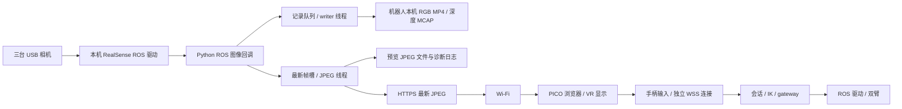

# 正式采集 frame gap、VR 延迟与摘头显暂停：现场诊断

2026-10-22。只读检查机器人 `ranger-piper`（192.168.87.138）的现有数据、日志、进程与网络快照；没有发送控制输入，没有启停服务，也没有修改配置或 QC 阈值。

结论：三个现象应分别处理。**原始记录确实存在缺帧间隔；VR 预览与控制存在传输尾延迟，当前实现会放大其影响；摘头显暂停则是明确的会话规则。现有证据不能把它们统一归因于 Wi-Fi，也不能确定相机缺帧发生在 USB、驱动还是 ROS 接收环节。**

## 1. 检查对象与证据位置

- 部署：`~/robot-infra/current -> releases/018-20261022-formal-collection`；core source SHA256 为 `d0fe3be2c2e3d29db89f45adf63dc851bf20caa0405c11383b5c0186c0739590`。
- 会话：`~/robot-infra/runs/20261022T124015Z_2cef230e`。
- 任务数据：`~/robot-infra/dataset/fill_pen_holder`；包括 saved 和 discarded，不能只看已保存目录。
- 配置：三路 RGB 640×480、30fps、MP4；仅固定相机记录 640×480、30fps 原始深度；相机预览目标 8fps。
- 派生统计：机器人 `~/robot-infra/runs/019-readonly-audit/`；本地副本在 `artifacts/validation/019-data/`。`inventory.json` 保存逐集 QC/帧数及状态，`camera-gaps.json` 保存大间隔的两端时间，`transport-analysis.json` 保存传输统计，`system-snapshot.json` 保存两秒资源快照。这些本地 artifacts 按既有规则不进入 Git。
- 日志按 `events.jsonl`、`events.000001.jsonl` 等顺序读取，固定各文件读取边界；本次分析约 2.056GB 诊断日志、16,671 条输入和 44,513 条预览事件。持续运行的后续数据不在该快照内。

状态快照为 PAUSED / recorder IDLE，最近暂停原因为 `vr_visibility_visible-blurred`。它只代表检查时刻；不能用退出后的输入空档当网络故障时长。

## 2. 实际数据走哪条路

**记录到 MP4 的图像并不经过头显和 Wi-Fi 回传。**预览卡顿不等价于原始采集卡顿；两者仍共享机器人主机的 CPU、内存、ROS 回调和部分磁盘资源，可能间接影响彼此。

## 3. frame gap：有真实异常，但还不能定位到单个根因

此次检查了十个已结束的尝试：一条保存、九条丢弃。其中两条 capture QC 通过（一条被用户丢弃），六条出现 frame gap，三条发生会话中断；其中一条同时有 gap 和输入中断，所以共八条 QC 不通过。

当前最大帧间隔阈值为 150ms。平均约 30fps，仍可能因一次超过阈值的间隔失败。例如：

| episode 目录识别后缀 | 流 | 接收时间间隔 | 对应 ROS header 源时间间隔 |
|---|---|---:|---:|
| `ac34fddd…` | 固定 RGB | 165.820ms | 166.810ms |
| `b1430e3e…` | 右腕 RGB | 265.481ms | 266.849ms |
| `011eb129…` | 左腕 RGB | 197.797ms | 200.137ms |
| `ecacd6b4…` | 右腕 RGB | 299.967ms | 300.207ms |

所有尝试均为 `dropped=0`、`writer_error=null`，每路 `received_by_writer == written`，`rate_filtered=0`。所以没有发现记录器队列溢出、写入错误或主动筛帧的证据。MP4 后端并没有把已经入队的图像悄悄少写掉。

大间隔在接收到的图像源时间中也存在，不能只解释为“帧完整到达、写盘稍晚”。但 ROS header 时间只是收到的消息所携带的源时间；它不能证明中间那些曝光没有发生。候选环节包括相机/USB、RealSense 驱动、ROS/DDS 丢失、Python 回调调度不及时导致订阅队列丢帧。writer 之后的计数无法看到订阅之前的损失。

三路也并非始终一起卡：最差的 `ecacd6b4…` 中左右腕分别约 27.54/24.55fps，而固定 RGB 仍约 29.99fps、最大间隔约 42ms。需要逐相机定位，不能只看整机一个 FPS。

USB 拓扑检查显示三台都以 USB3/5000M 连接，未见 USB2 降速；左腕与固定相机共享一个 USB hub，右腕走另一端口。这是后续对照实验的线索，尚不能据此认定带宽不足。

## 4. VR 延迟：存在实测尾延迟，也有实现上的放大机制

成功收到的输入所携带的上一包 RTT：中位数 **27.0ms**、95 分位 **121.8ms**、最大 **703.2ms**。服务端 `app.input()` 处理时间分别是 0.112/0.335/1.033ms。

这说明输入业务处理函数本身通常很快。**其计时不包括接收前的线程调度、完整解析/发送、浏览器调度和网络往返**，因此不能把剩余时间全部算成 Wi-Fi 延迟。超时请求也不会成为成功 RTT 样本；日志另外记录了两次“控制响应超时”。

浏览器 JPEG 获取耗时通常约 41ms，95 分位约 144–148ms，极端约 640–649ms；解码通常约 4ms。这里来自输入包携带的“最近一次媒体统计”，是重复采样加权值，不能当独立 JPEG 请求分布。服务端从图像接收到预览事件发布通常约 12–13ms，95 分位约 24–27ms，偶发约 155–380ms；这是包含排队/编码/预览落盘的代理值，不是曝光到眼睛的端到端延迟。

两处明确的设计行为会降低体验：

1. [预览循环](../../src/robot_infra/web/xr-session.js)用三路独立 HTTP JPEG 轮询，正常目标 8fps；最近控制 RTT 大于 100ms 时，降到 **2fps**。这意味着更新间隔可达约 500ms，传输慢时还会更长。原始记录 30fps 不会让头显自动变成 30fps。这是此前保护控制连接的折中，不能作为最终流畅预览方案。
2. [输入传输](../../src/robot_infra/web/xr-transport.js)每次只允许一个请求在途，等待 ACK 后才发送下一包，期间合并位姿样本。因此 RTT 为 120ms 时，持续控制更新上限约 8Hz；RTT 为 500ms 时约 2Hz。页面以约 30Hz生成输入，并不意味着机器人以 30Hz收到输入。按键边沿与连续位姿需要不同的可靠性/时效策略。

控制已经使用独立 WSS 端口，媒体 HTTP 也支持持久连接；不能描述成“每帧都新建 TLS”或“还没分离控制连接”。现有隔离解决了连接池争用，却没有消除共享 Wi-Fi、浏览器和主机调度的影响。

## 5. 多线程已有，但资源隔离仍不充分

[live_teleop.py](../../src/robot_infra/live_teleop.py)将 ROS spin、JPEG、记录写入、诊断日志、HTTP/WSS 与控制线程放在同一 Python 进程。IK 已有独立 worker。线程减少了直接阻塞，却不保证 CPU/GIL、ROS executor 与内存资源互不影响。

代码还有一项可以直接改善的开销：即使没有人在看预览、没有录制 episode，预览线程仍持续生成 JPEG、每帧写一个文件，并记录预览事件。快照已有约 **40,872 个 JPEG / 334.5MB**；整个连续诊断日志超过 2GB。这些不等同于任务 MP4，有必要把诊断归档设为显式配置，并让实时预览默认走内存中的最新帧。

两秒 PAUSED/IDLE 快照中 gateway 约占 **单核的 72.3%**，写盘约 1.24MB/s；机器有 16 个逻辑 CPU。这不代表全机 CPU 72.3%，也不能证明故障时 CPU 饱和，只说明待机仍有持续工作，值得测量回调调度和每线程负载。

机器人当时连接 HCP-203A 的 5GHz Wi-Fi，信号约 −32dBm；缓存显示 270Mbit/s 是链路信息，不是实测吞吐。信号好也不能排除竞争、重传和瞬时延迟；目前没有 PICO 同时刻无线统计，也没有故障时持续网络追踪。

## 6. 摘下 VR：独立的会话设计问题

WebXR 可见性变成非 `visible`、追踪姿态缺失或退出 VR，会触发暂停；录制中的 episode 被标为 interrupted。实际有一条 2.67 秒尝试以 `vr_visibility_visible-blurred` 结束，四路相机各 80 帧、约 30fps、最大间隔不足 38ms。**这次暂停发生时图像记录正常，不能归因于相机或 Wi-Fi。**

这是当前只支持沉浸式 WebXR 输入的限制。若想摘下头显后仍看电脑屏幕操作，需要独立设计“操作员显示方式”和“遥操输入源”，并验证头显厂商在摘下后是否继续提供手柄追踪。仅删掉暂停判断，无法保证浏览器还在运行 XR 帧、也无法恢复厂商停止的控制器追踪。

## 7. 下一实施切片与验收顺序（尚未实施）

建议先做性能与可观测性切片，保持 graph 的输入、执行、记录、预览职责分离：

1. 增加逐段时间和队列指标：驱动源帧号/时间、回调延迟、记录队列等待与编码耗时、预览帧身份与显示年龄。保留原始时间，避免只有 RTT/FPS 两个数字。
2. 将预览逐帧落盘改为可选诊断；无人订阅时停止预览编码。明确有限队列、最新帧替换规则及相互独立的故障处理；必要时将图像采集/记录与控制移到独立进程，而非只增加线程。
3. 分离连续位姿的最新值传输与按键/状态命令的可靠确认，避免每个姿态包都等待一整次 RTT；保留会话、序号、时效和停止语义。将媒体升级为有明确延迟预算的持续视频通道。
4. 再做可配置的桌面监看/替代输入模式；是否支持摘头显后的同一对手柄，取决于设备追踪实测，不能先承诺。

先用固定配置做对照：相机独立长录制、完整服务但关闭预览、完整服务开启预览；每轮至少 60 秒并重复，保持相同场景/流配置。全栈控制的比较需现场授权与配合。若有条件，再只改变机器人有线/无线连接；不能在同一轮同时改分辨率、深度、预览和网络，否则无法辨因。

018 曾通过相机独立 10 秒测试，只证明那次短时采集可用，不能覆盖长时三相机+深度+双臂+VR 并发。这次诊断没有运行新的运动或采集测试，没有声称任何优化已生效。

不通过提高阈值、补帧或更改时间戳掩盖问题。现有单个 gap 导致整集不通过的规则也值得演进：保留缺陷标签与异常区间、允许后续训练筛选连续可用片段；这是质量使用策略，不能代替修复采集链路。
