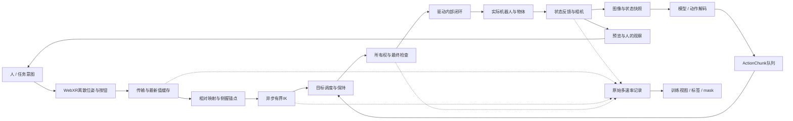

# 遥操与推理管线的统一数学模型

配套：[逐步学习课程](../pipeline-learning.md) · [离线学习与公式阅读器](../pipeline-model.html) · [前篇信号报告](2026-10-20-signal-timing-and-learning.md)。

**目标：** 用一套可追溯到代码的数学语言，解释如何产生可信的示范数据，以及如何忠实、及时地执行模型动作。这里的“完整”指覆盖系统边界内各模块与接口，不表示已辨识未知硬件动力学，也不表示已经证明闭环稳定。

**基线：** 2026-10-22 `runtime_identity()` 对 `src/robot_infra` 源文件计算的树 SHA256 为 `380ee1788a47160a48382610fc8826ebc6996ef4b89ec25d64eed7ef80014248`，与计划014相同；它不是整个 Git 仓库的哈希。物理遥操/数采和短回放已有证据；推理只有 fake 设备、合成 RGB、假模型及 HTTP 链路验证。真实 VLA/WAM、模型服务器与真机动作闭环尚未实现。本轮无设备连接、无控制代码修改。

全文用三类标签：**[实现]** 可由当前源码确定；**[分析]** 为理解和设计引入的模型；**[建议]** 尚待实现/验证。不能把分析模型中的参数当作 Piper 的实测参数。

## 1. 系统边界：一个混合、多速率、部分可观测闭环

### 1.1 什么是状态，什么是动作

对双臂设置，定义物理关节状态与夹爪开度：

$$
q(t)=\begin{bmatrix}q_L(t)\\q_R(t)\end{bmatrix}\in\mathbb R^{12},\qquad
w(t)=\begin{bmatrix}w_L(t)\\w_R(t)\end{bmatrix}\in\mathbb R^2.
$$

关节角单位 rad，开度单位 m。实际训练样例的 14 维顺序是：左六关节、左夹爪、右六关节、右夹爪；不是先放十二关节再放两个夹爪。把两种排列联系起来的置换必须显式定义。

广义物理状态记作 $x(t)=[q,\dot q,w,\dot w,x_d,x_o,x_h]$：$x_d$ 是驱动内部状态，$x_o$ 是物体/接触环境，$x_h$ 是人的状态。并非这些量都可观测。应用下发的是位置目标 $u=(u_q,u_w)$；它不是电机力矩，也不是实际状态。

软件记忆记作 $z$，包括最新输入、侧握锚点、IK 上一解、队列、当前目标、epoch/lease、录制状态和模型缓存。离散模式记作 $m$。统一系统为：

$$
\dot x(t)=F_m(x(t),u(t),d(t);\theta),\qquad
z_{k+1}=\Phi_m(z_k,E_k),\qquad m_{k+1}=\Psi(m_k,E_k).
$$

$d$ 是扰动，$\theta$ 是未知物理参数，$E_k$ 是异步事件。**[分析]** 这是混合系统表达：物理状态随时间演化，软件在事件上更新，会话模式改变哪些动作允许发生。

### 1.2 两条链和三个闭环

1. **硬件内环：** 驱动将目标变成力矩和运动，应用不能用 ROS 发布 Hz 代替该内环频率。
2. **遥操外环：** 人通过图像/现场观察修正手柄；预览卡顿会改变示范行为。
3. **策略外环：** 模型根据新观测修正未来动作；执行长 chunk 期间并不每步重新理解图像。

两种意图源可以共享执行面，但它们的时间语义不同：人给“当前希望去哪里”，策略给“从某个时间起的一段计划”。必须有显式 mapper/scheduler，而非只换一个返回数组的函数。

### 1.3 模式也是模型的一部分

下面按当前实现概括主要路径；它不是两个 runner 已经合并为同一个状态机的声明：

| 管线与模式 | 更新规则与允许发生的行为 |
|---|---|
| 遥操 SELF_CHECK → STANDBY | 检查设备与反馈，等待用户发起回位 |
| HOMING → READY | 按配置生成回位目标，反馈确认到位；未到位不能仅凭计时宣布成功 |
| PREPARING → TELEOP | 采集场景先等记录器就绪；TELEOP 中每侧握键决定位姿跟随，扳机独立控制夹爪 |
| FINALIZING → REVIEW → COMMITTING | 停止跟随、排空写入并做 QC，A 保存 / X 丢弃；保存不意味着任务成功 |
| PAUSED / FAULT / CLOSED | 输入退出或过期、故障、关闭走相应停止与清理；恢复不能直接沿用过期 IK 结果 |
| 回放/推理 ALIGNING → RUNNING → COMPLETED | 先起始对齐，再消费 source 目标；主动中止进入 STOPPED、故障进入 FAULT，完成不自动证明末点已到达 |

**[分析]** 一条被暂停切断的时间序列，不应被解释为同一个平稳控制律生成的完整轨迹。训练片段应带模式边界；接管、重握和 reset 应使相关锚点/token/cache 失效。回位、遥操、记录状态之间还存在异步握手，所以同一时刻的会话模式和 recorder phase 是两个变量。

### 1.4 把人和模型都放回闭环

**[分析]** 人的运动可以抽象为 $h(t)=\mathcal H(\mathcal V_{\le t},\ell,x_h(t))$：$\mathcal V_{\le t}$ 是当时已经看到的预览/现场信息历史，$\ell$ 是任务。模型则给出 $A_r\sim\pi_\theta(\cdot\mid O_r,\ell,\kappa_r)$。前者还有人的记忆、预判和疲劳，后者有观测编码、计算延迟和缓存。二者都不是脱离反馈的独立信号发生器。

若预览年龄为 $A_v$、输入到执行年龄为 $A_u$，人针对一幅画面作出的修正至少跨越这两段延迟，另有人反应与执行器响应。因此“只降低输入 RTT、让预览继续积压”未必能得到好示范。延迟波动还会使人反复补偿、过冲或停顿；这些行为会进入数据。这里不假定人的控制器为某个已知线性增益。

## 2. 时钟、采样与信息年龄

### 2.1 不同设备的时间不能直接相减

**[分析]** 把真实参考时间写成 $t$，设备时钟读数写成：

$$
c_i(t)=a_i t+b_i+\eta_i(t).
$$

$a_i$ 是漂移比例，$b_i$ 是偏移，$\eta_i$ 是测量/时钟噪声。只有获得映射 $\widehat t_i=(c_i-\widehat b_i)/\widehat a_i$ 及其不确定性，才可以比较跨域时刻。机器人 host monotonic、host wall clock、浏览器 performance、XR frame time、相机/SDK stamp 各有不同语义。

每条事件至少区分以下**概念时刻**：源状态对应时刻 $s_n$，应用采样 $b_n$，发送 $v_n$，主机接收 $r_n$，计算开始/结束，计划生效 $\tau_n$，实际发布 $p_n$，反馈对应物理时刻，写盘完成 $d_n$。当前字段不足以恢复全部时刻：例如浏览器采样时间并不是 PICO 的原始跟踪传感器时刻。

**[实现]** 当前同主机分析优先用 host monotonic。`previous_rtt_ms` 是上一请求的应用往返，不是单向延迟；`created_s` 是主机生成 IK 请求的时刻，不包含此前跟踪/传输年龄。单个 `snapshot.time_ns` 也不能证明所有图像是在该时刻曝光。

### 2.2 用“信息年龄”描述是否跟手

在统一时域上，执行 tick $t_j$ 使用的最新样本编号是：

$$
\nu(j)=\max\{n:r_n\le t_j\},\qquad A_h(t_j)=t_j-s_{\nu(j)}.
$$

$A_h$ 是 hand age：机器人当前依据的是多久以前的手部信息。未校准 $s_n$ 时只能给“接收后年龄” $t_j-r_n$，通常低估完整年龄；报告必须注明。

**[分析]** 若信号变化率有界 $\|\dot h\|\le V_h$，估计噪声界为 $\epsilon_h$，则用旧样本近似现在的误差满足：

$$
\|h(t)-\widetilde h(s)\|\le V_h(t-s)+\epsilon_h.
$$

对位姿应分别计算平移距离和旋转测地角，不能直接把 m 与 rad 相加。这个界说明：同样 100 ms，在缓慢搬运和快速接触任务中的影响不同。提高存盘 Hz 不能减小已经存在的 $t-s$。

### 2.3 当前网络与控制 tick 的数学模型

**[实现]** 网页通常相隔至少 33 ms 提交位姿；A/X/侧握关键阈值边沿可提前。传输保持一个在途请求；边沿有有界队列，普通位姿占一个可替换最新值槽。扳机模拟量不在边沿 signature 内。

稳定 RTT 为 $L$、持续有包的简化条件下，交付速率上界约为 $\min(f_{submit},1/L)$。这针对当前实现，不是 WebSocket 的固有限制。边沿队列也不是任何异常下绝不丢：仍受容量、失败与会话撤销约束。

遥操循环是工作完成后睡眠：

$$
t_{j+1}=t_j+C_j+T_c+\xi_j,\qquad T_c=1/60\ \mathrm{s}.
$$

$C_j$ 是 tick 工作时间，$\xi_j$ 是调度等待偏差。因此配置 60 Hz 不代表精确 60 Hz。推理/回放 runner 使用累计下一 deadline，落后时重置而不补发 burst；两条循环不能互借实测频率。

**[建议]** 分开定义控制期望周期、实际 tick 间隔、输入新样本率、丢弃/覆盖数、p99/max 年龄。把“重复发送旧目标”和“产生新决策”分别统计。

## 3. 手柄到目标：坐标、离合、夹爪

### 3.1 精确对应当前实现的相对映射

对每侧 $s\in\{L,R\}$，在本次侧握起点保存手柄锚点 $(p_{h0},R_{h0})$ 和由反馈 FK 得到的末端锚点 $(p_0,R_0)$。设 $A\in SO(3)$ 是已声明轴变换，比例 $\rho$：

$$
p_d[n]=p_0+\rho A(\widetilde p_h[n]-p_{h0}),
$$

$$
R_d[n]=A\widetilde R_h[n]R_{h0}^{\mathsf T}A^{\mathsf T}R_0.
$$

**[实现]** 这是 `PinocchioModel.relative_target` 的乘法顺序；朝向关闭则保持 $R_0$。轴矩阵、URDF base/tip 与安装标定必须一致。不能把上述左乘旋转改成右乘而称为同一映射。

侧握定义分段模式 $c_s[n]\in\{0,1\}$。进入激活时创建新 token 和锚点；释放时发新鲜反馈保持、清空锚点/待用结果。重握后手柄绝对坐标可不同，而机器人目标仍从新锚点开始连续地定义。

### 3.2 夹爪是另一个控制通道

扳机值 $b_s[n]\in[0,1]$，本场景按下打开：

$$
u_{w,s}[n]=w_{min,s}+b_s[n](w_{max,s}-w_{min,s}).
$$

**[实现]** 此公式只在会话/按钮基线条件满足时生效。独立扳机模式中，侧握只决定臂位姿跟随；每次有效 controller source 建立扳机基线，超过 0.01 的变化才首次建立 jaw target，之后跟随。不能由静态公式推出“进入遥操就一定立即关闭夹爪”。

若物体阻止完全闭合，可能 $u_w=0$ 而 $w=0.032$ m。两者不矛盾：一个是目标，一个是接触约束下的结果。位置命令仍不能单独说明接触力。

## 4. 异步 IK：几何优化加软件状态

### 4.1 目标函数、约束与数值解

用 $T(q)$ 表示 base 到 tip 的 FK，局部 SE(3) 残差为 $e(q)=\log(T(q)^{-1}T_d)$。当前有限预算求解近似以下问题：

$$
q_k^*=\underset{q_{min}\le q\le q_{max}}{\mathrm{arg\,min}}
\|W e(q)\|^2+\lambda_s\|q-q_{seed,k}\|^2+\lambda_p\|q\|^2.
$$

**[实现]** $W=\operatorname{diag}(20,20,20,2,2,2)$，$\lambda_s=2$、$\lambda_p=10^{-5}$。因此位姿项平方后的系数是 400/4。SE(3) log 的平移部分与有限旋转耦合，不应始终等同于世界坐标位置直接相减；代码另外计算几何位置/角度残差用于报告。

SciPy `least_squares(method='trf')` 处理边界；Pinocchio 提供 FK、Jacobian 和 log 导数。它求局部数值解，不保证全局最优或目标可达。[SciPy 官方说明](https://docs.scipy.org/doc/scipy/reference/generated/scipy.optimize.least_squares.html)

同一 token 内，$q_{seed,k}$ 优先是前一次接受解；首次/新 token 用请求中的反馈 seed。若有小幅限位外测量，先按声明容差投影；超容差拒绝。当前 `allow_best_effort=true`，接受不等于满足 3 mm/0.03 rad 收敛阈值，更不等于物理到达。

### 4.2 为什么平滑权重与更新率耦合

**[分析：局部标量近似，非 Piper 辨识]** 暂忽略姿态项、边界与非线性，把一个方向的目标写成 $d_k$，其权重为 $\gamma>0$：

$$
\min_q\ \gamma(q-d_k)^2+\lambda_s(q-q_{k-1})^2.
$$

令导数为零，得到：

$$
q_k=(1-\alpha)q_{k-1}+\alpha d_k,\qquad
\alpha=\frac{\gamma}{\gamma+\lambda_s}.
$$

这是对求解目标的递推低通。在固定间隔 $\Delta$ 下，等效一阶衰减时间常数为：

$$
\tau_{IK}=-\frac{\Delta}{\ln(1-\alpha)}.
$$

例：$\alpha=0.25$，10 次新解/秒对应约 0.348 s，30 次/秒对应约 0.116 s。**保持同样权重而网络变慢，会改变实际平滑时间。** 它不是简单固定的“2 点平滑”。若想近似固定时间常数，应按 $\alpha(\Delta)=1-e^{-\Delta/\tau}$ 设计独立时域处理；这只是候选设计，不能未经验证就修改 IK 权重。

多关节局部线性化对应：

$$
\delta q\approx (J^{\mathsf T}W^{\mathsf T}WJ+\lambda_s I)^{-1}
J^{\mathsf T}W^{\mathsf T}W e_d.
$$

这里 $e_d$ 定义为线性化目标增量，符号与原始残差 Jacobian 必须一致。加权 Jacobian 的不同奇异方向受到不同衰减；奇异位形、关节限位、分支变化会破坏统一标量低通近似。

### 4.3 异步求解不只是一个耗时数字

请求创建、worker 启动求解、求解完成、控制线程消费的时间分别记为 $a_k,b_k,c_k,d_k$。总等待为：

$$
L_{IK,k}=(b_k-a_k)+(c_k-b_k)+(d_k-c_k).
$$

**[实现]** worker 的发送与读取由控制 tick 的 poll 推动；等待槽保留最新请求，正在算的请求不被覆盖。同 token 且结果从创建算起年龄 <0.3 s 才可用。配置 50 ms 是求解内检查预算，不是 OS 硬实时承诺。只有“accepted”的结果更新目标；没有新结果时继续使用最近目标，直到停止/过期规则触发。

**[建议]** 分别记录 solver compute、queue wait、consume wait、使用时源输入年龄、IK 残差与关节跳变。只优化 1 ms 的求解器，可能远不如减少 100 ms 的旧输入有效。

## 5. 共享执行面与真实机器人

### 5.1 把最终检查写成一个算子

对 proposal $a_j$、状态 $y_j$、权限状态 $z_j$，定义：

$$
\mathcal G(a_j,y_j,z_j)=
\begin{cases}a_j,&\text{所有权、时间、语义、限位等检查通过},\\
\bot,&\text{拒绝}.
\end{cases}
$$

**[实现]** 常规 `submit` 主要是通过/拒绝，不是普遍裁剪或规划器。检查 source/epoch、lease、递增 seq、创建/过期时间、endpoint/name/unit/frame、有限值、关节/夹爪边界，以及启用的可选跟踪/速度条件。已验证物理 profile 的若干可选动作界为 null；不能由“有 guard”推出“有碰撞或动态可行性保证”。

freshness 同时检查最近接收年龄和 SDK stamp 最近变化年龄，防止重复发布冻结缓存冒充新反馈。但“stamp 变化”仍不证明其绝对时间就是硬件采样时间。

左/右命令顺序发送，不是双臂硬件原子事务。发布途中可能一侧成功另一侧失败；这要记录为 partial-send，不能将一个 group accepted 事件当双臂同时运动证据。停止时使用可用的新鲜实测位置保持；无新鲜反馈时不能承诺成功保持。

### 5.2 从离散目标到连续响应

**[分析]** 令 $p_j$ 是应用发布时刻，应用层目标保持为：

$$
u(t)=u_j,\qquad p_j\le t<p_{j+1}.
$$

这是 ZOH 语义。驱动内部可能另做缓存、插值、限速、伺服；真正硬件输入与应用层 ZOH 不一定完全一致，发布回执只说明调用返回。

对于固定姿态附近的局部线性分析，可以把已包含内部控制器的执行器写成：

$$
\dot x_p=A_p x_p+B_pu(t-L_d)+E_pd,\qquad y=C_px_p+v.
$$

无延迟、区间 $T_j$ 内输入不变时的精确离散化为：

$$
x_{p,j+1}=e^{A_pT_j}x_{p,j}+
\left(\int_0^{T_j}e^{A_p\sigma}B_p\,d\sigma\right)u_j.
$$

有延迟时需按输入实际切换时刻分段积分或扩展延迟状态，不能直接忽略 $L_d$。上述矩阵尚未在 Piper 上辨识。数字控制教材明确区分物理连续系统、采样与保持。[University of Michigan 数字控制教程](https://ctms.engin.umich.edu/CTMS/?example=Introduction&section=ControlDigital)

### 5.3 频率选择不等于稳定性证明

一阶教学执行器 $\dot q=\omega_b(u-q)$，保持时间 $T$ 的精确更新是 $q_{j+1}=e^{-\omega_bT}q_j+(1-e^{-\omega_bT})u_j$。对恒定输入，它对任意 $T>0$ 都收敛；但大 $T$ 会失去跟踪快速目标的能力。这说明“稳定”和“跟踪好”不同。

若再闭合一个外部控制环，延迟给局部频率响应增加相位 $-\omega L$；ZOH 在低频附近再贡献约 $-\omega T/2$。在交越频率附近，可用 $\omega_c(L+T/2)$ 估算额外相位损失，但这是局部线性近似，不能拿它为非线性、有接触、有切换的双臂系统签稳定性结论。需要测量/建模驱动、外环和延迟分布。

### 5.4 分清几种误差

在同一局部坐标、同一物理时刻附近，设 $x_d$ 是期望末端位姿局部坐标，$f(q_{IK})$ 是 IK 预测位姿，则：

$$
x_d-f(q)=[x_d-f(q_{IK})]+[f(q_{IK})-f(q)]
\approx e_{IK}+J(q_{IK})(q_{IK}-q).
$$

第一项是几何求解误差，第二项来自关节执行偏差。若目标/反馈时刻错位，还应加入约 $\dot x\delta t$ 的项；不能把总误差全归给 IK。大旋转应使用群上的误差，而非直接相减矩阵/四元数。

### 5.5 回放为何不能承诺恢复原运动

设原示范和回放的物理响应分别为 $x^{demo}=\mathcal P(u^{demo},x_0^{demo},d^{demo};\theta^{demo})$、$x^{replay}=\mathcal P(u^{replay},x_0^{replay},d^{replay};\theta^{replay})$。当前回放以已发布目标及其原时间轴为输入；它努力复用 $u$，而不是从离散反馈反演连续 $x$。

即使 $u^{replay}=u^{demo}$，初始状态、负载/物体、控制配置、发送时刻和内部状态不同，都可能使响应不同。只有在确定性且解唯一的模型下，所有这些条件一致才可推导相同响应。把记录的 $y_q$ 直接改当位置目标，也等于重新串了一次执行器响应，不等于复原原运动。

所以评测应分别报告“目标时间轴是否忠实”和“实际状态是否复现”；离散观测的插值误差、发布调度误差、执行跟踪误差是不同项。没有带宽假设、足够采样与同步条件，不能从有限采样点唯一恢复连续运动，具体混叠例子见[前篇交互实验](../signal-timing-report.html)。

## 6. 记录与训练数据：保留事实，再定义视图

### 6.1 每个传感器有自己的观测模型

状态观测一般写成 $y_i[n]=h_i(x(s_{i,n}))+v_i[n]$。图像更接近曝光窗口上的积分：

$$
I_i[n]=\mathcal E_i\left(\int_{s_{i,n}}^{s_{i,n}+e_i}
K_i(t)\,\mathcal R_i(x(t))\,dt\right)+\epsilon_i[n].
$$

$\mathcal R_i$ 是场景成像，$e_i$ 是曝光时长，$K_i$ 是曝光权重，$\mathcal E_i$ 表示传感器/编码处理。这里只描述效应，不宣称当前已记录全部曝光参数。RGB/depth、两腕/固定相机独立采样；相同 FPS 不等于同步。

源 stamp、接收 stamp、video PTS、写盘完成时间各自保留；视频第 i 帧解码成功不证明其在理想 $i/30$ 时刻拍摄。压缩也会影响图像观测质量，不能仅用时间 QC 代替视觉 QC。

### 6.2 异步记录队列的容量模型

以时间窗 k 的字节到达量 $A_k$、服务量 $S_k$ 和队列占用 $B_k$ 建模：

$$
B_{k+1}=\max(0,B_k+A_k-S_k).
$$

平均到达率低于服务率仅是长期稳定的必要设计条件之一，不保证有限容量不溢出；突发量也要测。**[实现]** 记录器同时限制 bytes/items，溢出会累计 dropped、进入 FINALIZING，不是默默无限丢帧继续完整 episode。相机入队仍携带采样/接收元数据，写入线程不重新定义事件发生时间。

三路未压缩 RGB 640×480×3×30 约为 82.944 MB/s，三路 Z16 depth 若同尺寸/率再增 55.296 MB/s，总计 138.240 MB/s（十进制，不含元数据/拷贝）。MP4 降低磁盘输出不意味着编码前内存队列也以压缩大小入队。256 MiB 队列在 writer 完全阻塞的理想估算中，仅约能容纳 3.24 s RGB 或 1.94 s RGB+depth；真实还受 item 上限、其它事件与已有占用影响。

### 6.3 当前训练视图的精确定义

设网格 $t_i=t_0+i\Delta$，各流按 host receive time 有序。**[实现]** state/image 选不晚于 $t_i$ 的最近记录，且检验年龄阈值：

$$
\widehat y_i=y_{\nu_i},\quad \nu_i=\max\{n:r_n\le t_i\},\quad
m^y_i=\mathbf{1}[t_i-r_{\nu_i}\le A_{max}].
$$

该规则是**按主机可见性因果**，不等于已按曝光时刻物理同步。当前示例 action offset 为 1 步，标签是未来 $t_i+\Delta$ 之前最近确认发布的目标：

$$
a_i=u_{\mu_i},\qquad\mu_i=\max\{j:p_j\le t_i+\delta_a\},\quad\delta_a=\Delta.
$$

未来 action 是监督目标，合法；未来图像/反馈偷偷混入 $o_i$ 则与在线观测能力不符。没有已知历史目标或跨过 episode 末尾时，action 用 null/mask，不能拿 measured state 填补。

推荐监督样本为 $(o_i,A_i,M_i,\Delta,\mathrm{provenance})$，其中 $A_i=[a_i,\ldots,a_{i+N-1}]$、$M_i$ 是逐维/逐步有效性。不要跨暂停/接管/不同 episode 拼接。夹爪主标签优先为已发布目标；实际开度是状态，原始扳机另存以便审计。

### 6.4 什么叫“高质量数据”

它不是一个通用单分数，而至少是四个维度的向量：

| 维度 | 可计算指标 | 它不能单独说明什么 |
|---|---|---|
| 完整性 | hash、解码率、事件链、dropped、mask | 不保证动作正确 |
| 时序可信度 | 各流间隔、最大空洞、观测/目标年龄、对齐偏差 | 不保证任务成功 |
| 行为与执行 | IK 残差、跟踪误差、夹爪事件、重握/边界跳变 | 不保证任务覆盖充分 |
| 学习价值 | 成功标签、任务描述、场景覆盖、动作分布、数据划分 | 不替代原始证据 |

不规则采样时，建议时间加权跟踪误差：

$$
E_q=\sqrt{\frac{\sum_i \|S_q(u(t_i)-y_q(t_i))\|^2\Delta t_i}{\sum_i\Delta t_i}}.
$$

$S_q$ 指定各坐标尺度/权重；大空洞超过阈值的区间应排除并单独报告覆盖率，不能让一个旧点代表整段缺失。前篇报告使用反馈样本等权 RMSE，和这里的建议指标不同。

## 7. 学习模型：把动作空间与时间契约一起学习

### 7.1 条件动作分布

模型学习 $p_\theta(A_i\mid o_i,\ell_i)$，$\ell_i$ 是任务条件。归一化动作 $\bar A=S_a(A-\mu_a)$ 需要记录尺度、顺序、单位和版本；关节 rad 与夹爪 m 不能未经权衡地共享损失权重。

训练动作网格 $\Delta$ 是分布的一部分。同样 N=16，30 Hz 的首末点跨度 0.5 s，10 Hz 为 1.5 s。部署把输出数组逐点改为另一频率，改变了真实速度与动作时域；delta pose/velocity/absolute position 的变换规则也不同。

### 7.2 Flow Matching 的生成时间不等于运动时间

一种教学条件流是：

$$
Z_\sigma=(1-\sigma)\epsilon+\sigma\bar A,
\quad\mathcal L=\mathbb E\left[\frac{\|M\odot(v_\theta(Z_\sigma,\sigma,o)- (\bar A-\epsilon))\|^2}{\max(1,\sum M)}\right].
$$

$\sigma\in[0,1]$ 是生成过程，$t_i+i'\Delta$ 是物理动作时间，两者不可混用。这个式子是在常见线性条件路径上加 mask 的教学设计，**不是当前项目已经训练的模型，也不是所有 ZeroWAM 细节**。缺失位置参与输入前仍需模型一致的占位/屏蔽方案，mask loss 不能单独消除其干扰。[Flow Matching 原论文](https://arxiv.org/abs/2210.02747)

DiT 是网络骨干选择，不自动加入动力学约束；生成 ODE 连续不代表输出动作索引上的速度连续。[DiT 原论文](https://arxiv.org/abs/2212.09748)

可探索在损失中加入速度/加速度正则，但差分必须除以真实 $\Delta$、$\Delta^2$；否则换采样率就改变物理约束强度。也不能一味平滑夹爪开关与接触动作。训练应保留任务、分段、有效性，按 episode/场景划分验证，避免相邻重复帧泄漏。

### 7.3 模型学到的是经过采集管线塑造的分布

把人的理想任务行为记为 $A^*$，采集链和训练视图合成算子记为 $\mathcal D$，记录的监督目标是 $\widetilde A=\mathcal D(A^*,\text{时延、IK、执行、重采样})$。因此模型拟合的是 $p(\widetilde A\mid\widetilde O)$，不是自动恢复 $p(A^*\mid O^*)$。数据很多也不能唯一反演未知且有丢失的 $\mathcal D$。

一个局部标量例子：真实目标为 $a(t)$，对齐误差为 $\delta$，则 $a(t+\delta)\approx a(t)+\dot a(t)\delta$。在给定观测附近，近似零均值时间抖动会引入方差 $\dot a(t)^2\operatorname{Var}(\delta)$；有偏延迟还会改变条件均值。模型可能把工程抖动学成动作不确定性；接触/开关处不满足光滑假设，标签可直接错到另一个事件阶段。

降采样连续状态前，抗混叠低通可减少高频折叠，但它有幅频/相位影响；离线双向滤波使用未来值，不能悄悄当作在线因果观测。对夹爪目标或模式边沿应保留事件语义，而非无条件低通。当前 training-view 使用 latest，并未实现通用抗混叠滤波。重复旧图像也不等于获得新的独立信息。[采样与回放的前篇实验](../signal-timing-report.html)

## 8. 推理侧完整时序：观测、chunk、合并、执行

### 8.1 一个策略请求的数学对象

定义请求：$R_r=(id_r,e_r,t^{req}_r,O_r,\kappa_r)$。$e_r$ 为 epoch，$O_r$ 是各流观测及其时间/有效性，$\kappa_r$ 是模型缓存/reset 状态。返回：

$$
\mathcal C_r=\{(\tau_{r,k},a_{r,k})\}_{k=0}^{N_r-1},\quad
\tau_{r,k+1}>\tau_{r,k}.
$$

同时携带 action spec、request/epoch/observation identity、生成耗时/有效期。动作可以是 joint target，也可以是 EEF pose；后者需要显式姿态/坐标/IK adapter，不能把 16 维 EEF 数组当 14 维关节数组。

**[实现]** 当前假推理只接受 `joint_absolute` 与一致 action_spec；snapshot 中三图为合成 RGB，状态为 fake feedback。此验证没有建立真实多相机时间对齐器。`time_ns` 标记组装快照的主机时刻，未来真实输入还必须逐流携带 source/receive/capture 信息和年龄。

### 8.2 当前 AsyncPolicySource 的算法模型

以消费结果时刻 $t$（RUNNING elapsed）为准，当前接收条件包括：

- pending request、epoch、observation identity、动作语义一致。
- 请求年龄不超过 deadline 0.3 s；snapshot 总年龄不超过 0.4 s。
- 时间数组有限、严格递增；相邻动作间隔不超过 max_gap 0.15 s。
- **首动作时间必须严格大于当前 elapsed**；过去起始的整段被拒绝，不做自动裁去过期前缀。

这些是当前默认构造参数，实际 profile 可以覆盖。新 chunk 合并形式是：

$$
Q\leftarrow\{(\tau,a)\in Q:\tau<\tau_{r,0}\}\ \cup\ \mathcal C_r.
$$

到期后只取最新一个：

$$
u(t_j)=a_{k^*},\qquad k^*=\underset{\tau_k\le t_j}{\mathrm{arg\,max}}\ \tau_k.
$$

同一 tick 中间到期目标可能不逐个发布。最后动作只允许保持到 max_gap，超过则队列耗尽；无首个动作也有等待上限。未来队列末端距现在小于 refill horizon（默认 0.3 s）时触发下一请求，一个 worker 请求在途。代码检查 chunk 内间隔，但跨新旧边界的可用性仍可能在运行时由耗尽条件发现，不应宣称已静态证明所有接缝连续。

**尚无：** 原生模型 RTC guidance、TE、速度连续拼接、模型/机器人误差纠正器、真实摄像头与模型接口。`FakeBackend` 直接更新位置，不能验证惯性、延迟、碰撞或接触性能。

### 8.3 四个预算必须同时满足

设 $L_r$ 为从发请求到控制线程消费结果的总延迟；$\ell$ 为计划首动作相对请求时刻的提前量；$B$ 为旧计划可覆盖的剩余时间；$A_{obs}$ 为请求时观测年龄。

$$
L_r<\ell,\qquad L_r\le D_{req},\qquad
B\ge L_r+M,\qquad A_{obs}+L_r\le A_{max}.
$$

第一条是当前实现的首动作未来性条件；第三条是设计上的无断粮预算，不等于当前已全面静态验证。加上运动响应延迟后，任务反应年龄还会进一步增长。若时钟有误差，预算要包含其上界，不能假装精确同步。

例如 mock 默认 lead=80 ms。假设控制线程在请求后 100 ms 才消费结果，哪怕旧动作覆盖还有 500 ms、deadline=300 ms，依然会因新 chunk 首动作已过期而拒绝。**单纯增大 N 没有解决 lead 约束。** 提高 lead 则可能让计划更旧，所以不能只无限增大它。

对 N 个动作、每步保持 $\Delta$、执行 K 步后请求下一段的教学调度，$B=(N-K)\Delta$。当前实现按队尾低水位触发，不是固定 K；这两个模型应区分。

### 8.4 接缝平滑、TE、RTC 与执行忠实度

接缝跳变定义 $J_0=\|S_a(a^+_{seam}-a^-_{seam})\|$；若有速度信息，再看 $J_1=\|\dot a^+_{seam}-\dot a^-_{seam}\|$。位置连续不保证速度/加速度连续，几何可达不保证动态可执行。

TE 融合的是**同一物理时刻**的多次预测：$\bar a(t)=\sum_r w_r(t)a_r(t)/\sum_r w_r(t)$。它可能降低抖动，也可能平均出两条绕障路线之间的不可行路径；动作类型与几何表示必须限制适用范围。[ACT 原论文](https://www.roboticsproceedings.org/rss19/p016.pdf)

RTC 在生成过程内利用仍将执行的前缀和重叠区域约束下一段动作；它不是输出后插值。论文的梯度引导与软掩码旨在改善计划一致性，不能保证机器人状态精确等于前缀目标。[RTC §3](https://arxiv.org/html/2506.07339v2)

**[建议]** 将原始模型动作 $a^{raw}$、后处理 $a^{motion}$、最终发布 $u$、测量 $y$ 分开记录。设备端维护权威动作消费索引，模型端根据它进行 RTC/cache 更新；若后处理重定时、IK 修改、接管或超时使旧前缀失效，撤销/重新生成，而非把旧预测当实际完成。UMI 对观测与执行延迟分别匹配，说明时序接口必须与训练假设相容。[UMI](https://arxiv.org/html/2402.10329v3)

## 9. 两种质量目标与可验证设计

### 9.1 遥操高质量：让意图、结果和时间都可信

| 设计目标 | 数学/统计观察量 | 当前能力与下一步 |
|---|---|---|
| 人的有效意图及时到达 | $A_h$、覆盖率、关键事件漏报率 | 有输入/RTT事件；需端到端年龄与扳机脉冲基准 |
| 映射可解释 | frame、锚点、$\rho,A$、token | 已配置/记录；外部安装标定仍需实测 |
| IK 既连续又响应充分 | $e_{IK}$、结果年龄、目标跳变、更新率 | 有结果/耗时；需队列与消费时延分解 |
| 执行跟随可衡量 | $E_q$、最大误差、两臂发送/反馈偏差 | 有反馈；缺完整物理辨识与复现评测 |
| 数据无隐式伪造 | mask、来源、时钟域、dropped | 原始记录/训练视图已有基础 |
| 对任务有价值 | 成功标签、任务/场景覆盖 | new_test 仅工程测试，不能充当成功任务集 |

### 9.2 推理高质量：忠实、及时、可跟踪、能纠错

不能只追求“模型输出直接送下去”，也不能过度平滑到变成另一条行为。分别检查：

1. **语义忠实**：动作空间、归一化、单位、frame、dt 与训练一致。
2. **时间忠实**：按计划时刻执行，报告 deadline miss、丢弃/替换、队列覆盖与新观测反应年龄。
3. **运动可跟踪**：跟踪误差与接触行为满足任务要求；限位通过不等于动态可执行。
4. **闭环有效**：模型有足够新的观测修正计划，chunk 接缝/缓存一致。
5. **结果有效**：真实任务成功率与恢复能力；低 loss 和平滑曲线都不能替代。

### 9.3 按误差预算分配工程工作

**[分析]** 以一个平移方向为例，允许总误差 $\varepsilon$，可保守分配：

$$
\varepsilon_{tracking}+\varepsilon_{IK}+\varepsilon_{clock}
+V_{task}A_{information}\le\varepsilon.
$$

这只是同一局部坐标下各项已知上界时的设计预算，不应将相关误差随意当独立噪声做平方和。若任务速度 0.1 m/s，给年龄项分配 5 mm，则年龄预算为 50 ms；这不是系统通用阈值，而是任务指标反推设计的一例。

针对推理，先测 $L_r$ 分布和逐流观测年龄，再选择 lead、refill、N/K 与失败策略；针对 IK，先看总消费年龄与残差，再决定优化求解器还是调度；针对记录，先看峰值队列/空洞，再决定编码、分辨率或存储介质。

## 10. 从模型到下一轮小切片

本节均为建议，尚未实施：

| 顺序 | 切片 | 先离线验证什么 | 后续硬件需验证什么 |
|---|---|---|---|
| 1 | Timing ledger / QC | 同一 input→intent→result→command 的关联、时钟和缺失值 | 源时钟语义、实际延迟分布 |
| 2 | 传输/控制调度 | 注入 RTT、乱序/断连、短扳机脉冲；边沿与位姿分策略 | 现场输入体验、年龄与新目标率 |
| 3 | Replay evaluator | 原示范与回放按原时轴比较，不用时间规整掩盖延迟 | 多姿态/负载的跟踪与停止 |
| 4 | Training resampler | 明确 causal/latest/interpolation/滤波/mask、边界、夹爪标签 | 示例质量与任务标注 |
| 5 | 真实观测 shadow policy | 四预算、动作语义、逐流年龄、模型输出审计 | 真相机与服务器性能，不下发动作 |
| 6 | 模型真机与可选 RTC | 原生输出/后处理前缀一致，超时与接管清缓存 | 任务成功、计划接缝、跟踪及反馈纠错 |

不建议把全部频率设成同一个值，也不建议先加复杂 MPC 掩盖时间戳或标签错误。需要的抽象是可替换的意图源、映射、时间适配器、运动处理器与记录器；每个模块都声明输入/输出语义及延迟责任。

## 11. 可核查索引、证据与未知量

| 模块 | 当前源码 | 方程/概念 |
|---|---|---|
| XR/网络 | [xr-session.js](../../src/robot_infra/web/xr-session.js), [xr-transport.js](../../src/robot_infra/web/xr-transport.js) | 提交门限、边沿/latest、stop-and-wait |
| Session | [teleop_session.py](../../src/robot_infra/teleop_session.py) | 模式、锚点、tick、trigger baseline |
| IK | [pinocchio_model.py](../../src/robot_infra/pinocchio_model.py), [solver_worker.py](../../src/robot_infra/solver_worker.py) | 相对变换、残差、seed、请求/结果 |
| 执行 | [live_control.py](../../src/robot_infra/live_control.py), [piper_ros.py](../../src/robot_infra/adapters/piper_ros.py) | guard、receipt、发布/保持 |
| 反馈 | [piper_driver.py](../../src/robot_infra/adapters/piper_driver.py) | 缓存发布不等于原生伺服 |
| 记录 | [real_episode.py](../../src/robot_infra/real_episode.py), [collection_runtime.py](../../src/robot_infra/collection_runtime.py) | 有界队列、事件时间、生命周期 |
| 训练 | [training_view.py](../../src/robot_infra/training_view.py) | causal latest、future label、mask |
| 推理/回放 | [workflow.py](../../src/robot_infra/workflow.py), [workflow_runner.py](../../src/robot_infra/workflow_runner.py) | 合并/消费、lead/deadline、原生绑定 |

已有测试定位：`tests/test_teleop_session.py`、`tests/test_pinocchio_model.py`、`tests/test_real_episode.py`、`tests/test_data_workflows.py`、`tests/test_workflow_execution.py`。它们验证软件契约，不能替代未知硬件参数。

前篇真实证据：短回放约60 Hz目标发布、169 Hz反馈接收；左/右第二关节样本等权 RMSE约0.04476/0.03585 rad；这些是回放内部目标与反馈的比较，未补偿反馈延迟，也不是原示范/回放复现误差。[原始统计与来源hash](../assets/signal-timing/evidence.json)

未知且不得填典型值：PICO跟踪/预测延迟、机器人原生伺服频率、实际输入到力矩的控制律、完整曝光语义、跨设备时钟误差、接触力与负载参数、真实模型服务器时延。完整框图允许这些位置用待辨识函数表示；得到其数值仍需要有计划的实验。

本轮交付是数学/实现映射与学习材料；没有证明所有模式下稳定，没有新增硬件能力，也没有修改任何运行参数。学习时请从[第一课](../pipeline-learning.md)开始，逐项回答“这个变量是什么、何时发生、谁生成、谁消费、失败如何记录”。
