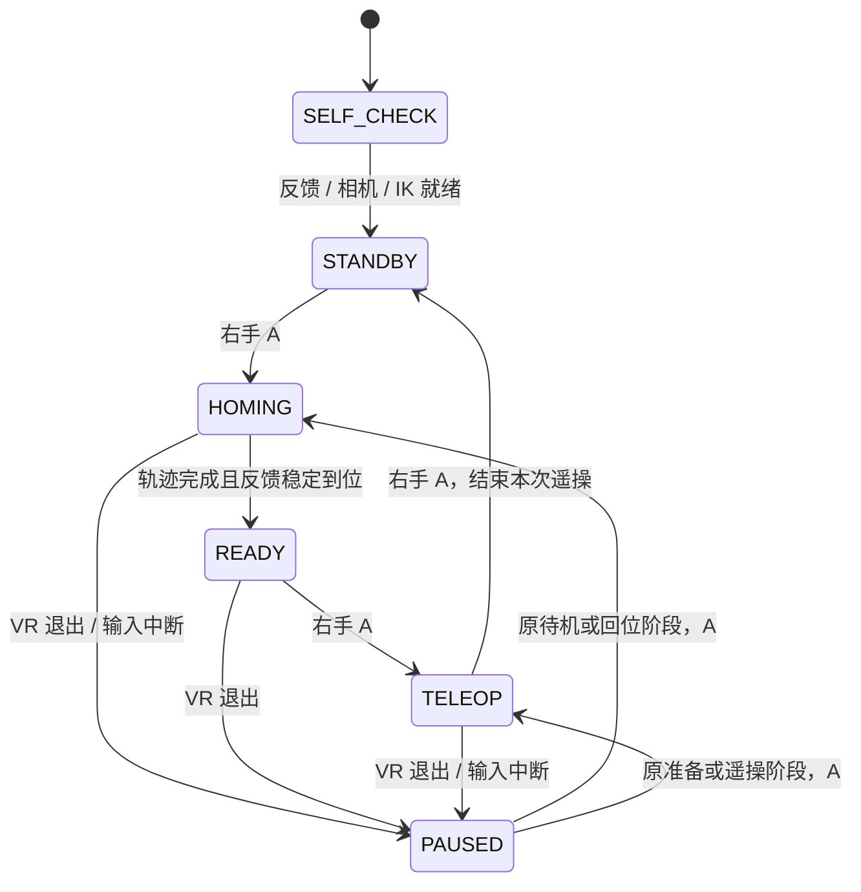
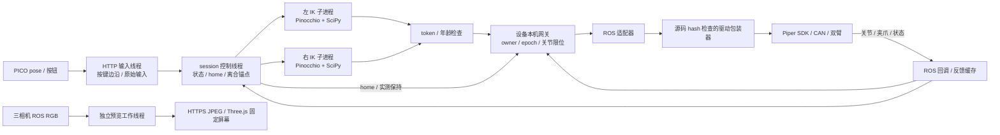

# 自由遥操 session：启动与现场操作

2026-10-23性能增量：候选020的通信/线程对照、按需预览、可选JPEG归档与性能诊断见[通信与性能说明](communication-and-performance.md)。独立相机诊断不控制机械臂；正式部署版本与测试边界见[020验证记录](validation/2026-10-23-communication-performance.md)。默认不再连续保存预览JPEG，原始episode数据保持原格式。

2026-10-16，`live-teleop/2` 实验入口。A4-S 当前绑定双 Piper、三路 RealSense、PICO WebXR。这是具体组合的执行实现，尚不是任意 graph 编译器。旧 v1 位置遥操保留兼容，旧页面和 v2 操作流程不能混用。

2026-10-17增量：机器人端独立入口、真实episode采集与相机capture/preview/record配置见[采集手册](episode-collection.md)。新增可选独立WSS控制输入（teleop extra），主画面距离2.21m，HUD可按hud_face_viewer正对进入时的观察点。本文下方以自由遥操路径为主。

## 一条命令启动

从 `configs/teleop-session.example.json` 和 `configs/realsense-rgb.example.json` 复制本地 profile，填写模型路径/hash、已审计驱动模块/hash、CAN、相机 SDK serial、话题、home 和坐标变换。相机 USB descriptor serial 与 SDK serial 不可混用。主机地址放在启动参数中，不写入控制算法。

Ubuntu 设备端需要已匹配的 ROS/SDK、Python ≥3.11、Pinocchio、SciPy 和 Pillow；项目 extras 为 `motion,video`。本次复用主机现有 Pinocchio4.0.0 / SciPy1.18.0，未安装或修改系统包。uv.lock 是另一套依赖解析基线，不能宣称本次部署按锁安装。Windows 可运行 fake；Linux/其他机器人需要独立验证。

```bash
source /opt/ros/jazzy/setup.bash
source /home/ros/ros2_ws/install/setup.bash
export PYTHONPATH="$PWD/src${PYTHONPATH:+:$PYTHONPATH}"
python3 -m robot_infra teleop \
  --config profiles/local/robot.session.json \
  --camera-config profiles/local/robot.realsense.json \
  --camera-driver /opt/ros/jazzy/lib/realsense2_camera/realsense2_camera_node \
  --ros-domain-id 64 --host 0.0.0.0 --advertise-host <device-ip> --port 8445 \
  --cert profiles/local/tls/cert.pem --key profiles/local/tls/key.pem \
  --duration 1800 --output artifacts/session-001
```

替换 `<device-ip>` 和本机路径。output 必须为新目录。安装包后也可用 `robot-infra teleop`。先增加 `--check-only` 可校验配置、模型、home、CAN UP 和文件，既不构造驱动也不发设备命令；这不是动态设备自检。正式启动才启动两个驱动、三相机、网关；动态自检要求反馈新鲜、驱动话题唯一、三路图像到达和两个 IK worker 就绪。启动不自动使能或回位。

CAN 由实验室先配置，工具不运行 sudo。先退出占用同一设备的旧应用；工具只管理自己的子进程。证书和私钥处理见[部署手册](live-teleop.md)，头显必须访问 HTTPS。

## 状态与按键



1. 进入网页、处理测试证书、进入 VR。屏幕按首次进入时的头部位置与水平朝向摆放，随后固定在 `local-floor` 空间；转头看两侧腕屏，抬低头看 HUD。重新进入可重新摆放。
2. 待机按右手 A：两臂按各自配置回 home。本次用户指定六关节全0，4秒平滑插值，再连续0.5秒处于0.02rad到位误差内，才显示准备就绪。回位消息不含夹爪目标，不改变开口；超时进入故障，不假装完成。
3. 再按 A：进入遥操，尚不因这次按键主动移动。按住同侧侧握键后建立“当前手柄姿态＋当前机械臂 FK”锚点，位置和朝向的相对变化驱动同侧机械臂。scale=1。松开侧握清除旧锚点，发布一次实测保持目标；再次按住重新取锚点。
4. 新默认independent_trigger模式中，扳机独立控制同侧夹爪：按下打开、松开关闭，当前SDK配置范围0–0.07m；不需要侧握，进入遥操后首次主动改变扳机才发命令。旧clutch模式仍要求侧握。每臂 `gripper.trigger_pressed` 显式配置为 `open`，也支持 `close`；网页按配置显示。回位及停止不新发夹爪目标。启动不继承旧驱动使能时自动关爪的副作用。
5. 自由遥操模式A结束后返回待机，HUD增加“完成遥操次数”；X记录为忽略事件。collect模式则进入异步收尾/REVIEW，A保存/X丢弃，见采集手册；次数与有效数据分开。
6. VR 不可见、跟踪丢失、退出或输入超时会暂停，旧 IK token/控制权失效。重新进入先松开按键，再按 A 执行 HUD 所示操作；不会自动恢复跟随。回位中断后必须重新按 A，从当前反馈重新回位。

本次取消了 v1 的10cm、0.6rad启动偏移、软件关节速度与目标跟踪误差测试框。保留模型关节限位、夹爪物理范围、有限值/单位/坐标、唯一控制权、输入/反馈时效；这些是执行语义。原生驱动速度仍20%，不是100%。没有碰撞检测和任务空间规划；不可达目标允许有界 best-effort，必须查 `motion_result` 的位置/朝向误差，不能把 accepted 当到达证明。

## 数据如何流动、为什么不会被 IK 卡住



HTTP 只校验、记原始包和更新输入，不做 IK。控制线程60Hz推进状态/home，非阻塞轮询每臂结果。每臂最多一个求解中目标和一个可替换最新目标，禁止排队追赶旧手柄动作；结果超过0.3秒或 token 已变就丢弃。原生求解卡住超过2秒进入故障，退出时先正常结束，再有限等待/终止专属子进程。ROS、视频、日志和输入服务各自运行；按 A、松侧握、退出不需等待数值求解结束。线程/进程隔离不构成硬实时保证。

Pinocchio 提供 URDF 模型、FK、SE(3)误差和解析雅可比；SciPy 提供有界最小二乘，上一解热启动及关节平滑项借鉴 QuestArm。未复制其 TCP 偏移、坐标假设或自动关爪。当前 tip=gripper_base，外部指尖 TCP 尚未标定。权重和时序均在 profile；这套 Piper ROS 消息方言、按钮布局和双手绑定仍是具体适配层，不能宣称任意设备开箱即用。

## 退出与审查

先 A 结束或网页暂停，再退出 VR。终端 Ctrl+C：启动器先停网关以撤销控制并尝试实测保持，再停自有相机/驱动；不回零、不自动失能、不关闭夹爪、不停止底盘或他人进程。检查 `processes.json`、`stack-ended.json` 的6个退出码、`episode/events.jsonl` 的 finalize 和 `journal-summary.json`。所有退出0仍须结合 journal 的错误和末尾事件判断完整性。

诊断保存原始 XR 包、意图、IK、guard、实际发布命令、反馈、状态转换及 JPEG 索引。JPEG 是有损预览，非原始三相机训练录像；collect已新增独立real-episode/1原始MCAP、QC和REVIEW A保存/X丢弃，原fake collection格式不变。本次不接策略推理。

审查优先看：`teleop_session.py` 的状态转移/暂停、`solver_worker.py` 的 token/退出、`pinocchio_model.py` 的坐标与误差、`live_control.py` 的最终执行检查、`adapters/piper_driver.py` 对已安装驱动的有限包装。自动化与现场证据见[验证报告](validation/2026-10-16-a4s-session.md)。
