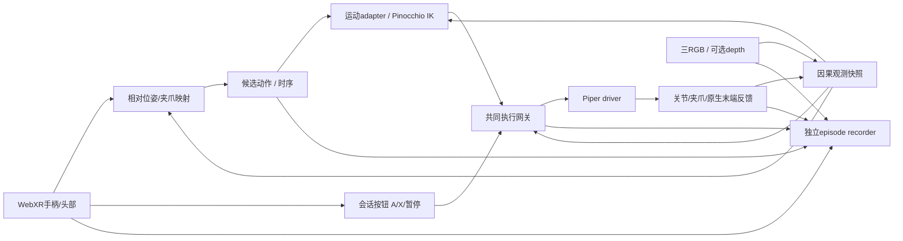
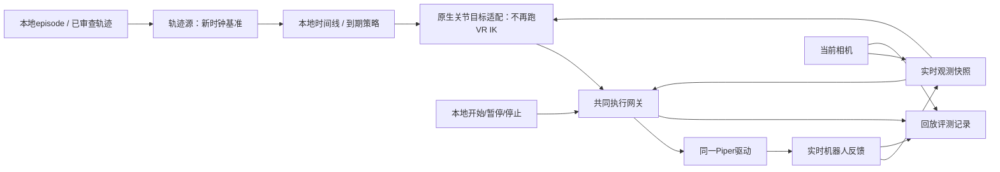
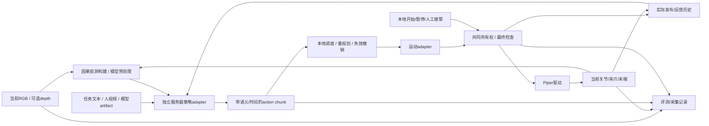

# 采集、轨迹回放、策略推理：三图共用一个执行面

2026-10-20实现进展：计划014已实现native source/session绑定，A4-S短轨迹真机与独立HTTP假模型/fake设备通过；见[当前操作](replay-and-mock-inference.md)和[验证](validation/2026-10-20-replay-and-mock.md)。下面为2026-10-19设计快照，仍没有任意图解释器或真实策略桥。

2026-10-19。这个定位合理：**更换意图/动作来源，保留设备观测、控制权、运动转换、最终检查和记录能力**。不是把三套脚本各自连接SDK，再用三个不同命令启动。

本轮已提供`experiment-graph/1`三份JSON模板、类型/连边/瞬时环检查、离线trajectory plan与训练视图。它们是可验证的设计切片，**尚不是统一的真机graph runner**。现有真实采集仍由collect/live-teleop/2启动，M1 fake graph也维持原格式，不能将新图塞给旧`run`后声称已执行。

## 1. 采集图



当前已实现的部分对应：WebXR输入→TeleopSession映射/IK进程→LiveGateway→PiperROSBackend/driver wrapper，反馈和图像进recorder。图里的边是语义边，实际线程、ROS/WebSocket传输与配置路径分开。原生depth仍需启用并验证，不能把图里有该可选端口视为实机已经采了depth。

## 2. 轨迹回放图



从架构上说“把来源换成本地文件”是对的，但换在**候选动作层**最直接。重放最终joint/gripper目标通常跳过WebXR相对映射和IK，可减少一层不确定性。若选择重放末端轨迹，则保留位姿adapter和IK，并验证frame/TCP；若选择重放原始VR输入，则必须处理锚点、参考空间、按键生命周期，它反而不适合第一版真机轨迹回放。

还须区分：

- 观测/日志回放：读文件、展示数据或喂给模型，完全不连接硬件。现有`replay`是M1日志读回，不是机械臂运动命令。
- 命令轨迹回放：读取经检查的数值目标，经**新session、新ownership、新deadline**执行到真机。禁止重用旧lease/token/epoch或旧绝对monotonic时间。
- 实测状态轨迹复现：把feedback作为另一种参考轨迹，不等于原command复现；尤其夹爪不能将物体接触开口当关闭目标。

第一版物理回放仍需：模型/名字/单位核对、初始姿态对齐、夹爪初始目标证据、速度缩放、暂停/恢复语义、过期动作处理及实时反馈。延迟后不能把一堆过期点突然连发；我们的离线TimelineSource只枚举到期事件，没有授予物理执行能力。离线计划保留原始间隔，不能悄悄压缩长停顿。

当前离线命令：

```bash
robot-infra trajectory-check /path/to/episode_000000 \
  --config configs/training-a4s-rgb.example.json \
  --output /new/output/trajectory.json
```

输出含offset_ns、具名endpoint/names/unit/positions、确认发布来源；不含旧控制权或可直接发送的ROS消息。默认只接收saved且QC通过的episode。

## 3. 推理图（VLA / WAM共用接口）



VLA与WAM的差异放在policy/artifact/运动adapter，不放在驱动：

| action语义 | motion节点 | 共用部分 |
|---|---|---|
| 绝对关节+夹爪目标，例如我们的joint14 profile | 具名原生目标直通，不做IK | 时序、ownership、硬件限位/检查、驱动和日志 |
| 绝对末端位姿+夹爪 | 显式frame/TCP映射→IK→原生目标 | 同上 |
| ZeroWAM当前RoboTwin初始参考的EEF16 | 模型通道解码→初始参考复原→经过验证的坐标/夹爪映射→IK | 同上；另外需要有状态缓存历史回路 |

原始相机30fps、模型请求频率、动作执行频率、VR预览频率是四个独立配置。推理模式不能继续依赖PICO每0.6秒续租才可运行；本地session负责执行生命周期，模型worker负责输出有效chunk，VR可作为监控/显式接管来源。切换来源会升epoch并取消所有旧结果。

## 4. 端口、连边与配置边界

新图版本独立为experiment-graph/1。节点以kind选插件，端口由目录声明：observation-stream/1→snapshot→observation-batch/1，source→candidate-action/1→scheduler→motion→native-targets/1→gateway→driver-command/1。gateway还输出execution-events/1，model history/context分别有独立端口。

机器人反馈和模型history是跨tick边，模板显式delayed=true；它们形成合法闭环。去掉这些时序边后必须是DAG，不能为允许反馈而放任同一tick内无限循环。驱动command输入只能来自唯一gateway，数据端口类型不匹配、重复连边、未绑定输入、多个动作producer会拒绝。

同为candidate-action也不表示任何向量都兼容：模板必须声明action_encoding，并与motion一致；frame_mapping和gripper_mapping必须显式。今后的完整artifact还需维名、单位、shape、reference pose、normalization hash、action dt与模型输入规格；本轮静态模板中的占位描述**不是通过校准的数值映射**。

| 资产 | 负责内容 |
|---|---|
| robot/deployment profile | 驱动模块、CAN/ROS/路径、相机身份、模型与TCP |
| experiment graph | 模式、节点类型、语义连边、source和执行面选择 |
| task/collection request | 任务、数据路径、episode编号与保存策略 |
| policy artifact | 输入规格、权重/处理器版本、action表示/归一化/dt、上下文能力 |
| training mapping | state/action选字段、质量准入、因果采样、单位和标签 |

因此“只换graph启动三种工作流”是最终用户体验；机器身份、任务和模型大文件不应全部复制进每个graph。

三模板位置与预检：

```bash
robot-infra experiment-plan configs/graphs/a4s-collection.json
robot-infra experiment-plan configs/graphs/a4s-replay.json
robot-infra experiment-plan configs/graphs/a4s-inference.json
```

返回plan_only=true、physical_commands=false；不启动设备，不能作为物理运行命令。模板中的MODEL_SERVER、轨迹路径和校准描述需替换后再进行后续runtime准入。

## 5. 接下来的代码改动顺序

1. **已做：** 通用episode reader、只读audit、训练语义/帧引用视图、原始发布时间轨迹计划、三图静态编译、证实的诊断上限修复及门控改进；旧采集入口保持。
2. **共同执行session：** 将TeleopSession内的home/开始/暂停/停止与WebXR采样拆开，保留LiveGateway/PiperROSBackend唯一写路径；让webxr、trajectory、policy source按同一协议交付候选动作。测试接管/过期/故障，不重写驱动。
3. **先接物理轨迹：** shadow对照原始目标/反馈，再现场起始姿态对齐和短轨迹。将trajectory source绑定共同session；不能跳过已知目标/关节名检查。
4. **再接mock策略：** 分离观测同步、模型worker、chunk调度和motion adapter，测慢服务、断连、旧结果、不同action表示；保留策略预测与真实发布的不同流。
5. **ZeroWAM server bridge：** 分机reset/infer/cache协议、artifact通道/单位和初始参考映射；先离线/影子，再测真实策略。完整chunk复现后再评估异步/RTC等优化。
6. **graph启动统一：** 用受控插件注册表将编译计划绑定上述已有runner，CLI选择graph；collection/replay/inference共享设备资源与状态生命周期。只有这些绑定与现场测试完成后，才称三图物理运行已实现。

图设计不应迫使我们一次实现任意可视化图引擎。先把这三个可复用闭环做成可测试的配置模板和运行契约，后续图形化编辑器仅编辑同一份graph，无需另一套控制逻辑。

ZeroWAM具体代码约束与缓存风险见[专项研究](research/2026-10-19-zerowam-deployment.md)。本轮没有启动轨迹回放或策略物理执行。
