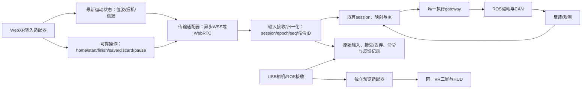

# 通信改进审核稿：传输方式、证据与实施范围

**10月24日审核结论：只实施S0、S2，S1暂缓。** 当前范围以[计划021](../plans/021-transport-semantics-and-live-validation.md)为准。下文保留10月23日提案用于追溯，不能把新增命令体系/异步WSS当作已批准工作。现有采集已经使用机器人端状态机；S2先复用原包和状态机，仅替换输入连接。

2026-10-23，**待用户审核，不是已实现方案**。本轮只读核对代码与机器人状态、编写审核资料。用户要求“审核通过了才能执行”，因此“可以继续真机验证”不被解释为本方案已获批准。

项目要提供可替换输入、设备观测、执行与记录能力，同时让操作员容易连接和完成任务。协议是连边的实现选择，不能让TCP/UDP细节侵入驱动、IK、episode业务，也不能以新增配置项代替实际低延迟与完整采集验收。

## 1. 先分清四层

- 物理连接：Wi-Fi、以太网、USB、CAN。
- IP传输：TCP、UDP；共享内存、管道、CAN不属于两者。
- 上层协议：WebSocket、HTTP、WebRTC、DDS/RTPS等。
- 应用交付语义：可靠命令、最新状态、媒体、完整记录；这层决定应当允许怎样的丢弃、重试、排序与确认。

可靠不等于TCP，UDP也可以承载可靠协议；异步不等于UDP，TCP也允许连续发送而不逐条等待业务ACK。TCP自身的确认与当前代码每个输入包的应用ACK是两个机制。

## 2. 当前每一段实际是什么

| 连边 | 当前实现/证据 | TCP、UDP或其他 | 拟议处理 |
|---|---|---|---|
| 浏览器加载页面、配置、状态与停止API | Python HTTPS/HTTP1.1服务器 | TLS/TCP | 保留可靠管理入口；停止还依赖本机失联处理，不能只靠一次远端请求 |
| 头显位姿、扳机、侧握、A/X→主机 | `xr-transport.js`与`control_socket.py`；正式profile选WSS | WebSocket/TLS/TCP；兼容HTTP POST也是TCP | 将最新运动状态与可靠操作命令分开；先异步WSS对照，再验证WebRTC数据通道 |
| 主机相机预览→头显 | 三路HTTPS JPEG轮询，正常8fps，控制RTT高时2fps | HTTP1.1/TLS/TCP | 单独评估WebRTC媒体轨道；不把大视频数据塞进运动数据通道 |
| 主机ROS节点↔相机驱动、Piper驱动 | 实测RMW为FastDDS，图像publisher advertise RELIABLE；本机存在SHM资源 | 可使用共享内存或RTPS/UDP等；**各边实际选中路径尚未追踪** | 同机优先评估IPC路径；Image订阅QoS可配置，其他命令/反馈先沿用基线；不把DDS统一替换成TCP或UDP |
| session↔左右IK worker | `multiprocessing.Pipe` | 本机IPC，不是IP TCP/UDP | 继续复用，保留token与最新目标机制 |
| 相机SDK→主机 | 本次台架三台USB RealSense | USB | 与头显网络分开测量 |
| Piper SDK→USB-CAN→机械臂 | 已审计SDK/SocketCAN路径，can0/can2 | CAN及USB-CAN，不是TCP/UDP | 复用驱动与唯一gateway，通信改造不绕过执行面 |
| 相机/反馈→episode writer→磁盘 | 内存有界队列、MP4/MCAP/index | 本机队列与文件IO | RGB MP4、头部原始深度和原始时间保留，不使用预览的丢帧规则 |
| 独立模型服务器↔机器人（未来真实策略） | 目前只有HTTP假模型/fake环境验证 | 现有mock RPC为HTTP/TCP；真实模型链路待实施 | 模型请求/动作chunk可靠传输并带时效/代次，不能照搬每个VR位姿的投递规则 |

特别注意：Image选RELIABLE不代表改成TCP。FastDDS可在UDP等传输上实现可靠交付，同机也支持SHM；启用某种transport、发现SHM文件，都不能证明每个数据边确实走了它。[FastDDS传输说明](https://fast-rtps.docs.eprosima.com/en/stable/fastdds/transport/transport.html)。

## 3. TCP/UDP可采用哪些实现

| 方式 | 适用场景与实现 | 本项目取舍 |
|---|---|---|
| 原生TCP socket＋TLS | Python `socket/asyncio`、C++ socket等；需定义消息边界、序列化和背压 | 适合原生端/服务间；普通头显网页使用WebSocket等标准接口，不自行设计裸TCP协议 |
| WebSocket/WSS | 浏览器WebSocket API＋Python现有websockets；消息边界现成、可靠有序、可异步连续发送 | 保留为可用基线/兼容适配器，解除逐位姿等待ACK；TCP重传队头阻塞仍存在 |
| HTTP1.1/2 RPC | 请求响应、配置、模型RPC等；通常TCP/TLS | 适合管理/可靠业务，不用逐帧POST构建最终运动流 |
| 原生UDP socket/DTLS | `SOCK_DGRAM`、asyncio datagram、C++等 | 可作为未来原生输入适配器；普通PICO/Quest网页不能像Python应用一样直接开裸UDP socket，不在本轮另做APK/桌面中转安装流程 |
| WebRTC DataChannel | 浏览器RTCPeerConnection＋服务端候选aiortc；典型SCTP/DTLS/ICE/UDP，支持有序/无序与可靠/部分可靠 | 优先的浏览器UDP类数据路径；必须验证设备、依赖、实际选中连接和背压，不能默认所有网络都能直连UDP |
| WebRTC媒体轨道 | 视频使用RTP/SRTP、独立媒体拥塞控制与解码 | 预览候选；训练原始记录继续本机保存 |
| WebTransport | 浏览器API，HTTP/3/QUIC/UDP可同时提供可靠stream与不可靠datagram；规范也考虑可靠fallback | 后续备选，当前头显支持未测；本轮不并行维护第三套浏览器传输 |
| DDS/RTPS | 当前ROS2消息通信；UDP/SHM等与QoS分别配置 | 复用已安装中间件，按数据用途配置并测量，不自制第二套机器人中间件 |

WebSocket基于TCP，见[RFC6455](https://www.rfc-editor.org/rfc/rfc6455.html)。WebRTC数据通道的协议栈与可靠性选项见[RFC8831](https://www.rfc-editor.org/rfc/rfc8831.html)、[W3C WebRTC](https://www.w3.org/TR/webrtc/)；WebTransport能力见[W3C规范](https://www.w3.org/TR/webtransport/)。服务端候选[aiortc](https://aiortc.readthedocs.io/en/latest/)已有Python异步实现，参考QuestArm也使用它，但没有因此获得本项目兼容性证明。

UDP不自动保证及时送达；重传、拥塞控制、无线接入、省电、浏览器调度和排队仍可能增加延迟。WebRTC若选中了中继/TCP路径，必须报告实际路径，不能标成“UDP验证通过”。

## 4. 原改进计划：是不是问题、为什么要改

证据来自[020现场报告](validation/2026-10-23-communication-performance.md)，不是对QuestArm实际性能的推测。

| 拟议改动 | 是不是问题：证据 | 为什么必要/预期收益 | 证据限制与取舍 |
|---|---|---|---|
| 最新运动状态不逐包等ACK | 当前`drain()`每包await；30Hz目标下，Windows无线回显只完成518包/30秒，回环约898包 | 解除更新率约受`1/RTT`限制，尽早发送新位姿；ACK保留给命令和计时 | 不消除TCP队头阻塞或无线抖动；需要有界积压，不能只删await |
| 运动状态与可靠命令分离 | 当前位姿、夹爪、侧握与A/X共用输入包及确认；这是代码事实 | 位姿允许覆盖旧样本，保存/开始等操作需确认与幂等；两种需求不再互相拖累 | 引入跨通道顺序问题，必须用session/epoch/状态版本解决，不能直接开两个socket就接真机 |
| WebRTC UDP类运动适配器 | TCP在丢包时可能等待旧字节；本项目尚无UDP对照，不能认定当前尾延迟全由TCP造成 | 为实时状态提供无序/不重传选项，与相同语义的WSS做A/B | 新依赖、信令、证书/ICE与设备兼容成本；普通浏览器支持不能替代PICO/Quest实测 |
| 无线条件单变量对照 | 纯WSS回环p95约0.76ms、Windows无线约109ms，ICMP也有尾延迟/丢包；省电配置有线索 | 即使不传视频仍卡，网络本身必须改善；换UDP不能替代这一项 | 省电尚非已证实根因；现场读取实际状态后才临时修改并恢复，不能一次改多个系统参数 |
| 保留020按需内存预览、可选归档 | 已实施于候选；原待机持续保存JPEG，快照4万余文件/334MB；关闭编码降低诊断进程开销 | 减少无人使用时的工作、磁盘增长和资源耦合，保留显式诊断归档能力 | archive复测可通过，不能说取消归档就根治gap；正式current尚为018 |
| Image RELIABLE候选与投递审计 | 失败段4个设备帧号有metadata但没有Image；RELIABLE60/180秒最大间隔约43/46ms，best-effort180秒约69ms | 优先保证本机训练帧交付，识别源帧与记录帧差异 | best-effort也可QC通过；可靠交付可能增加缓存/重传时延，需完整并发验证 |
| 独立低延迟视频流 | JPEG目标8fps且高RTT降2fps；Quest媒体获取p95约142–178ms | 改善操作反馈，原始30fps不等于头显30fps；测显示帧龄而非只提高配置FPS | 新编码/解码负载、三路带宽与浏览器兼容需实测；与输入改造分批，便于辨因 |
| 拆分更多进程 | 原服务有共享GIL/回调/写入竞争的可能，但同进程图像负载WSS回环p95仅约1.96ms、最大9.53ms | 若完整双臂反馈负载下出现明显调度阻塞，再隔离图像/记录进程 | **目前不足以要求全面重写多进程架构**，先测完整负载，避免复制/IPC成本与复杂度 |

因此“网络尾延迟存在”“ACK门限存在”“一次Image丢失发生在writer前”都有证据；“UDP能消除所有延迟”“省电就是根因”“必须全面拆进程”仍是未经证实的判断，不能作为既定结论。

## 5. 拟议graph与共同语义

以下为目标设计，不是当前已运行graph，也不是可直接传给CLI的配置。

输入适配器、传输、session、驱动和记录分别负责各自工作；GELLO/主从臂/键鼠以及回放/策略不被迫使用WebRTC。更换运输方式不会改变最终控制权归属。实现仍是原生工作流切片，不在本轮承诺任意graph执行器。

拟议规则：

1. 连续运动为完整状态快照：同侧位姿、扳机、侧握、序号、session/epoch、采样时间。发送端只替换尚未发送的旧状态；接收端丢弃旧序号和旧代次，不把旧值积压到机械臂上。
2. A/X等转换为明确语义命令，带唯一ID和期望会话状态版本。运行中的同一会话内幂等：ACK丢失重试不会重复回位/重复保存。进程重启建立新session/epoch，不声称无持久化条件下跨崩溃“恰好一次”。
3. 两通道没有天然全局顺序。start成功后才授权相应代次的运动；pause/finish撤销代次并清掉待发运动。raw按钮保留作证据，但不能在命令路径与运动路径各触发一次A/X动作。
4. 扳机与侧握作为完整状态重复发送；松键包偶发丢失由下一状态纠正，长时失联仍由本机已有超时/停止机制处理。可靠pause可辅助通知，不假设断网后某一停止包必达。
5. 有界在途/发送buffer与背压，状态替换计数、命令确认和拒绝原因可观测。WebRTC运动候选`ordered:false,maxRetransmits:0`；该选项本身不提供样本有效期或无限吞吐，需要应用层序号/过期检查。
6. 新鲜度信息绑定**采样时刻**，不在重发旧样本时刷新成“新数据”。可沿用主机签发时间票据形成保守时间界，或明确带误差的时钟估计；不直接把浏览器performance.now与主机monotonic相减。
7. 正在采集的原始输入、被拒绝样本、真正发布命令、反馈、源时间和本机接收时间继续记录；预览允许丢旧帧，训练记录不套用该策略。
8. 兼容模式在连接阶段明确选择并展示；连接中途掉线先暂停、重建会话，不能静默并行投递WSS和WebRTC或用旧动作恢复。单个入口/配置选择适配器，操作员仍按原A/侧握/扳机流程。

## 6. 建议执行批次与审批范围

### 第一批：建议本次审核S0–S2

**S0：020候选的完整真机基线与无线只读核验。**建立独立验证profile/任务，用现有三RGB MP4＋头部原始深度，沿用已确认坐标、缩放、夹爪、Home与驱动速度。先一条30秒episode，确认A回位/开始/结束、侧握、独立扳机与保存/丢弃，再做同配置连续段，记录双臂反馈和相机计时。现场条件允许时只选择一个无线变量临时对照并恢复；具体系统改动记录到profile/收据，不能静默改正式连接。

**S1：共同输入语义与异步WSS基线。**明确版本化运动状态/操作命令及共同接收入口，保留旧适配器；新增fake测试覆盖乱序/丢包/重复/延迟/旧epoch/跨通道start-stop竞态/断线清理。实现有界异步WSS，先用300ms延迟的模拟ACK证明新位姿不再被迫等一整个RTT，业务命令仍幂等。

**S2：WebRTC数据适配器与A/B验证。**在独立依赖环境验证候选aiortc与现有PyAV/ROS的兼容，不覆盖已安装环境。先无机械臂的Quest3连接、UDP路径/重传/背压测量；PICO作为另一设备分别记录。若设备或网络不支持，保留可用WSS模式并明确显示原因，不自动声明UDP支持。完成假设备与无运动对照后，才将同一接收语义接到既有gateway进行短episode真机A/B。

异步WSS不是另一套长期业务栈，而是同一契约的兼容适配器及对照，用来分别测出“取消逐包等待”和“更换传输”各自的收益。用户若希望优先WebRTC，可先做S1的公共契约和S2无机械臂路径，但不跳过共同语义与旧epoch/重复命令测试。

### 第二批：本次仅提交方向，不执行S3

**S3：WebRTC三路预览。**尽量复用同一媒体库和VR布局，媒体数据走视频轨道，不走控制DataChannel。先保持当前预览分辨率，逐步验证三路目标30fps、编码/解码与显示帧龄、拥塞下主动丢旧预览帧；原始RGB-D采集独立。录制RGB/深度分辨率继续配置化。该批需根据S0–S2结果补具体编码预算与验收目标，再提交审核。

更多进程拆分、WebTransport、原生UDP客户端、DDS全局调参不包含在本次建议批准范围。网络省电/有线对照只是候选试验，不能作为上线前必须购买设备或重建网络的硬要求。

## 7. 验收与操作可用性

第一批的功能验收应全部满足：

- 旧WSS配置可运行，采集、回放和假模型原有检查通过；驱动和IK不读取WebRTC细节。
- 注入300ms业务响应延迟时，30Hz模拟输入仍可持续提交新状态，待发状态/命令队列受配置约束，不出现无界积压。
- 按键重试只执行一次，旧epoch与finish后的残留运动被拒绝；跨通道顺序反转有确定结果和记录。进入/退出VR、断线/重连的状态清楚，错误不持续刷屏。
- Quest3至少3段各60秒正常操作完成，无误回位/误保存/控制权串扰；A保存与X丢弃各有真实结果，失败样本也保留。该样本量仅是本轮门槛，不是长期稳定性认证。
- 每段报告输入实际接收率、样本新鲜度界/不确定性、RTT尾部、命令完成/重复计数、真实发布/反馈、相机源/接收gap、writer队列和QC。不能把RTT当单向控制延迟，也不能只报平均FPS。
- 同一网络、同一录制负载、同一头显做WSS/WebRTC对照，报告实际选中的ICE路径；不能用不同日期的PICO与Quest数据证明协议优劣。
- 新适配器达到功能验收且稳定输入的间隔/年龄分布相对基线改善，才推荐默认启用；达不到就保留可用基线并报告局限，不靠延长输入超时、放宽QC或补帧“过关”。

性能目标需要区分可控的软件开销与现有无线条件：本轮不承诺未经实测的端到端<20ms，也不把“必须一直30Hz”当无线网络的既定能力。审核通过后先采S0相同网络基线，给出S1/S2实际改进幅度和失联次数，由结果决定默认配置。

供本次审核的场景目标建议为：稳定操作段收到的新状态数至少达到头显实际产生新样本数的80%（实际采样30Hz时参考24Hz），接收间隔p95不超过100ms，3段60秒没有未经操作员结束的会话中断。它们是A4-S候选验收目标，不是行业标准，也不适用于所有机器人。样本年龄与接收频率同时报告；没有可信的单向时间界，就明确标未知，不以高包率宣称低延迟。现有网络达不到时应报告性能未达标、保留基线并继续定位，不更改统计口径。

操作员仍使用一个机器人端命令与一个页面，保持A/侧握/扳机流程。依赖/证书/端口检查、当前设备与实际传输、错误恢复提示、版本与日志位置应由启动器集中给出；这些属于可用性，不留给操作员手动启动多个进程。018保留为可回退基线，候选先走独立profile，不直接覆盖正式任务数据。

## 8. 本轮只读状态与审核项

2026-10-23机器人SSH可达，正式current仍018，当前无robot_infra服务，8445/8446未监听；左右can0/can2均UP、1Mbps。它们显示CAN的ERROR-ACTIVE协议状态不等于一次已确认的驱动故障；尚未启动SDK读取新的机械臂反馈，不能把接口UP当机械臂全部正常。系统Python未发现aiortc，部署依赖环境的兼容性仍需S2验证。

本轮没有安装包、修改运行时/正式配置、激活CAN、启动机械臂、启动相机或发送运动。当前待审核的是：**是否批准第一批S0–S2及上述执行顺序与验收边界；S3视频改造另行细化审核。**批准后可在本次真机验证授权下按阶段继续；现场操作者配合是执行条件，不重复索要已经给出的同范围许可。
