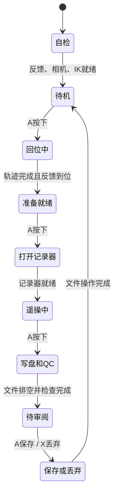
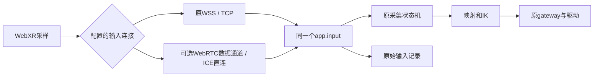

# WebXR采集流程与本轮连接改动

2026-10-24。先说明流程，再说明连接；两件事分别验证。当前实施范围是[计划021](../plans/021-transport-semantics-and-live-validation.md)。

## 采集已经是状态机

机器人端的 [`TeleopSession`](../src/robot_infra/teleop_session.py) 决定当前阶段。网页 [`xr-session.js`](../src/robot_infra/web/xr-session.js) 读取手柄、发送输入，约每300ms取一次状态来显示HUD。网页不会自己认定“已经回位”或“已经保存”。



遥操中，侧握只决定同侧机械臂是否跟随；扳机独立控制夹爪。位置、朝向仍经过原映射、IK和gateway。退出VR、失去跟踪或输入超时会暂停，并使旧运动目标失效；正在录制的集会结束并进入审阅，不拼接续录。重新进入须先松开按钮，避免一直按着A造成误启动。回位、开文件、写盘、保存都有等待阶段，不能只在网页改一行状态跳过去。

这不是完整状态图：还存在暂停、故障、关闭分支；具体异常原因保留在状态与日志中。无采集的自由遥操省去录像和审阅阶段。

## 与QuestArm哪里相同、哪里不同

参考本地 `questarm-real-robot-deployment` 的WebXR路径：网页 `python/cambot/cambot/teleop/client/index.html`，桥接 `webxr_piper_bridge.py`，服务端 `episode_coordinator.py`。旧APK/ADB路径不是这次比较对象。

| 内容 | 本项目 | QuestArm WebXR |
|---|---|---|
| A/X含义 | 机器人根据状态解释按键上升沿 | 网页根据服务端状态发送prepare/start/stop/save/discard等请求 |
| 谁确认阶段完成 | TeleopSession等待反馈和记录器 | episode_coordinator等待驱动/记录器确认 |
| 手柄持续输入 | 完整姿态与按键快照；原WSS逐包等回复 | 连续发送controller_pose，不逐包等回复；桥接缓存最新目标 |
| 画面 | 当前三路HTTPS JPEG轮询 | WebRTC视频，保留JPEG兼容 |

因此应借鉴它清晰的操作提示、连续输入和视频处理，但不需要再加一套采集状态机。把服务端状态搬到网页也不能修好网络等待和相机帧空档。

## S1原本是什么意思，为什么暂不做

“S1”只是旧计划中第二项工作的编号，并非协议或功能。旧提案想同时增加两件事：

1. 统一规定“位姿可以丢旧留新，开始/结束/保存必须可靠执行”；
2. 改WSS发送方式，不再发送一包就等回复。

“WSS”就是加密WebSocket，使用TCP；“异步”在这里仅指不用等上一包的业务回复。以前那组说法混在一起，容易让小改动显得像必须重建框架。用户已要求暂缓，当前不新增命令格式、编号体系或命令总线，也不改旧WSS。现有输入快照、序号、参考空间标识和状态机先继续使用。

## 本轮WebRTC究竟改什么

配置选择 `webxr_transport.input: "webrtc"` 后，网页通过同一HTTPS页面交换一次连接信息，再用WebRTC数据通道发送**原来的输入包**。接收仍调用同一个 `app.input → TeleopSession.ingest`，下游运动与记录不感知协议变化。

安装可选依赖时选择项目的 `webrtc` extra，例如在独立环境中 `pip install '.[teleop,video,mp4,motion,webrtc]'`；已有环境也可以单独安装该extra。依赖锁在 `uv.lock`，不能把候选依赖覆盖进尚未验收的正式部署。本轮机器人专用目录为 `python-deps-webrtc-021`。session配置示例：

```json
"webxr_transport": {
  "input": "webrtc",
  "preview_congestion_rtt_ms": 100,
  "preview_congestion_fps": 2
}
```

这是现有session JSON中的一个字段；其余相机、任务、驱动和运动配置照旧。WebRTC不使用WSS的8446监听端口；协商走页面的8445，数据使用ICE协商的UDP端口。动态UDP端口需要设备网络允许互通；此切片没有固定端口范围或外网穿透保证。先用 `collect ... --check-only` 查依赖，再先做不驱动机械臂的诊断。



首切片只建**一个可靠、有序通道**，姿态和按键不拆开：省去跨通道排序和重复命令问题。连续发送不等业务回复；回复用于RTT和失联检查。浏览器最多32包未回复、发送缓冲64KiB，服务器队列最多32包；积压或原有1秒回复超时会报错并暂停，不无限排队。现有0.8秒时间凭据、机器人输入超时和QC阈值不变。

可靠有序是WebRTC数据通道的选项，不代表改回TCP；DTLS/SCTP可经UDP承载。但它仍会重传，不能保证恶劣无线下完全没有等待。现阶段不设置外部STUN/TURN，仅验证同网段直连；连接失败显示错误，不悄悄回落WSS。HUD和客户端事件记录实际候选协议；没读到候选就显示“路径未知”，不能只凭WebRTC名称宣称UDP已验证。接口依据[aiortc官方说明](https://aiortc.readthedocs.io/en/latest/api.html)。

10月24日头显试验后的小修正：WebRTC只在有效VR采样开始时连接，退出、失去可见性或暂停时释放，普通网页停留不占输入连接；重新进入会重新协商。关闭中的旧协商失败不应污染下一次连接。积压错误分别报告“未回复包数量达到上限”和“发送缓冲积压”，错误事件保留清理前的计数/字节/最老回复等待时间，原始输入附带同样的可选诊断字段；阈值保持不变。连接仍只允许一个输入者，这不是新增采集流程状态机。

页面、状态、停止、连接协商和JPEG预览仍用HTTPS/TCP。S2只改输入连接，不能据此声称视频也换成UDP或相机gap已经修好。

## 是否还需要S1

目前没有证据证明需要独立的“共同输入语义”层，已有状态机继续复用。WebRTC自身需要连接建立、发送、回复计时和关闭代码，这属于输入适配器。

如果实测仍被丢包重传拖慢，再讨论“位姿允许丢帧、按键单独可靠传输”；那时才需要具体解决跨通道顺序。若仅希望保留WSS时也更跟手，可以另做一个小范围发送改动，不必捆绑新消息体系。两项都不是当前已实施或默认必做事项。
